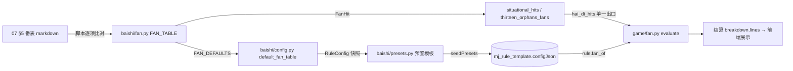

## 用户需求

在柏氏规则（`baishi`）中调整「海底」类番种，把原来「只有末张为 1 筒才算海底」的单一路径拆成两档，其余口径（仅自摸、末张才生效、互斥、与杠上开花叠加）保持不变。

## 产品概览

牌局进行到牌墙最后一张时，摸牌者若自摸胡，按末张牌面给番：末张是 1 筒记「海底捞月」100 番（维持现状）；末张是其它任何牌记新增的「海底捞」50 番。结算面板、番种明细、战绩详情里会多出一行「海底捞 50」，与其它番累加后按底分与自摸/庄家倍率结算。

## 核心功能

- **海底捞月（100 番）不变**：牌墙最后一张恰为 1 筒，摸到该张并自摸胡。
- **新增海底捞（50 番）**：牌墙最后一张为非 1 筒的其它牌，摸到该张并自摸胡。
- **两档互斥**：同一张末张只可能命中其中一个，不叠加、不重复计分。
- **仅自摸**：末张被打出后被人点炮胡或抢杠胡，不计任何海底番。
- **可叠加**：杠后从牌尾补到最后一张并自摸胡时，「海底捞」/「海底捞月」与「杠上开花 10 番」同时计入。
- **番表扩容**：柏氏番表由 35 项变为 36 项，其余番种与数值一律不动。
- **边界不变**：摸到末张但无人胡仍按荒庄处理（有杠落库迁庄、无杠重发）。

## 技术栈

沿用现有后端：Python 3.10 + FastAPI + pydantic（`RuleConfig` 快照）+ pytest；番表为代码资产（`FAN_TABLE`）并由 `default_fan_table()` 物化进模板 `configJson`。前端零改动——番名与番值随 `breakdown.lines` 下发，全仓 `*.ts/*.vue/*.js` 无「海底 / hai_di」硬编码。

## 实现方案

核心判定只有一处语义：**「摸到最后一张 + 自摸」**，再按 `win_tile` 是否等于 9（一筒，`tile = suit*9 + rank-1`）分流到 100 番或 50 番。

现状是两处重复写了同一个条件（`situational_hits()` 与 `thirteen_orphans_fans()`），因此本次先抽一个单一出口 `hai_di_hits(ctx)`，两个调用点改为调用它，避免第三处重复、也避免 13 不靠 / 十三幺 / 七对 / 标准胡四条牌型路径出现分歧。

判定口径与既有实现等价，不需要改动引擎：`game/engine.py:353` 已经用 `is_last_tile = remaining == 0`（`remaining = back - front + 1`）表达「刚抽走的就是牌墙最后一张」，牌头与牌尾补牌共用同一计数器，因此杠后补牌取走末张同样命中。

关键决策与理由：

- **不建互斥组**：两档由 `win_tile` 二值分流天然互斥，加组只会让「同组取最高」逻辑多一次无意义比较。
- **不新增 ctx 字段**：`is_last_tile / is_self_draw / win_tile` 三者已足够；新增字段会污染通用族 `hai_di` 的语义，且要动 `game/hand.py` 与两处 ctx 构造，扩大改动面。
- **`win_tile is None` 必须守卫**：`HandContext.win_tile` 类型为 `int | None`，若只写 `else` 分支，None 会误判成 50 番。
- **番表顺序即文档顺序**：`test_baishi_fan_table_matches_07_section_5_markdown` 会解析 07 §5 表格逐项强比对（id/名称/番/互斥组/计数/行序），新行必须紧跟 `hai_di_lao_yue`，两边同序改。

性能：判定是 O(1)，只在一手胡牌结算时执行一次；番表查询为 36 项线性扫描（`rule.fan_of`），可忽略。无热路径、无 N+1、无额外 I/O。

可靠性 / 兼容性（关键风险）：`game/fan.py:64-71` 的 `evaluate()` 对 `rule.fan_of(hit.id) is None` 是**静默跳过**。预置模板由 `seedPresets` 按代码覆盖 `configJson`，重跑即可拿到 36 项；但**家庭复制出的模板（`familyID != 0`）不会被刷新**，其 `fan_table` 仍是 35 项，新番会被无声吞掉。因此必须配一个幂等的补数脚本（仅当 `configJson.fan_table` 缺 `hai_di_lao` 时在 `hai_di_lao_yue` 后追加），并打印修改条数。无 DDL、无协议变更、历史局 `fanItemsJson` 不回刷。

## 架构设计

改动收敛在 `baishi` 族内，遵循「规则语义唯一权威 = 07 文档、代码逐项对齐文档、单测脚本化比对」的既有约定：



数据流不变：`engine._ctx()` 生成 `is_last_tile/is_self_draw/win_tile` → `baishi/fan.py` 产出 `FanHit` → `game/fan.py` 按 `rule.fan_table` 取番值与名称 → 结算与前端。本次只改「产出哪一条 FanHit」。

设计原则对齐：单一职责（判定收在 `hai_di_hits`）、DRY（消掉两处重复）、开闭（加番种不改结算）、最小爆炸半径（不动引擎、不动协议、不动前端）。

## 目录结构

```
majiang/
├── code/backend/src/
│   ├── game/families/baishi/
│   │   ├── fan.py                     # [MODIFY] FAN_TABLE 在 hai_di_lao_yue 之后插入 ("hai_di_lao","海底捞",50,None,False)；
│   │   │                              #          新增 hai_di_hits(ctx) 单一出口（is_last_tile + is_self_draw + win_tile is not None，
│   │   │                              #          win_tile==9 → 100，否则 → 50）；situational_hits() 与 thirteen_orphans_fans()
│   │   │                              #          改为调用它；__all__ 导出；模块 docstring 35→36、局面番 5→6 个
│   │   ├── config.py                  # [MODIFY] default_fan_table() docstring「35 项」→「36 项」
│   │   ├── presets.py                 # [MODIFY] baishi_default.description「35 项番表」→「36 项番表」
│   │   ├── __init__.py                # [MODIFY] 包 docstring 番表项数与「海底捞月 100 番」表述补 50 番
│   │   └── selfcheck.py               # [MODIFY] REQUIRED_CASES 增 "07-13-37"；顶部注释 36 条 → 37 条；07-13-07 注释补 50 番
│   ├── tools/
│   │   └── backfillBaishiHaiDiLao.py  # [NEW] 幂等补数：遍历 mj_rule_template 中 ruleFamilyCode='baishi' 的行，
│   │                                  #       configJson.fan_table 缺 hai_di_lao 时在 hai_di_lao_yue 后追加并 update，
│   │                                  #       打印 scanned/updated 条数；复用 common/mysqlCommon，风格对齐 seedPresets.py
│   └── tests/
│       └── test_baishi_s7.py          # [MODIFY] 番表项数断言 35→36（2 处）+ markdown 行数断言 35→36；
│                                      #           13.7 用例改写为四组合（1筒自摸=100 且不含 50 / 其它牌自摸=50 且不含 100 /
│                                      #           非自摸不计 / 非末张不计）+ win_tile=None 守卫；
│                                      #           test_case09_thirteen_unrelated_keeps_situational_fans 补「海底捞 50 照常判定」；
│                                      #           新增「海底捞 + 杠上开花 = 60」用例
├── plan/
│   ├── 07-柏氏规则细则.md              # [MODIFY] 状态行 v1.15 + 修订历史；§5 标题「番表（35 项）」→36，表格 hai_di_lao_yue 后插新行
│   │                                  #          `| `hai_di_lao` | 海底捞 | 50 | — | 否 | 见 §6.5.2 |`；§6.5.2 拆为「海底捞月 100 / 海底捞 50」；
│   │                                  #          §9 荒庄「海底优先」措辞；§13-07 扩写；新增 §13-37；§14 联动态补行
│   ├── 03-规则族设计.md                # [MODIFY] §3.5 海底优先句（约 216 行）、§7.3 表海底行（约 370 行）、§7.1/§7.2「番种 35 项」→36
│   └── 改进和错误修复文档.md            # [MODIFY] 台账新增一节：变更点、验收、风险、回滚（重跑旧版 seedPresets 即回 35 项）
└── README.md                          # [MODIFY] 第 29 行「柏氏番表 35 项」→「36 项（含海底捞 50 番）」
```

发布相关（最后一并处理，不作为代码改动主体）：版本号三处（`code/backend/src/config/basicSettings.py` 的 `VERSION`、`code/frontend/package.json`、桌面与手机登录页 `ref()`）按惯例升到 **v1.1.7**；发版顺序为「查 OPEN/PLAYING → 部署后端 → 跑 `tools/seedPresets.py` → 跑 `tools/backfillBaishiHaiDiLao.py`」，重启后端会中断进行中对局。

## 关键代码结构

```python
# code/backend/src/game/families/baishi/fan.py
HAI_DI_ONE_DOT: int = 9  # 一筒

def hai_di_hits(ctx: HandContext) -> list[FanHit]:
    """海底两档（07 §6.5.2）：仅「摸到牌墙最后一张 + 自摸胡」成立；
    末张为一筒 → 海底捞月 100；末张为其它牌 → 海底捞 50。点炮/抢杠不计。"""
    ...
```

约定：该函数是海底判定的**唯一出口**，`situational_hits()` 与 `thirteen_orphans_fans()` 均调用它；`thirteen_unrelated_fans()` 继续用 `situational_hits()` 按 `hit.id != "men_qian"` 过滤（不得整体删除该调用）。

## Agent 扩展

### SubAgent

- **code-explorer**
- 用途：在「文档与文案同步」任务中做一次全仓引用扫描，穷尽「35 项 / 35项 / hai_di_lao_yue / 海底」在后端代码、README、plan 目录、部署脚本中的全部出现点，避免漏改导致番表比对用例或文档口径不一致。
- 预期产出：一份按文件与行号归类的引用清单（区分「必须改」「仅注释」「历史台账不改」三类），作为文档回写与验收的核对依据。