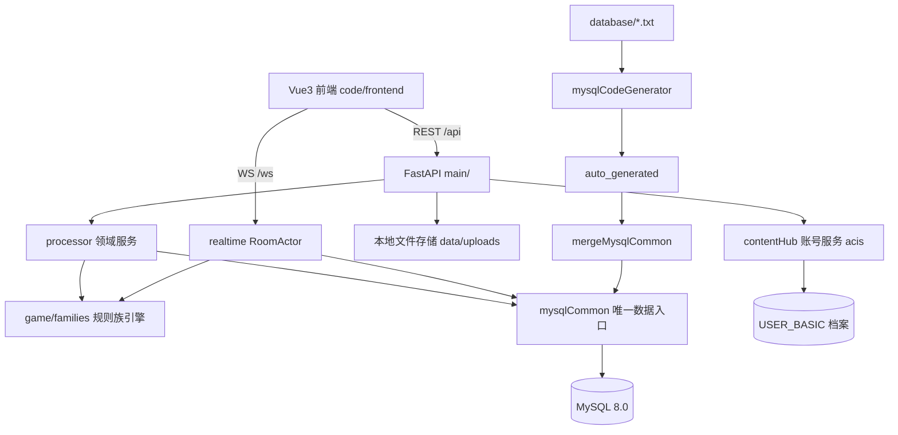

## 用户需求

对"家庭麻将"项目重制系统框架。本轮**只产出文档**，不修改代码、不创建 code 目录、不改配置；规划评审通过后再分步实施。

## 产品概述

面向家庭成员的在线麻将 Web 应用：6 位数字邀请码开桌、四人入座、服务端权威判定吃碰杠胡、结算积分、实时聊天与系统播报、战绩查询。本次规划新增：MySQL 数据库、规则族选择、后台可管理的多套牌面皮肤、复用 contentHub 账号体系。

## 核心交付

- **文档分层**：新建 `plan/` 存放规划文档（总纲需求、架构、数据库、规则族、协议、UI、实施计划、step-prompts）；`docs/` 只保留系统说明（系统总览、开发指南、部署、运维备份）。
- **目录规划**：`backend/`、`frontend/` 迁入 `code/`，`code/backend` 对齐 contentHub `code/src` 结构。
- **数据库 MySQL 化**：`database/*.txt` 为唯一表定义源，经 `mysqlCodeGenerator.py` 生成、合并进 `mysqlCommon.py`；业务层只经 mysqlCommon，移除 SQLAlchemy/Alembic；空库重建，不迁移旧数据；`recID` 使用 INT。
- **账号系统**：不自建。复用 contentHub 账号服务（A0A0 登录/注册、A3A0 取资料、GAA0 会话与功能清单）+ `USER_BASIC` 表存档，麻将后端另签 JWT 供 REST/WS 使用。
- **规则族 + 模板**：族决定引擎插件与可用开关，模板为族内参数预设；包含国标、广东、四川与**独立定义的廉家规则**（细则待用户提供，先留族标识、配置骨架与待补清单）。
- **多套牌面皮肤**：管理员可上传、启停、排序、设默认；用户偏好存库；前端按皮肤渲染 34 种牌与牌背，资源缺失回退现有 CSS 牌面。
- **邀请码**：6 位纯数字（100000-999999），不含字母，唯一性由库约束，生成冲突重试。
- **分步实施**：参照 photo-browser 范式编写 `plan/step-prompts.md`，每步单独开新对话，含目标、前置、必读文档、改动点、验收清单、硬约束与输出要求。

## 边界

- 本轮零代码改动；代码级变更全部写入实施计划。
- 协议保持 REST + WebSocket 形态，新增字段一律可选。
- 旧 SQLite 数据不迁移；账号在账号服务侧初始化，本地 USER_BASIC 由登录/注册同步。

## 技术栈

| 层 | 选型 |
| --- | --- |
| 数据库 | MySQL 8.0 / InnoDB / utf8mb4；pymysql + DBUtils 连接池（读写句柄 dbW/dbR） |
| 表定义与生成 | `database/mj_*.txt` + `mysqlCodeGenerator.py` + `genTableCode.ps1` + `mergeMysqlCommon.py` + `initTables.py` |
| 数据访问 | `common/mysqlCommon.py` 单一入口（生成区 + 手写扩展查询区），禁止业务层裸 SQL |
| 后端 | FastAPI + Uvicorn（REST + 原生 WebSocket），移除 SQLAlchemy/Alembic |
| 账号 | contentHub 账号服务 acis（HTTP CMD 协议）+ `USER_BASIC` 档案表 + 本地 JWT |
| 前端 | Vue 3 + TypeScript + Vite 5 + Pinia + Tailwind CSS（沿用） |
| 文件存储 | 本地磁盘 `code/backend/data/uploads/tiles/<skinCode>/`，后端静态路由暴露，文件名含内容哈希 |
| 工具 | Python 3.11+ / PowerShell |


## 实施策略

1. **文档先行**：按依赖顺序 总纲 → 架构 → 数据库 → 规则族 → 协议 → UI → 实施计划 + step-prompts，形成可评审闭环。
2. **DB 先行**：先把 `*.txt` 表定义与生成/合并链路写实（字段级），后端模块改造清单再对齐 mysqlCommon 函数签名，避免返工。
3. **增量兼容**：通用族与 CSS 回退保证现有功能不回退；协议新增字段可选；规则快照保留原键名。
4. **可执行粒度**：文档写到文件路径、函数名、字段、校验、错误码、验收命令级别。

## 关键技术决策

### 1. txt 单源 + 生成链路

`mj_*.txt → mysqlCodeGenerator.py → auto_generated/auto_gen_code_mj_*.py → mergeMysqlCommon.py → mysqlCommon.py 生成区`；手写区与生成区用 BEGIN/END 标记隔离。

- `genTableCode.ps1` 必须在 `database/` 工作目录传裸文件名；`-t` 规则改为"去 `mj_` 前缀 + 去全部下划线"。
- 定义规范：单空格分隔、禁 Tab；COMMENT 不含 `%`/`#`；首字段 `recID INT AUTO_INCREMENT PRIMARY KEY COMMENT '记录ID'`；尾部固定 `label/memo/regID/regYMDHMS/modifyID/modifyYMDHMS/delFlag`；时间 `VARCHAR(16)` 的 `YYYYMMDDHHMMSS`。
- 生成器不支持外键与复合唯一键：改用应用层校验 + 单列唯一键（`gameSeatKey`、`skinTileKey`），并在文档登记。
- JSON 列不由生成器识别：登记 `MYSQL_JSON_COLUMN_NAME_LIST`，写库前 `normalizeJsonValue4DB`（dict/list→dumps，空串→NULL）。
- Windows 产物 GBK：合并工具容错解码后统一 UTF-8。
- 只使用产物数据层段，不装配 `#http interface` CMD 段：对外仍是 FastAPI REST + WS，避免双协议与两套鉴权。

### 2. 账号接入（不自建）

- `common/accountClient.py` 复用 contentHub：`ACCOUNT_SERVICE_URL`、CMD 常量、30s 超时、`B0` 成功、`CI` 下游不可用、异常不上抛。
- 登录：前端提交 loginID/passwd → 后端转发 A0A0 → 成功后取 A3A0 → 同步 `USER_BASIC`（存在 update / 不存在 insert，写 regID/regYMDHMS）→ 签麻将 JWT（含 loginID、roleName、exp）。
- `USER_BASIC` 采用 contentHub 的 45 列定义与手写数据层（create/query/insert/update/delete/stat），不套用 mj_* 尾部七字段规范。
- 角色映射：账号服务角色不在白名单时回落默认角色；麻将侧再映射为 `admin/member` 权限位。
- 账号服务不可达时返回明确中文错误（不复用 "CI" 裸码给前端）；`MYSQL_SKIP_CONNECT=1` 仅用于静态检查场景。

### 3. 连接与并发

FastAPI 同步路由在线程池执行，pymysql 单连接不可跨线程共享：`mysqlHandle` 内部改线程本地 + `DBUtils.PooledDB`，对外保持 `dbW/dbR` 与函数签名；异步路由不得直接触库（经 `run_in_threadpool` 或改同步路由）；读库默认与写库同实例，避免主从延迟导致写后读不到。

### 4. 规则族 + 模板

- `mj_rule_family`：`familyCode` 唯一、`engineCode` 插件标识、`capabilityJson` 声明可用开关与番种上限、`status`、`sortOrder`。
- `mj_rule_template`：归属族、`configJson` 预设、`presetFlag`、`ownerID`、`activeFlag`。
- 引擎：`game/families/{generic,guobiao,guangdong,sichuan,lianjia}/`，统一注册表接口（牌墙/发牌、合法动作、牌型插件集、番种求值、结算、可选开关）；`generic` 完整复刻现有 RuleConfig 语义，保证现有 76 个用例可平移。
- `lianjia`：本轮只落族标识、配置骨架、待补细则清单（番种、封顶、包牌、连庄、荒庄等）；用户提供文本后按同一契约实现。
- 开桌只选模板；服务端把「族 + 模板 + 生效配置」整体快照进 `mj_room.ruleSnapshot` 与 `mj_game.ruleSnapshot`，历史不可变。

### 5. 多套牌面皮肤

- `mj_tile_skin` + `mj_tile_skin_asset`：`tileKey` 取 `1w…9w/1t…9t/1s…9s/east…red/back`；上传校验格式（png/webp，SVG 需净化或拒绝）、大小、尺寸、命名；落盘名用内容哈希，DB 存相对路径。
- `/api/skins` 返回清单（不含二进制、带 ETag）：`skinCode/skinName/isDefault/tileAspect/assets/fallback`。
- `Tile.vue` 优先 ``，缺失键或 `onerror` 回退 CSS；`loading="lazy"`、`decoding="async"`、静态资源 `public, immutable`。
- 偏好：`mj_user_pref.skinCode`，优先级 用户偏好 > 皮肤默认 > `css-classic`。

### 6. 邀请码

6 位数字 `100000-999999`；`mj_room.roomCode` 单列 UNIQUE；生成时用加密随机源 + 冲突重试（最多 10 次）；文档统一正则 `^[1-9][0-9]{5}，前后端同规则。

## 数据库规划

`USER_BASIC`（移植 contentHub，loginID 主键）+ 12 张 `mj_*` 表：
`mj_user_pref`、`mj_rule_family`、`mj_rule_template`、`mj_room`、`mj_game`、`mj_game_player`、`mj_game_round`、`mj_room_message`、`mj_tile_skin`、`mj_tile_skin_asset`、`mj_audit_log`、`mj_schema_version`（记录已执行建表/变更版本）。

## 架构设计



## 目录结构（本轮仅文档；代码目标形态写入架构文档）

```
majiang/
├── README.md                                   # [MODIFY] 技术栈、code/ 目录、文档导航、移除 SQLite
├── plan/                                       # [NEW] 规划唯一来源
│   ├── README.md                               # 索引、阅读顺序、文档状态、术语表
│   ├── 00-项目总纲与需求.md                     # 现状盘点、角色、功能清单、非目标、验收口径
│   ├── 01-系统架构设计.md                       # 目录迁移、分层、账号接入、mysqlCommon 红线、连接池、部署拓扑
│   ├── 02-数据库设计.md                         # USER_BASIC + 12 张 mj_* 字段级定义、生成/合并流程与坑、初始化种子
│   ├── 03-规则族设计.md                         # 族注册、engineCode 契约、模板 schema、校验、快照、廉家待补清单
│   ├── 04-协议设计.md                           # REST/WS v1、账号/皮肤/偏好接口、6 位数字邀请码、错误码
│   ├── 05-UI设计.md                             # 设计系统、页面规划、皮肤切换、34 张牌与牌背规格、切图清单
│   ├── 06-实施计划.md                           # 阶段拆分、文件级改动清单、测试与验收、回滚
│   └── step-prompts.md                         # 分步实施提示语（每步一新对话，含验收与硬约束）
├── docs/
│   ├── 系统总览.md                              # [NEW] 能力地图、角色权限、数据流、文档索引
│   ├── 开发指南.md                              # [NEW] 本地启动（MySQL+账号服务）、表结构变更流程、调试测试
│   ├── 部署.md                                  # [MODIFY] MySQL 建库授权、systemd、Nginx、发版；删除 SQLite
│   └── 运维与备份.md                            # [NEW] mysqldump/恢复演练、日志、健康检查、故障排查
│   （原 规则设计.md / 协议.md 迁入 plan/03、plan/04，docs 保留跳转说明）
└── code/                                        # [规划，本轮不创建]
    ├── backend/                                 # 等价 contentHub code/src
    │   ├── database/                            # userBasic.txt、mj_*.txt、mysqlCodeGenerator.py、auto_generated/
    │   ├── common/                              # mysqlCommon、mysqlHandle、accountClient、miscCommon
    │   ├── config/                              # mysqlSettings、basicSettings、local_settings
    │   ├── main/                                # FastAPI 装配与路由（auth/users/rules/rooms/history/skins/admin）
    │   ├── processor/                           # 规则校验、房间编排、皮肤管理、账号同步、审计
    │   ├── game/                                # 牌引擎 + families/{generic,guobiao,guangdong,sichuan,lianjia}
    │   ├── realtime/                            # RoomActor、快照、落库
    │   ├── tools/                               # genTableCode.ps1、mergeMysqlCommon.py、initTables.py
    │   └── tests/                               # 现有 76 用例平移 + 账号/规则族/皮肤/邀请码用例
    └── frontend/                                # 沿用结构，新增 skins store、Tile 图片渲染与回退
```

## 关键结构

`database/mj_rule_family.txt` 片段：

```
recID INT AUTO_INCREMENT PRIMARY KEY COMMENT '记录ID'
familyCode VARCHAR(32) NOT NULL UNIQUE COMMENT '规则族编码 幂等键'
familyName VARCHAR(64) NOT NULL COMMENT '规则族名称'
engineCode VARCHAR(32) NOT NULL COMMENT '引擎插件标识'
capabilityJson JSON NULL COMMENT '可用开关与番种上限'
status VARCHAR(24) NOT NULL DEFAULT 'ENABLED' COMMENT 'ENABLED或DISABLED'
sortOrder INT NOT NULL DEFAULT 0 COMMENT '排序号'
label VARCHAR(32) COMMENT 'label'
memo VARCHAR(200) COMMENT 'memo'
regID VARCHAR(32) COMMENT '注册ID'
regYMDHMS VARCHAR(16) COMMENT '注册年月日'
modifyID VARCHAR(32) COMMENT '修改用户ID'
modifyYMDHMS VARCHAR(16) COMMENT '修改年月日'
delFlag CHAR(1) COMMENT '删除标记'
```

## 实施注意

- **性能**：皮肤清单按皮肤聚合 + ETag；房间快照不含图片数据；唯一索引覆盖 `roomCode/templateCode/familyCode/skinCode/loginID`，普通索引覆盖 `roomID/gameID/createdYMDHMS`；聊天查询加 LIMIT；USER_BASIC 查询走 `loginID` 主键。
- **兼容**：`state.snapshot`/`room.welcome` 新增族与皮肤字段可选；规则快照保留原键名；旧战绩可读。
- **安全**：上传限管理员、magic number 与扩展名双白名单、单文件与单皮肤容量上限、拒绝带脚本 SVG；口令只走环境变量；日志不打密码、手牌明文与账号服务凭据。
- **可验证**：每份文档附验收清单（全表生成 0 失败、7 个数据层函数齐全、空库初始化可开一局、邀请码纯数字、切换皮肤 34 张+牌背全部命中）。

## Agent Extensions

### SubAgent

- **code-explorer**
- Purpose: 在编写 `02-数据库设计.md`、`04-协议设计.md` 与 `06-实施计划.md` 前，梳理后端全部 SQLAlchemy 会话/模型调用点（文件、函数、涉及表、读/写、事务边界）、FastAPI 路由到数据层的调用链，以及前端所有 HTTP/WS 字段使用点，确保"移除 ORM 改走 mysqlCommon"的改动清单无遗漏。
- Expected outcome: 输出按文件分组的调用点清单与契约字段对照表，作为数据库设计与实施计划附录；并核验协议新增字段与前端实际使用一致。