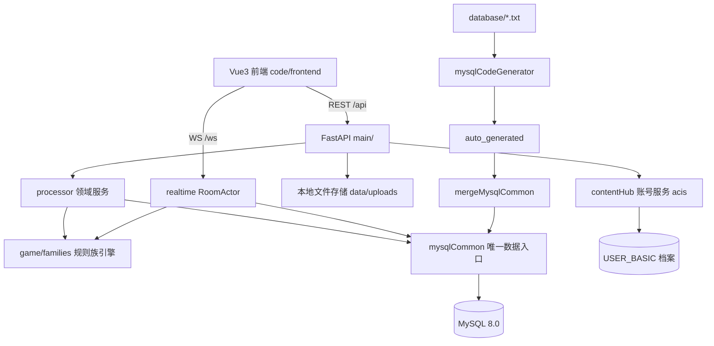

## 用户需求

对"家庭麻将"项目做一次系统框架重制。本轮**只产出文档**，不修改代码、不创建 `code/` 目录、不改配置；规划评审通过后再按文档分步实施。

## 产品概述

面向家庭成员、部署在自有服务器上的在线麻将 Web 应用：账号登录、6 位纯数字邀请码开桌、四人入座、服务端权威判定吃碰杠胡、结算积分、实时聊天与系统播报、战绩查询。规划后新增能力：MySQL 数据库、按家庭（family）隔离的多租户形态、规则族选择、后台可管理的多套牌面皮肤、复用 contentHub 账号体系。

## 核心功能与交付内容

- **文档分层**：新建 `plan/` 存放规划文档（总纲需求、架构、数据库、规则族、协议、UI、实施计划、step-prompts）；`docs/` 只保留系统说明（系统总览、开发指南、部署、运维备份）；原 `docs/规则设计.md`、`docs/协议.md` 迁入 `plan/03`、`plan/04` 并留跳转说明。
- **目录规划**：`backend/`、`frontend/` 迁入新建的 `code/`；`code/backend` 对齐 contentHub 的 `code/src` 结构；文档给出旧路径到新路径的逐项映射。
- **数据库 MySQL 化**：`database/*.txt` 为唯一表定义源，经 `mysqlCodeGenerator.py` 生成 CRUD，合并进 `mysqlCommon.py`；业务层只经 mysqlCommon 访问 MySQL，移除 SQLAlchemy/Alembic；空库重建，不迁移旧数据；`recID` 使用 INT。
- **账号系统（不自建）**：复用 contentHub 账号服务（A0A0 登录/注册、A3A0 取资料、AIA0 存在性）+ `USER_BASIC` 45 列档案表（contentHub 手写数据层原样借用）+ 麻将后端自签 JWT 供 REST/WS 使用。
- **家庭实体与隔离**：新增 `mj_family`（编码/名称/管理员/默认规则族/默认皮肤）与 `mj_family_member`（成员归属、成员角色）；房间、规则模板、自定义皮肤、审计按 family 隔离；`mj_rule_family` 与 `USER_BASIC` 保持全局。
- **规则族 + 模板分层**：族决定引擎插件与可用开关，模板是族内参数预设，开桌只选模板；包含国标、广东、四川与**独立定义的廉家规则**（本轮留族标识、配置骨架、包牌结算入口与待补细则清单，待用户提供规则文本后填入）。
- **多套牌面皮肤**：管理员可上传、启停、排序、设默认；支持全局内置皮肤与家庭自定义皮肤；用户偏好存库；前端按皮肤渲染 34 种牌与牌背，资源缺失回退现有 CSS 牌面。
- **邀请码**：6 位纯数字（100000-999999），不含字母，全局唯一，生成冲突重试；入房校验家庭成员身份。
- **分步实施**：参照 photo-browser 范式编写 `plan/step-prompts.md`，每步单独开新对话，含目标、前置、必读文档、改动点、验收清单、硬约束与固定输出格式。

## 边界

- 本轮零代码改动；所有代码级变更写入 `plan/06-实施计划.md` 与 `plan/step-prompts.md`。
- 协议保持 REST + WebSocket 形态，新增字段一律可选，旧前端字段不减。
- 旧 SQLite 数据不迁移；账号在账号服务侧初始化，本地 USER_BASIC 由登录/注册同步。
- 不引入 Redis、消息队列等新基础设施；家庭规模下单进程 + 线程池 + 连接池足够。

## Tech Stack

| 层 | 选型 |
| --- | --- |
| 数据库 | MySQL 8.0 / InnoDB / utf8mb4；pymysql + DBUtils.PooledDB（读写句柄 dbW/dbR） |
| 表定义与生成 | `database/userBasic.txt`、`database/mj_*.txt` + `mysqlCodeGenerator.py` + `genTableCode.ps1` + `mergeMysqlCommon.py` + `initTables.py` |
| 数据访问 | `common/mysqlCommon.py` 单一入口（生成区 + 手写扩展查询区），业务层禁止裸 SQL |
| 后端 | FastAPI + Uvicorn（REST + 原生 WebSocket），移除 SQLAlchemy/Alembic |
| 账号 | contentHub 账号服务 acis（HTTP CMD 协议）+ `USER_BASIC` 档案表 + 本地 JWT |
| 前端 | Vue 3 + TypeScript + Vite 5 + Pinia + Tailwind CSS（沿用，不升级大版本） |
| 文件存储 | 本地磁盘 `code/backend/data/uploads/tiles/{skinCode}/`，后端静态路由暴露，文件名含内容哈希 |
| 文档 | Markdown；表定义代码块与接口契约代码块；Mermaid 仅用于架构与数据流 |


## Implementation Approach

**总体策略：文档先行、单源权威、可逐条验收。**

1. **建立文档权威边界**：`plan/02` 是表与字段的唯一来源，`plan/03` 是规则语义唯一来源，`plan/04` 是接口与错误码唯一来源，`plan/05` 是视觉与牌面规格唯一来源。其他文档只做摘要并链接，禁止复制字段表，避免多份口径漂移。
2. **先冻结目标形态再谈实施**：`plan/01` 给出 `backend/` 到 `code/backend/` 的逐项路径映射（含 `frontend/dist` 定位、Vite 代理、pytest rootdir、systemd WorkingDirectory、Nginx 静态缓存、uploads 路径），`plan/06` 按映射生成文件级改动清单，`step-prompts.md` 再拆成可独立验收的对话步骤。
3. **数据库设计以生成器能力为边界**：`recID INT AUTO_INCREMENT`、单空格字段行、尾部固定七字段、时间 `VARCHAR(16)`、唯一键内联；生成器不支持外键与复合唯一键，因此用 `gameSeatKey`、`skinTileKey`、`familyMemberKey` 等应用层拼接单列唯一键承担；`USER_BASIC` 保持 contentHub 原 45 列与手写数据层，不套用 recID 规范。
4. **家庭隔离落在数据模型而非 UI 过滤**：所有家庭域表带 `familyID`，服务端在解析 JWT 后按 `familyCode` 校验成员关系，再注入查询条件；`mj_game*`、`mj_room_message` 经 `roomID` 间接归属，避免冗余不一致。
5. **账号链路明确分层**：`accountClient`（HTTP 转发）→ `accountService`（登录/注册/资料/成员同步）→ `JWT`（仅身份与全局角色，不固化家庭）→ 家庭上下文按请求解析。JWT 不放家庭，避免切换家庭后需要重签。
6. **规则族用插件契约隔离差异**：统一 `RuleEngine` 接口（发牌、合法动作、牌型插件、番种求值、结算、可选开关），`generic` 完整复刻现有 `RuleConfig` 语义以保证 76 个用例可平移；`lianjia` 走同一契约，包牌在结算接口预留 `payerAllocation` 钩子，细则未定处标注"待补"而不臆造。
7. **皮肤按"清单 + 逐牌资源"两表建模**：清单接口按皮肤聚合返回并带 ETag，前端一次加载整表；`Tile.vue` 以图片优先、CSS 回退，保证零资源时表现与现在一致。
8. **性能与可靠性前瞻**：连接池尺寸按家庭规模固定（如 5-20），聊天查询强制 LIMIT，快照不携带图片二进制；每局结束同步落库，进程重启把遗留 `playing` 标记 `aborted`。

## Implementation Notes

- **只写文档**：所有步骤只创建/修改 `.md`；不生成 `code/`，不执行 `npm`、`pip`、建库等命令。文档中的命令一律标注"实施阶段执行"。
- **事实核对**：引用现有代码必须使用已核实路径与符号（`app/db/models.py` 7 表、22 个 REST 端点、`/ws`、`Tile.vue` 纯 CSS 渲染、76 个 pytest）；不虚构函数名或接口。
- **生成器坑位必须逐条写入 `plan/02`**：必须在 `database/` 目录传裸文件名（否则表名变成 `database/xxx`）；`-t` 取"去 `mj_` 前缀 + 去下划线"；Windows 产物 GBK 需容错解码；生成版 `query_*` 的 LIMIT 被注释掉，统一改手写查询；JSON 列需登记 `MYSQL_JSON_COLUMN_NAME_LIST`；`COMMENT` 禁 `%` 与 `#`；不支持外键/复合唯一键。
- **一致性自查**：写完四份核心文档后，用表名、字段名、接口路径、错误码四张清单交叉 grep，确保文档间无同义异名（如 `roomCode` 与 `roomNo` 不得混用）。
- **迁移风险清单**：`app/main.py` 的 `parents[2]/"frontend"/"dist"`、pytest `rootdir` 与 `sys.path`、`.env` 工作目录、systemd `WorkingDirectory`、Nginx `proxy_pass` 与 `/assets` 缓存、README 与 docs 全部命令路径。
- **安全口径**：文档只写环境变量名与占位符，不写真实口令、账号服务地址凭据；上传接口限定管理员、magic number 与扩展名双白名单、拒绝带脚本 SVG、单文件与单皮肤容量上限。
- **验收可执行**：每份文档末尾附"验收清单"，条目必须是可执行命令或可核对事实（全表生成 0 失败、7 个数据层函数齐全、邀请码正则匹配、34 张牌与牌背全部命中、跨家庭访问返回 403）。

## Architecture Design



**分层职责**：`main/` 只做路由、鉴权、Pydantic 校验与错误映射；`processor/` 编排业务（家庭成员校验、规则模板校验、皮肤管理、审计）；`game/` 为纯逻辑引擎，不触库；`realtime/` 持有内存房态并按座位生成快照；`common/mysqlCommon.py` 是唯一 SQL 出口。

**数据流**：请求 → JWT 解析（loginID/全局角色）→ 家庭上下文解析（familyCode 或 roomCode）→ 领域服务 → mysqlCommon → MySQL；WS 入房以 6 位数字邀请码定位房间，再校验成员身份。

## Directory Structure

```
majiang/
├── README.md                                   # [MODIFY] 技术栈改为 MySQL + contentHub 账号；目录改为 code/；文档导航指向 plan/；删除 SQLite 命令
├── plan/                                       # [NEW] 规划唯一来源
│   ├── README.md                               # [NEW] 文档索引、阅读顺序、状态（草案/已评审/已实施）、术语表（规则族/模板/快照/family/皮肤/邀请码）
│   ├── 00-项目总纲与需求.md                     # [NEW] 现状盘点（7 表/22 端点/5 视图/76 用例）、角色权限、功能清单、非目标、验收口径
│   ├── 01-系统架构设计.md                       # [NEW] 旧新路径映射、后端分层、账号链路、家庭上下文、mysqlCommon 红线、连接池与事务边界、部署拓扑
│   ├── 02-数据库设计.md                         # [NEW] USER_BASIC 45 列 + 15 张 mj_* 字段级定义、命名规范、索引、JSON 登记、生成/合并流程与坑、种子数据
│   ├── 03-规则族设计.md                         # [NEW] 族注册表、RuleEngine 契约、capability 声明、模板 schema、校验、快照、五族差异、廉家待补清单
│   ├── 04-协议设计.md                           # [NEW] REST 资源与错误码、WS 信封 v1 增量、家庭/皮肤/偏好接口、6 位数字邀请码规则、快照字段、兼容约定
│   ├── 05-UI设计.md                             # [NEW] 设计系统、页面规划（登录/家庭/大厅/规则/牌桌/战绩/皮肤管理）、34 张牌与牌背规格、切图清单、回退与响应式
│   ├── 06-实施计划.md                           # [NEW] 阶段 P0-P7、文件级改动清单、测试矩阵、验收清单、回滚方案、风险登记
│   └── step-prompts.md                          # [NEW] 分步实施提示语（S0-S8），每步独立对话、含目标/前置/必读/改动/验收/硬约束/输出格式
├── docs/                                       # 系统说明文档
│   ├── 系统总览.md                              # [NEW] 能力地图、角色与权限、数据流、与账号服务关系、文档索引
│   ├── 开发指南.md                              # [NEW] 本地启动（MySQL + 账号服务）、目录约定、表结构变更流程、调试与测试
│   ├── 部署.md                                  # [MODIFY] MySQL 安装/建库/授权、账号服务联通、systemd、Nginx、发版；删除 SQLite 备份章节
│   ├── 运维与备份.md                            # [NEW] mysqldump/物理备份、恢复演练、日志与健康检查、常见故障
│   ├── 规则设计.md                              # [MODIFY] 改为跳转说明，指向 plan/03-规则族设计.md
│   └── 协议.md                                  # [MODIFY] 改为跳转说明，指向 plan/04-协议设计.md
└── code/                                        # [规划，本轮不创建]
    ├── backend/                                 # 等价 contentHub 的 code/src
    │   ├── database/                            # userBasic.txt、mj_*.txt、mysqlCodeGenerator.py、auto_generated/、word_table_*.csv
    │   ├── common/                              # mysqlCommon、mysqlHandle、accountClient、miscCommon
    │   ├── config/                              # mysqlSettings、basicSettings、local_settings（环境映射与口令环境变量）
    │   ├── main/                                # FastAPI 装配与路由（auth/families/users/rules/rooms/history/skins/admin）
    │   ├── processor/                           # 家庭成员校验、账号同步、规则校验、皮肤管理、审计
    │   ├── game/                                # 牌引擎 + families/{generic,guobiao,guangdong,sichuan,lianjia}
    │   ├── realtime/                            # RoomActor、分座位快照、落库
    │   ├── tools/                               # genTableCode.ps1、mergeMysqlCommon.py、initTables.py
    │   └── tests/                               # 现有 76 用例平移 + 家庭隔离/账号/规则族/皮肤/邀请码用例
    └── frontend/                                # 沿用 Vue3 结构，新增 families/skins store、Tile 图片渲染与回退、皮肤管理页
```

## Key Code Structures

`database/mj_family.txt`（严格单空格、首列 INT、尾部七字段固定）：

```
recID INT AUTO_INCREMENT PRIMARY KEY COMMENT '记录ID'
familyCode VARCHAR(32) NOT NULL UNIQUE COMMENT '家庭编码 幂等键'
familyName VARCHAR(64) NOT NULL COMMENT '家庭名称'
ownerLoginID VARCHAR(32) NOT NULL COMMENT '家庭管理员登录号'
defaultRuleFamilyCode VARCHAR(32) NULL COMMENT '默认规则族编码'
defaultSkinCode VARCHAR(32) NULL COMMENT '默认皮肤编码'
status VARCHAR(24) NOT NULL DEFAULT 'ENABLED' COMMENT 'ENABLED或DISABLED'
sortOrder INT NOT NULL DEFAULT 0 COMMENT '排序号'
label VARCHAR(32) COMMENT 'label'
memo VARCHAR(200) COMMENT 'memo'
regID VARCHAR(32) COMMENT '注册ID'
regYMDHMS VARCHAR(16) COMMENT '注册年月日'
modifyID VARCHAR(32) COMMENT '修改用户ID'
modifyYMDHMS VARCHAR(16) COMMENT '修改年月日'
delFlag CHAR(1) COMMENT '删除标记'
```

皮肤清单契约（`GET /api/skins?familyCode=...` 返回，前端据此渲染与回退）：

```
{
  "skinCode": "lianjia-jade",
  "skinName": "廉家青玉",
  "familyCode": "lianjia",
  "isDefault": true,
  "tileAspect": 0.667,
  "assets": { "1w": "/uploads/tiles/lianjia-jade/1w.8f3a1c.webp", "back": "/uploads/tiles/lianjia-jade/back.2b9d40.webp" },
  "fallback": "css-classic"
}
```

## Agent Extensions

### SubAgent

- **code-explorer**
- Purpose: 在编写 `plan/02-数据库设计.md`、`plan/04-协议设计.md`、`plan/06-实施计划.md` 前，全面梳理后端全部 SQLAlchemy 会话/模型调用点（文件、函数、涉及表、读/写、事务边界）、FastAPI 路由到数据层的调用链、前端所有 HTTP/WS 字段使用点，确保"移除 ORM 改走 mysqlCommon"与"家庭隔离"的改动清单无遗漏。
- Expected outcome: 输出按文件分组的调用点清单（含 7 张旧表到新表的字段映射、22 个端点清单、前端契约字段对照），直接作为 `plan/02` 与 `plan/06` 的附录，并核验协议新增字段与前端实际使用一致。