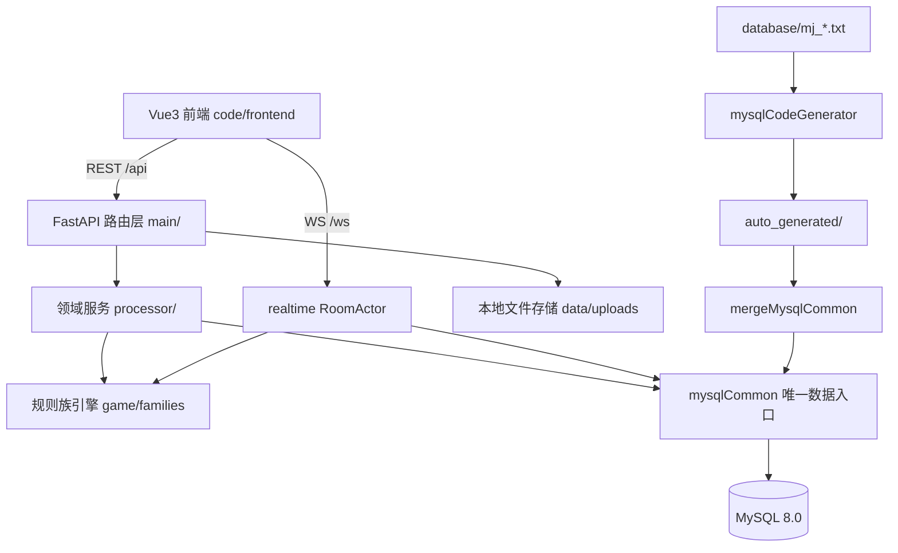

## 用户需求

对"家庭麻将"项目做一次系统框架重制。本轮只做文档规划，不改任何代码、不调整目录、不改配置；规划清晰经确认后再进入编码阶段。

## 产品概述

面向家庭成员、部署在自有服务器上的在线麻将 Web 应用：账号登录、6 位邀请码开桌、四人入座、服务端权威判定吃碰杠胡、实时聊天与系统播报、规则模板自定、战绩查询。规划后新增两项能力：按"规则族"选择玩法、按"皮肤"切换牌面。

## 核心功能与交付内容

- **文档分层**：新建 `plan/` 存放规划类文档（总纲需求、架构、数据库、规则族、协议、UI、实施计划）；`docs/` 只保留系统说明类（总览、开发指南、部署、运维备份）。
- **目录重构**：`backend/`、`frontend/` 迁入新建的 `code/`；`backend` 根对齐 contentHub 的 `code/src` 结构。
- **数据库 MySQL 化**：以 `database/mj_*.txt` 为唯一表定义源，经 `mysqlCodeGenerator.py` 生成 CRUD，再由合并工具汇入 `mysqlCommon.py`；业务层只经 `mysqlCommon` 访问 MySQL，移除 SQLAlchemy/Alembic；空库重建，不迁移旧数据。
- **规则族 + 模板分层**：规则族决定引擎插件与可用开关，模板是族内参数预设，开桌选模板；沿用现有通用规则能力并保持规则快照不可变。
- **多套牌面皮肤**：管理员后台可上传、启用/停用、排序；用户选择存偏好；前端按皮肤渲染 34 种牌与牌背，资源缺失时回退现有 CSS 牌面。
- **规划文档配套**：规则族设计、协议设计作为主规划的子文档，UI 设计独立成文，含牌面图片规格与切图清单。

## 边界

- 本轮零代码改动；所有代码级变更写入实施计划，待确认后执行。
- 协议保持 REST + WebSocket 形态，新增字段一律可选，兼容旧前端。
- 旧 SQLite 数据不迁移，仅重建表结构与预置规则模板。

## 技术栈

| 层 | 选型 |
| --- | --- |
| 数据库 | MySQL 8.0 / InnoDB / utf8mb4；pymysql 长连接注入（读写句柄 dbW/dbR） |
| 表定义与生成 | `database/mj_*.txt` + `mysqlCodeGenerator.py` + `genTableCode.ps1` + `mergeMysqlCommon.py` |
| 数据访问 | `common/mysqlCommon.py` 单一入口（生成段 + 手写查询段），禁止业务层裸 SQL |
| 后端 | FastAPI + Uvicorn（保留 REST + 原生 WebSocket），移除 SQLAlchemy 2.0 / Alembic |
| 前端 | Vue 3 + TypeScript + Vite 5 + Pinia + Tailwind CSS（沿用） |
| 文件存储 | 本地磁盘 `code/backend/data/uploads/tiles/<skinCode>/…`，由后端静态路由暴露，URL 带内容哈希 |
| 工具 | Python 3.11+ / PowerShell（Windows 生成脚本） |


## 实施策略（文档先行，DB 先行）

1. 先把"目标形态"写清楚：目录、分层、表结构与生成流程、规则族契约、协议增量、皮肤规格，形成可评审的 7 份规划文档。
2. 文档顺序按依赖推进：总纲需求 → 架构 → 数据库 → 规则族 → 协议 → UI → 实施计划（含验收与回滚）。
3. 数据库是前置约束：所有表以 `.txt` 定义先落地并跑通生成/合并链路，后端各模块再按新 `mysqlCommon` 函数签名改写，避免"先改代码后补表"造成返工。
4. 规则族与皮肤均为**增量**设计：通用族与 CSS 回退路径保证功能不回退。
5. 本轮不生成代码，但文档必须写到可直接照做的粒度：文件路径、函数命名、字段清单、校验规则、错误码、验收清单。

## 关键技术决策

### 1. txt 单源 + 三段式生成链路

`mj_*.txt → mysqlCodeGenerator.py → auto_generated/auto_gen_code_mj_*.py → mergeMysqlCommon.py → common/mysqlCommon.py（生成区）`。手写区与生成区用 BEGIN/END 标记物理隔离，重跑不覆盖手写代码。

- `genTableCode.ps1` 必须以 `database/` 为工作目录、传裸文件名；表名前缀改为 `mj_`（contentHub 脚本只剥离 `ch_`，需同步改 `-t` 派生规则为"去 `mj_` 前缀 + 去下划线"）。
- 定义文件规范：单空格分隔、禁 Tab；`COMMENT` 不含 `%` 与 `#`；首字段 `recID BIGINT AUTO_INCREMENT PRIMARY KEY COMMENT '记录ID'`；尾部固定 `label/memo/regID/regYMDHMS/modifyID/modifyYMDHMS/delFlag`；时间统一 `VARCHAR(16)` 的 `YYYYMMDDHHMMSS`。
- 生成器不支持外键与复合唯一键：改为应用层保证 + 单列唯一键（如 `gameSeatKey = "<gameID>_<seat>"`、`skinTileKey = "<skinCode>_<tileKey>"`），并在文档中登记该约定。
- `JSON` 类型不在生成器类型表内：列仍需在 `mysqlCommon.py` 的 `MYSQL_JSON_COLUMN_NAME_LIST` 登记，写库前统一 `normalizeJsonValue4DB`（dict/list→dumps，空串→NULL）。规则快照、番种明细、分差数组全部走该通道。
- 生成产物在 Windows 下为 GBK：合并工具按 utf-8→gbk 容错解码，统一 UTF-8 写回。
- **只使用产物的数据层段**：`#http interface code begin/end` 段不装配。原因是本项目对外协议已是 REST + WS，若再接 contentHub 的 CMD 信封会形成双协议与两套鉴权；HTTP 层继续手写 FastAPI 路由 + Pydantic 校验，内部调用 `mysqlCommon` 函数（也避免 `mergeCrudApi.py` 的表接管冲突问题）。

### 2. 连接与并发安全（必须显式解决）

FastAPI 的同步路由跑在线程池，pymysql 单条长连接不可跨线程共享。方案：`mysqlHandle` 内部改为**线程本地连接 + 轻量连接池（DBUtils.PooledDB）**，对外仍暴露 `dbW/dbR` 与 `mysqlCommon` 原有函数签名；异步路由不得直接触库，统一经 `run_in_threadpool` 或改为同步路由。保留 `MYSQL_SKIP_CONNECT=1` 供静态检查/仅 HTTP 场景使用；家庭规模读库默认可与写库同实例，避免主从延迟导致的"写完读不到"。

### 3. 规则族 + 模板分层

- `mj_rule_family`：`familyCode` 唯一、`engineCode` 指向引擎插件（`generic/guobiao/guangdong/sichuan`）、`capabilityJson` 声明可用开关与番种上限、`status` 控制上下架。
- `mj_rule_template`：归属族、`configJson` 为族内参数预设、`presetFlag` 标记预置；开桌只选模板，服务端把「族 + 模板 + 生效配置」整体快照进 `mj_room.ruleSnapshot` 与 `mj_game.ruleSnapshot`。
- 引擎侧：`game/families/<engineCode>/` 提供注册表接口（牌墙/发牌、合法动作、牌型插件集、番种求值、结算、可选开关），通用族完整复刻现有 `RuleConfig` 语义，确保现有 76 个用例可平移。
- 校验分层：模板保存时按族 `capabilityJson` 做字段级 + 跨字段校验，错误消息仍为中文可直接展示。

### 4. 多套牌面皮肤

- 后端：`mj_tile_skin`（皮肤主档）+ `mj_tile_skin_asset`（逐张牌资源：`tileKey` 取 `1w…9w / 1t…9t / 1s…9s / east…red / back`）；上传接口校验格式（png/webp/svg）、单文件体积、尺寸与命名，落盘名用内容哈希，DB 只存相对路径；管理员可启停与设默认。
- 前端：启动拉取 `/api/skins` 清单（含 manifest 摘要），`Tile.vue` 优先 `` 渲染，`onerror`/缺失键回退现有 CSS 绘制，保证零资源时表现不变；`loading="lazy"` + `decoding="async"`，静态资源 `Cache-Control: public, immutable`。
- 偏好：`mj_user_pref.skinCode`；未登录/未设置时用皮肤默认值，再回退 `css-classic`。

### 5. 目录迁移清单（写入实施计划，逐项勾选）

`code/backend`、`code/frontend`；需同步：后端 `frontend/dist` 相对路径（当前 `parents[2]/"frontend"/"dist"`）、Vite 代理与构建输出、`.env` 工作目录约定、systemd `WorkingDirectory`、Nginx 静态缓存路径、README/docs 内所有命令与路径、pytest 的 rootdir 与导入路径。

## 数据表规划（12 张，均 `mj_` 前缀）

| 表 | 关键字段 | 说明 |
| --- | --- | --- |
| `mj_user` | `loginName` UNIQUE、`displayName`、`passwordHash`、`role`、`color`、`activeFlag`、`lastLoginYMDHMS` | 账号与角色 |
| `mj_user_pref` | `userID` UNIQUE、`skinCode`、`chatSoundFlag`、`showTenpaiFlag` | 用户偏好 |
| `mj_rule_family` | `familyCode` UNIQUE、`familyName`、`engineCode`、`capabilityJson` JSON、`status`、`sortOrder` | 规则族注册 |
| `mj_rule_template` | `templateCode` UNIQUE、`familyCode`、`name`、`description`、`configJson` JSON、`presetFlag`、`ownerID`、`activeFlag` | 族内模板 |
| `mj_room` | `roomCode` UNIQUE、`roomName`、`hostUserID`、`templateID`、`familyCode`、`ruleSnapshot` JSON、`status`、`closedYMDHMS` | 房间（快照不可变） |
| `mj_game` | `roomID`、`familyCode`、`ruleSnapshot` JSON、`status`、`startedYMDHMS`、`endedYMDHMS` | 场次 |
| `mj_game_player` | `gameSeatKey` UNIQUE、`gameID`、`seatNo`、`userID`、`totalScore` | 场次座位与总分 |
| `mj_game_round` | `gameID`、`roundNo`、`dealerSeat`、`winnerSeat`、`winType`、`winningTile`、`patternID`、`fanItemsJson` JSON、`fanTotal`、`scoreDeltaJson` JSON、`finishedYMDHMS` | 每局结算 |
| `mj_room_message` | `roomID`、`userID`、`messageKind`、`content`、`createdYMDHMS` | 聊天与播报 |
| `mj_tile_skin` | `skinCode` UNIQUE、`skinName`、`previewFileID`、`defaultFlag`、`status`、`sortOrder`、`ownerID` | 皮肤主档 |
| `mj_tile_skin_asset` | `skinTileKey` UNIQUE、`skinID`、`tileKey`、`fileID`、`thumbFileID`、`width`、`height`、`sortOrder` | 逐张牌资源 |
| `mj_audit_log` | `operatorID`、`action`、`targetType`、`targetID`、`detailJson` JSON、`createdYMDHMS` | 管理操作留痕（皮肤/模板） |


## 架构设计



读写链路：请求 → Pydantic 校验 → 领域服务（引擎/房间）→ `mysqlCommon` 单条/批量函数 → MySQL；房间内实时状态仍在内存 `RoomActor`，每局结束立即落库；进程重启把遗留 `playing` 场次标记 `aborted`。

## 目录结构（本轮只创建/修改文档；代码目标形态写入架构文档）

```
majiang/
├── README.md                                  # [MODIFY] 更新技术栈、目录（code/）与文档导航；移除 SQLite 相关命令
├── plan/                                      # [NEW] 规划文档，唯一规划来源
│   ├── README.md                              # 索引与阅读顺序、文档状态（草案/已评审）、术语表
│   ├── 00-项目总纲与需求.md                    # 现状盘点、角色、功能清单、非目标、验收口径
│   ├── 01-系统架构设计.md                      # code 目录迁移、后端分层、mysqlCommon 红线、部署拓扑、并发与连接池
│   ├── 02-数据库设计.md                        # 12 张表字段级定义、mj_*.txt 规范、生成/合并流程与坑、初始化与种子
│   ├── 03-规则族设计.md                        # 族注册、engineCode 插件契约、模板 schema、校验与快照（子文档）
│   ├── 04-协议设计.md                          # REST/WS v1、皮肤与偏好接口、快照/事件增量、错误码（子文档）
│   ├── 05-UI设计.md                            # 设计系统、页面规划、牌面皮肤规格与切图清单、响应式与状态
│   └── 06-实施计划.md                          # 阶段拆分、文件级改动清单、测试与验收、回滚方案
├── docs/                                      # 系统说明文档
│   ├── 系统总览.md                             # [NEW] 能力地图、角色权限、数据流、文档索引
│   ├── 开发指南.md                             # [NEW] 本地启动（MySQL）、目录约定、表结构变更流程、调试与测试
│   ├── 部署.md                                 # [MODIFY] MySQL 安装/建库/账号、systemd、Nginx、发版；删除 SQLite 备份章节
│   └── 运维与备份.md                           # [NEW] mysqldump/物理备份、恢复演练、日志与健康检查、常见故障
│   （原 规则设计.md / 协议.md 迁入 plan/03、plan/04，docs 内保留跳转说明）
└── code/                                      # [规划] 实施阶段创建，本轮不落盘
    ├── backend/                               # 等价 contentHub 的 code/src
    │   ├── database/                          # mj_*.txt、mysqlCodeGenerator.py、auto_generated/、word_table_*.csv
    │   ├── common/                            # mysqlCommon.py（唯一 DB 入口）、mysqlHandle.py、miscCommon.py
    │   ├── config/                            # mysqlSettings.py（dbW/dbR、环境变量口令）、basicSettings.py
    │   ├── main/                              # FastAPI 装配与路由（auth/users/rules/rooms/history/skins/admin）
    │   ├── processor/                         # 领域服务（规则校验、房间编排、皮肤管理、审计）
    │   ├── game/                              # 牌引擎 + families/<engineCode>/ 规则族插件
    │   ├── realtime/                          # RoomActor、快照、落库（沿用）
    │   ├── tools/                             # genTableCode.ps1、mergeMysqlCommon.py、initDatabase.py
    │   └── tests/                             # 平移现有 76 用例 + 规则族/皮肤/迁移用例
    └── frontend/                              # 沿用 Vue3 结构，新增 skins store、Tile 图片渲染与回退
```

## 关键结构（摘录，供文档评审）

`database/mj_tile_skin.txt` 定义片段（严格单空格、尾部七字段固定）：

```
recID BIGINT AUTO_INCREMENT PRIMARY KEY COMMENT '记录ID'
skinCode VARCHAR(32) NOT NULL UNIQUE COMMENT '皮肤编码 幂等键'
skinName VARCHAR(64) NOT NULL COMMENT '皮肤名称'
previewFileID VARCHAR(200) NULL COMMENT '预览图相对路径'
defaultFlag CHAR(1) NOT NULL DEFAULT '0' COMMENT '是否默认皮肤'
status VARCHAR(24) NOT NULL DEFAULT 'ENABLED' COMMENT 'ENABLED或DISABLED'
sortOrder INT NOT NULL DEFAULT 0 COMMENT '排序号'
ownerID BIGINT NULL COMMENT '上传者用户ID'
label VARCHAR(32) COMMENT 'label'
memo VARCHAR(200) COMMENT 'memo'
regID VARCHAR(32) COMMENT '注册ID'
regYMDHMS VARCHAR(16) COMMENT '注册年月日'
modifyID VARCHAR(32) COMMENT '修改用户ID'
modifyYMDHMS VARCHAR(16) COMMENT '修改年月日'
delFlag CHAR(1) COMMENT '删除标记'
```

皮肤清单契约（`/api/skins` 返回，前端据此渲染与回退）：

```
{
  "skinCode": "jade-classic",
  "skinName": "青玉经典",
  "isDefault": true,
  "tileAspect": 0.667,
  "assets": { "1w": "/uploads/tiles/jade-classic/1w.8f3a1c.webp", "back": "/uploads/tiles/jade-classic/back.2b9d40.webp" },
  "fallback": "css-classic"
}
```

## 实施注意（写入文档，防返工）

- **性能**：皮肤清单不含二进制、按皮肤聚合返回并带 ETag；`Tile.vue` 复用同一 `skinCode` 的表单避免逐牌请求；房间快照不携带图片数据；MySQL 侧为 `roomCode/templateCode/familyCode/skinCode` 建唯一索引，为 `roomID/gameID/createdYMDHMS` 建普通索引；`room_messages` 查询加 `LIMIT`。
- **兼容**：`state.snapshot` 与 `room.welcome` 新增族/皮肤字段一律可选；旧前端字段不减。规则快照保留原 `RuleConfig` 键名，族信息只做附加字段，保证历史战绩可读。
- **安全**：上传接口限管理员、校验 magic number 与扩展名双白名单、限制单文件与单皮肤总容量、文件名不接受用户输入、禁止 SVG 内联脚本（或统一转 PNG/WebP）；口令只走环境变量，日志不打印密码与手牌明文。
- **可验证**：每份文档末尾附"验收清单"（如：`genTableCode.ps1` 全表生成 0 失败、`mergeMysqlCommon.py` 校验 7 个数据层函数齐全、空库初始化后能开一局并落库、切换皮肤后 34 张牌与牌背全部命中）。

## Agent Extensions

### SubAgent

- **code-explorer**
- Purpose: 在编写数据库设计与协议文档前，全面梳理后端所有 ORM/会话调用点、路由到数据层的调用链、前端所有 WS/HTTP 契约使用点，确保"移除 SQLAlchemy 改走 mysqlCommon"的改动清单无遗漏。
- Expected outcome: 输出按文件分组的调用点清单（文件、函数、涉及的 7 张表、读/写类型、事务边界），直接作为 02-数据库设计.md 与 06-实施计划.md 的附录，并核验协议文档中的字段与前端实际使用一致。