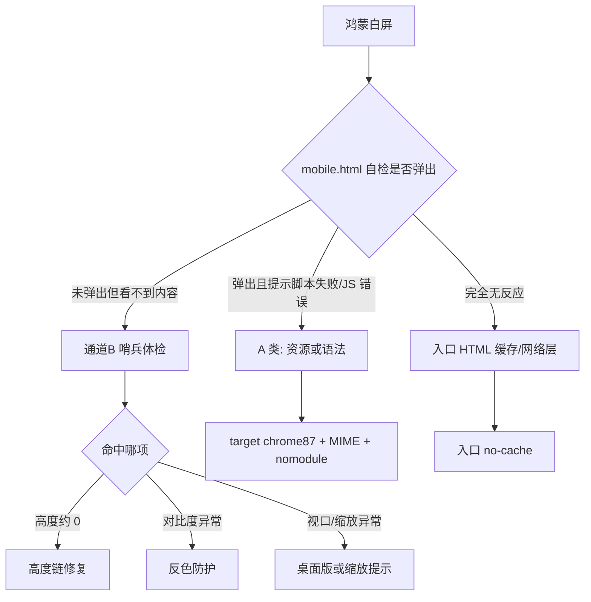

## 用户需求

移动端（`/mjmobile/`）目前为兼容 Chrome 78（2019）做了大量降级与兜底，用户判断这批超老内核可以不再兼容；同时鸿蒙系统自带浏览器上出现显示异常，希望明确根因方向并给出处置建议。本次**只出方案，不编码**。

## 产品概述

两条线并行推进：一是把手机版的内核基线抬到 Chrome 87（2020），释放构建与样式的兼容包袱；二是让"鸿蒙白屏"从猜测变成可自证的问题——先能看清手机到底发生了什么，再对症修复。

## 核心功能

**1. 兼容基线收敛**

- 手机版最低内核由 Chrome 78 提升到 Chrome 87，构建不再为可选链、空值合并等语法做降级；Safari 13、Firefox 70、Edge 79 等无人使用的目标一并移除。
- 随基线提升，删除已无意义的老内核样式兜底（`inset`、flex `gap` 补丁），保留仍需保留的视口高度回退。
- 对低于新基线的设备不再静默白屏，而是给出可读的"浏览器版本过低"提示。

**2. 鸿蒙显示问题定位与修复**

- 现状结论：前端全链路没有任何 UA 分支，鸿蒙异常不可能由自家 UA 判断引起，因此**先分诊、不猜 UA**。
- 建立两段式自检：区分"脚本没跑起来"（资源 404、MIME 不对、语法报错）与"跑起来了但内容看不见"（被强制反色、整页高度算成 0、内容被挤出视口、入口缓存指向已删除资源）。后一类是当前完全无感知的盲区，也正是"只剩背景"的高发原因。
- 提供可随时唤起的诊断面板：一次采集设备与 UA、视口与缩放、安全区实测值、关键 CSS 能力位、入口资源加载结果，并支持一键复制发给开发者。
- 依据诊断结果落地对应加固：暗色页面强制声明与显式文字色、整页高度链兜底、安全区异常归零保护、横屏闸门在无法全屏或锁向时的降级提示。

**3. 交付与验收**

- 入口 HTML 采用不缓存策略，静态资源继续长缓存，避免"入口引用已删除的旧资源"导致的整页白屏。
- 桌面与手机两套产物分别构建验证，覆盖鸿蒙自带浏览器、旧华为机、iOS Safari、桌面浏览器。
- 同步更新客户端规划的 WebView 下限、改进台账与发布记录，版本号在前后端与两个登录页保持一致。

## 一、结论先行（回答"UA 问题还是什么"）

1. **不是 UA 嗅探缺陷**。`src/**` 内无 `navigator.userAgent` 分支，`useOrientation`、`LandscapeGate`、`MobileRoomView` 均未做 UA 判断；鸿蒙的异常不可能由自家 UA 逻辑造成。
2. **白屏必须二分**，这是方案的技术主线：

- A 类：脚本未执行（`module` 请求 404 / MIME 非 JS / 语法错误被拒 / 被浏览器拦截）→ 现有 `mobile.html` 的 2.5s 自检可覆盖。
- B 类：Vue 已挂载但内容不可见（系统深色强制反色、`.mj-dvh` 高度算成 0、内容被挤出视口、入口 HTML 命中旧缓存而资源已被 `rsync --delete` 删除）→ **现有自检完全无感知**，必须新增哨兵。

3. 因此建议是：**不引入 UA 分支**，用"能力检测 + 实测视口 + 资源加载结果"取证，再对症修。UA 只作为诊断标注信息采集，不参与任何布局或功能分支。

## 二、技术栈与选型（沿用现有栈，不新增依赖）

- 构建：Vite 5.4 + `@vitejs/plugin-vue`，`esbuild` 负责语法降级，**不引入 `@vitejs/plugin-legacy`**（会带 core-js，体积与复杂度都不值得；家庭内网设备可控）。
- 样式：Tailwind 3.4 + `mobile.css` 增量覆盖，autoprefixer 默认 browserslist 已能补前缀。
- 诊断面板：**纯内联 ES5，写在 `mobile.html` 里**，不进 bundle。理由是它必须在"bundle 根本没跑起来"的场景下依然可用，依赖构建产物就失去意义。
- 部署：nginx 静态托管 `dist` → `/majiangapp/`、`dist-mobile` → `/mjmobile/`，沿用 `code/deploy/nginx-majiang.conf` 片段与 `~/mj_deploy2/18_front_only.sh`。

### 关键判断：哪些兜底能删、哪些必须留

| 兜底 | 位置 | 依据 | 处置 |
| --- | --- | --- | --- |
| `?.` / `??` 降级 | `build.target: chrome78` | Chrome 80+ 原生支持 | 删除（target 提到 87） |
| `@supports not (inset: 0)` | `mobile.css:27-34` | `inset` 简写 Chrome 87+ | 删除 |
| `@supports not (gap: 1px)` | `mobile.css:36-51` | flex `gap` Chrome 84+ | 删除 |
| `.mj-app / .mj-dvh` 的 `100vh` 回退 | `mobile.css:80-87` | `dvh` 是 **Chrome 108+**，chrome87 仍不认 | **必须保留** |
| `-webkit-text-size-adjust: 100%` | `mobile.css:55-59` | 防字体自动放大，与内核版本无关 | **必须保留** |


> 重点：把 target 提到 87 并不代表能用 `dvh`。这两件事正交，实施时不要顺手删掉 `100vh` 那一行。

## 三、实施策略

### 阶段 0：取证（先做，不改产品逻辑）

在 `mobile.html` 现有自检基础上扩为**双通道**，保持原 2.5s 判定不变（避免回归）：

- **通道 A（脚本层，沿用）**：`error` 捕获（区分 SCRIPT 资源失败 / 运行时异常）、`unhandledrejection`、`#app.children.length === 0`。
- **通道 B（新增哨兵）**：`#app` 有内容时做三项体检，任一命中则浮出可关闭的诊断卡：
- `#app` 实际高度 `< 40px`（高度链断 / 内容被压扁）；
- `getComputedStyle` 取首屏文本色，与其背景色算出对比度过低（把"被反色"变成可判定信号，而不是靠人眼猜）；
- `documentElement.scrollWidth > clientWidth * 1.2` 或 `visualViewport.scale` 明显偏离 1（桌面版网站 / 残留缩放）。
- **采集字段**（全部在 try/catch 内，逐项降级，任一 API 缺失不影响其他项）：UA、UA-CH 低熵（`brands`/`mobile`/`platform`，异步可选）、`innerWidth/Height`、`visualViewport.{width,height,scale,offsetTop}`、`screen.{width,height,availWidth,availHeight,orientation}`、`devicePixelRatio`、`documentElement.{clientWidth,scrollWidth,scrollHeight}`、`CSS.supports` 能力位（`inset`/`gap`/`dvh`/`aspect-ratio`/`backdrop-filter`/`position:sticky`）、`env(safe-area-inset-*)` 实测（探针元素 `padding` + `getComputedStyle`）、`#app` 子节点数与高度、`color-scheme` 与 `prefers-color-scheme`、入口脚本 URL 及 `performance.getEntriesByType('resource')` 中的失败项。
- **触发方式**：URL 带 `?diag=1` 或 `#diag`；发生 A 类错误自动弹出；另提供"连续点击标题 3 次"作为兜底入口。
- **输出**：浅底深字面板（沿用现有配色，保证被反色时仍可读）+ "一键复制"（`textarea` + `select()` + `execCommand('copy')`，兼容老内核）。

### 阶段 1：按根因假设逐一处置

| 假设 | 判定信号 | 修复方向 |
| --- | --- | --- |
| H1 系统/浏览器强制深色反色（"只剩背景"典型） | 面板中文本色被反转、对比度异常 | 不只依赖 `<meta name="color-scheme">`：`html,body` 显式设底色与文字色；牌桌根节点文字色不靠变量继承；必要时对牌桌区域加 `forced-color-adjust: none`（仅移动端沉浸区，保留无障碍权衡说明） |
| H2 整页高度链断裂 | 面板中 `#app` 高度 ≈ 0 或缺 `dvh` 能力 | `html,body { height: 100% }` 打通百分比链路；`.mj-app/.mj-dvh` 保留 `100vh → 100dvh` 双写并追加 `100%` 兜底；必要时由 `visualViewport` 写 `--mj-vh` CSS 变量作为最后一道 |
| H3 入口 HTML 命中旧缓存（资源已被 `--delete` 删除） | 面板中脚本 404、force reload 后恢复 | nginx 对 `mobile.html` 单独 `Cache-Control: no-cache, must-revalidate`，`assets/` 保持长缓存；自检失败文案改为"请清缓存或点强制重新加载" |
| H4 桌面版网站 / 残留缩放 | `clientWidth/screen.width` 比值失真、`visualViewport.scale ≠ 1` | 不做 UA 分支；面板直接提示"关闭桌面版网站、双击还原缩放"；viewport meta 保持现状 |
| H5 内核语法 / MIME | A 类错误 + 资源 200 但未执行 | target 提到 chrome87；核对 nginx 的 `types` 含 `js mjs → application/javascript`；`mobile.html` 加 `nomodule` 提示，覆盖低于基线的内核 |


补充加固：`useOrientation` 的全屏与锁向都可能被鸿蒙拒绝（`requestFullscreen` 静默失败、`screen.orientation.lock` 抛错），当前 `requestLandscape()` 只做 `.catch(() => undefined)`，结果是按钮点了没反应。应区分"能力不支持"与"调用被拒"两种失败，`LandscapeGate` 给出可执行文案（改用手动横屏），并避免 `fullscreenchange` 不触发时 `fullscreen` 状态与实际不符。

### 阶段 2：验收与文档

- 产物语法扫描：确认 `dist-mobile/assets/mobile-*.js` 不再出现降级痕迹且不含 class static block / TLA；源码已核查无 `Array.prototype.at`、`Object.hasOwn`、`structuredClone`、`replaceAll`、`crypto.randomUUID` 等运行时 API 依赖，`requestIdleCallback` 有 `setTimeout` 回退，故 chrome87 运行时安全。
- 真机矩阵：鸿蒙自带浏览器（重点）、华为 Android 12 旧机（明确降级提示）、iOS Safari、Android Chrome、桌面 Chrome；两个入口 `/majiangapp/`、`/mjmobile/` 均需回归。



## 四、实施要点

- **改动爆炸半径**：只动手机版入口与增量样式；`src/styles/index.css`、桌面版 `index.html`、PC target 保持不变。手机版 target 提升不影响 PC 产物（PC 仍是 `undefined`，走 Vite 默认）。
- **版本一致性**：`package.json`、`LoginView.vue`、`MobileLoginView.vue`、后端 `config/basicSettings.py` 四处同步到 1.1.6；发版记录新建 `plan/v1.1.6-发布记录.md`。
- **发版顺序**：先构建 `dist` + `dist-mobile`（两次独立 `npm run build` / `npm run build:mobile`），本地静态冒烟通过后再推测试端，最后生产 `18_front_only.sh`；发版前查 `OPEN/PLAYING`，但本次仅前端，不重启后端。
- **缓存与回滚**：nginx 改动前备份 `majiang.conf`（沿用历史 `_YYYYMMDD_HHMMSS.bak` 命名），失败即回滚该片段并 `nginx -s reload`；前端回滚用 `majiangapp_*.tgz` / `mjmobile_*.tgz`。
- **日志与隐私**：诊断面板只输出设备与视口信息，不含 token、手机号、房间号；一键复制内容需人工确认后再发群。
- **渐进上线**：诊断能力默认静默（正常路径无 DOM、无轮询、无网络请求），仅在 `diag` 或体检命中时工作，避免线上噪声。

## 五、目录结构

```
majiang/
├── code/frontend/
│   ├── vite.config.ts                       # [MODIFY] 手机 build.target → ['chrome87']，删除 chrome78 注释与多浏览器目标；PC 分支保持 undefined 不变
│   ├── mobile.html                          # [MODIFY] 自检扩为双通道：A 脚本层保持原逻辑，新增 B 哨兵体检；新增诊断采集与一键复制；新增 nomodule 低版本提示
│   └── src/mobile/
│       ├── styles/mobile.css                # [MODIFY] 删除 @supports not (inset:0) 与 @supports not (gap:1px) 两块；保留 vh/dvh 双写；补充 html,body height:100% 与显式文字色/底色；注释同步新基线
│       ├── composables/useOrientation.ts    # [MODIFY] 区分「能力不支持」与「全屏/锁向被拒」，返回可诊断结果；补 visualViewport 变化监听
│       └── components/LandscapeGate.vue     # [MODIFY] 按失败原因给不同文案与手动横屏指引，避免点了没反应
├── code/deploy/
│   └── nginx-majiang.conf                   # [MODIFY] 新增 /mjmobile/mobile.html 的 no-cache 精确匹配；确认 js/mjs 的 MIME 映射
├── plan/
│   ├── tools/smoke_v114.py                  # [MODIFY] 新增断言：入口 no-cache、诊断面板可唤起、chrome87 产物语法、两入口 200
│   ├── android家庭麻将客户端规划.md          # [MODIFY] WebView 可运行下限 78 → 87，同步风险表与 UA 检测表述（改为能力检测）
│   ├── 改进和错误修复文档.md                 # [MODIFY] 新增本批次条目（兼容基线收敛 / 鸿蒙分诊与加固）
│   └── v1.1.6-发布记录.md                    # [NEW] 改动摘要、真机矩阵结果、冒烟证据、回滚命令
└── code/frontend/package.json               # [MODIFY] version → 1.1.6
```

## 六、验收标准

1. 手机产物 target 为 chrome87，`mobile.css` 中 `inset`/`gap` 兜底已移除，`100vh` 回退仍在。
2. 任一台设备打开 `/mjmobile/?diag=1` 均能看到完整诊断卡，字段无 `undefined` 崩溃，一键复制可用。
3. 人为构造三类故障（脚本 404、`#app` 高度置 0、文本色反转）时，自检能分别给出可读提示而非静默白屏。
4. 鸿蒙自带浏览器上出现的问题可被面板明确定位到某条假设，并按对应方案修复后复测通过。
5. `npm run typecheck`、`build`、`build:mobile` 全绿，静态冒烟全 PASS，桌面版视觉与行为零变化。

## Agent Extensions

### SubAgent

- **code-explorer**
- Purpose: 全量核对手机端是否还有隐藏的 UA 嗅探、老内核兜底、以及会触发 chrome87 运行时缺口的 API 调用（含 `mobile/` 之外被手机端复用的共享模块）。
- Expected outcome: 输出一份"可删 / 必须留 / 待观察"的精确清单与文件行号，避免方案落地时误删 `dvh` 回退或漏掉共享模块中的不兼容 API。

### Skill

- **playwright-cli**
- Purpose: 在本地静态服务上验证两个入口的可加载性、诊断面板的唤起与字段完整性，并通过 Chromium 的设备模拟与视口覆盖复现"高度为 0""缩放异常"两类场景。
- Expected outcome: 产出可复现的截图与诊断面板快照，作为发版证据；同时确认桌面版无回归。