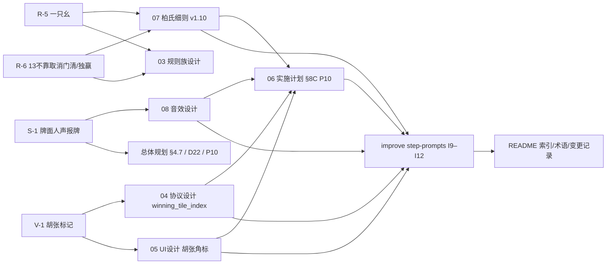

## 产品概述

为「家庭麻将」v1.1.0（发版步骤 I7 待开始）追加 4 项规则/体验需求，并**先产出全套规划文档**供审批；文档批准后再按分步提示语逐条实施代码。本轮交付物全部是 `plan/` 下的 Markdown 文档，**不含任何代码改动**。

## 核心功能

### 1. 柏氏新增番种「一只幺」（1 番）

- 与既有「断幺」完全对称：整手牌（**含副露**）中恰好 **1 张幺牌**（数牌 1/9 与字牌东南西北中发白合称幺牌），其余全部为 2–8 数牌时成立。
- 幺牌按**张数**计：成对的 1/9 作将牌时算 2 张，故「1 万单吊」**不**成立；成立例：1 张东 + 13 张 2–8 数牌。
- 1 番、不占任何互斥组、非计数型（一手只计一次）；与「断幺」互斥（断幺 = 0 张幺）；十三幺/全幺/全文字/13 不靠天然不成立；可与将牌、独赢、门清、缺门等自由累加。

### 2. 十三不靠不再计「门清」「独赢」

- 13 不靠仍为 10 番，将牌番、缺门番、清一色/混一色照常判定并累加；**删去**门清 1 番与独赢 1 番。
- 数值影响：一手典型 13 不靠由 14 番降为 12 番（10 + 将牌 1 + 缺门 1）。

### 3. 牌面人声报牌音效（新增 34 个）

- 出牌后除原有落牌底噪外，叠加播放该张牌的**女声报牌音**：一万～九万、一筒～九筒、一条～九条、东南西北中发白，共 34 个，逐张区分。
- 现有 15 个合成音效（落牌/摸牌/吃/碰/杠/胡/荒庄/掷骰/发牌/超时/聊天提示）**全部保留不变**，叫牌音也不替换。
- 素材取自 `plan/majiang_sound/women_mp3/`（40 个 mp3 中取 34 个牌面音），**用户已明确接受第三方素材的版权风险**，须在文档中登记来源与风险。

### 4. 结算页明显标记「胡牌的那张牌」

- 后端在终局四家手牌中补出胡张的**物理位置**，前端以**金色「胡」角标 + 双层描金**标记该张牌，取代当前仅 1px 金环的弱提示。
- 覆盖自摸、点炮、抢杠胡三种情形；同值多张时只标准一张；结算页（桌面 + 手机）与战绩回放页三处一致。

### 5. 文档交付（本轮唯一产出）

- 追加台账：`改进和错误修复文档.md` 新增 R-5 / R-6 / S-1 / V-1 四条七段式条目。
- 规则权威：`07-柏氏规则细则.md` 升 v1.10（番表 34 → 35 项、新增一只幺条款、13 不靠 判番范围调整、新增验收用例 35/36）。
- 联动文档：`03-规则族设计.md`、`04-协议设计.md`（新增 `winning_tile_index`）、`05-UI设计.md`（胡张角标规格）、`08-音效设计.md`（人声报牌）、`06-实施计划.md`（新增 P10 阶段）、`家庭麻将总体规划文档.md`（§4.7、D22/D23、P10、验收总则）、`plan/README.md`（索引/术语/变更记录）。
- 实施步骤：`improve step-prompts.md` 新增 I9～I12 四步可独立执行的提示语（状态「待开始」）。

## 一、技术栈与文档体系

| 项 | 选型 | 说明 |
| --- | --- | --- |
| 文档形态 | Markdown（`plan/*.md`） | 沿用仓库既有风格：状态行 + 修订历史 + 编号章节 + 表格 + 七段式条目 |
| 规则权威 | `plan/07-柏氏规则细则.md` | 番种数值与判定的唯一权威；番表以 `baishi/fan.py` 的 `FAN_TABLE` 为唯一来源 |
| 协议权威 | `plan/04-协议设计.md` | 只增字段、不改既有语义 |
| 音效权威 | `plan/08-音效设计.md` | 触发映射、优先级与限流、资源规格、版权登记的唯一权威 |
| 问题台账权威 | `plan/改进和错误修复文档.md` | 七段式：现象 / 复现与证据 / 根因 / 修复方案 / 验收标准 / 风险 / 联动文档 |
| 实施步骤 | `plan/improve step-prompts.md` | 每步独立开新对话，````text` 围栏内提示语 |
| 关联技术栈（文档需与之对齐） | 后端 FastAPI + MySQL 8.0（`mysqlCommon` 唯一 SQL 出口）、前端 Vue 3 + TS + Vite 5 + Pinia + Tailwind 3、Web Audio API | 本轮不改代码，仅在文档中写清实施口径 |


## 二、实施策略

### 2.1 核心思路：先冻结口径，再写实施步骤

4 项需求分属 3 个权威域（规则 / 音效 / 视觉），必须**先在各自主文档落定「唯一权威口径 + 验收用例 + 风险」**，再由 `improve step-prompts.md` 把每项拆成可独立执行、可回归的一步。这样审批时只需核对 4 份权威文档的一致性，实施阶段照提示语执行即可，避免边写边改口径。

### 2.2 关键决策与取舍

| 决策 | 取法 | 理由 |
| --- | --- | --- |
| 一只幺的挂接位置 | 与 `duan_yao` 同属「全局番」，在 `baishi/fan.py` 的 `global_fans()` 出口统一追加 | 四种牌型（标准/七对/13 不靠/十三幺）都能自然叠加；十三幺因含 13 张幺天然不成立；避免逐牌型函数挂接造成漏判 |
| 一只幺的「幺」定义 | 数牌 1/9 + 字牌（东南西北中发白） | 与用户口径「(1,9,字)」逐字一致；与「断幺」判定函数 `is_all_simples()` 互为补集，可复用同一套 `ctx.all_tiles()` 摊平口径 |
| 一只幺按张数而非按「种」计 | 恰好 1 张 | 与用户「只有一只幺」一致；写成按种会与「1 万作将（2 张）」冲突，须在 07 明确写成张数并给正反例，防止实现与用例打架 |
| 13 不靠取消门清/独赢的实现方式 | 只在 `thirteen_unrelated_fans()` 内**过滤** `men_qian`，并删除 `du_ying` 追加 | `situational_hits()` 同时产出天胡/地胡/杠上开花/海底捞月/抢杠胡，直接删调用会连带丢掉这 5 个番种 |
| 人声音效不扩 `SoundKey` 枚举 | 新增 `audio/voiceMap.ts` 做 tile→基名映射，`audioManager` 增 `playVoice(base, opts)` 走同一套限流/并发/降级 | `SoundKey` 是字面量联合类型，扩到 49 项会使预加载一次拉 49 个文件、首屏流量与 `audioState.total` 全部失控；改为按需加载 + 空闲预热可把首屏增量压到 0 |
| 人声音效与落牌底噪叠加而非替换 | `event.discarded` 时同时播 `discard`（P3）与牌面人声（P3） | 用户口径「保留现有合成音」；底噪保留麻将现场感，人声提供牌面信息 |
| 胡张位置由后端给出 | `final_hands_snapshot()` 新增 `winning_tile_index`（排序后 `concealed` 下标，同值取最后一次出现） | `concealed` 是扁平数组且引擎 `tiles.sort()` 会打散位置，前端无法可靠推断；由后端给下标是唯一可靠口径，且只增字段、不改表（JSON 列） |
| 胡张视觉用角标而非仅描边 | 新增 `winTile` 态：`ring-2 ring-gold-400` + 金色「胡」圆角角标 | 皮肤图模式下 `` 会留白，1px 描边易被吃掉；角标参照既有「庄」徽标 token，桌面/手机/战绩三处一致 |
| 不为「牌面报牌」新增用户偏好字段 | 复用既有总开关 + 音量 + `chatSoundFlag` | `mj_user_pref` 加列需 DDL 与协议扩展，超出本轮范围；文档中写明「如需独立子开关另立需求」 |
| 素材版权 | 使用 `women_mp3` 的 34 个牌面音，**在 08 §6 与改进台账中登记来源仓库无 LICENSE、权利不明、用户已接受风险** | 用户明确选择直接使用并上生产；文档留痕以备后续追溯与替换 |


### 2.3 性能与可靠性

- **人声音效加载**：34 个 mp3 合计约 300 KB，若随进桌预加载会把首屏流量抬高 3 倍。方案：**不进 `SOUND_KEYS` 预加载清单**，改为「进桌后空闲时段分批预热（每批 4 个）+ 出牌时按需 `loadOne` 兜底」，并保留现有「首次未命中则静音一次」的降级语义（`audioManager.ts` L389–394）。
- **限流叠加**：现有同键去重 150 ms 只对同键生效，牌面人声键随牌面变化，连续两张不同牌不会互斥 → 需在 08 写明**人声全局最短间隔（建议 250 ms）**与并发上限（复用 `MAX_CONCURRENT=4`），否则密集出牌会叠成噪音。
- **P0 抑制交互**：`hu` 为 P0，胡牌后 200 ms 内到达的 P3（落牌 + 人声）会被丢弃 → 文档写明「结算瞬间最后一张牌的人声可能不响，属预期」。
- **胡张索引口径**：后端 `winning_tile_index` 与前端旧局回退口径必须一致（均为「排序后最后一张同值牌」），否则老局战绩会指错牌；此约定须同时写进 04 协议与 05 视觉规格。
- **规则回归面**：番表由 34 → 35 项会牵动 `FAN_TABLE`、`config.default_fan_table()`、`presets.py` 描述、`__init__.py` docstring、`selfcheck.REQUIRED_CASES`、07 §5 表格与 03 §7.1 摘要 —— 文档必须逐处列出，否则 `test_baishi_fan_table_matches_07_section_5_markdown`（解析 07 §5 表格并逐项比对）会直接失败。

### 2.4 避免技术债

- 全部沿用既有模式：番表元组驱动、`global_fans()` 出口统一追加、`SoundSpec`/`playSound` 限流内核、`Tile.vue` 状态 prop + 绝对定位角标、「庄」徽标 token、07 §13 用例编号体系、`improve step-prompts` 提示语模板。不新增架构模式、不新增协议事件、不新增数据库列。

## 三、改动文件清单

### 3.1 目录结构总览

本轮**全部为 Markdown 文档修改，无新增文件、无代码改动**；`plan/majiang_sound/women_mp3/` 素材保持原位（实施阶段才复制进 `code/frontend/public/audio/voice/`）。

```
d:/StevenLianData/0301. Private Project/gitData/majiang/plan/
├── 07-柏氏规则细则.md          # [MODIFY] 规则唯一权威。番表 34→35 项（新增 yi_zhi_yao「一只幺」1 番/互斥组 —/计数 否，紧随 duan_yao 行）；§6.4 新增第 9 条「一只幺」（含张数口径、与断幺对称、3 正例 3 反例）；§6.3.4 第 4 条判番范围删去「独赢」「门清」并补数值影响（14→12 番）；§6.6 门清补「13不靠 不计门清」；§6.8 独赢补「13不靠 不判独赢」（§6.7 将牌「13不靠 也判」保留）；§12 Q 表增 Q12/Q13 并同步固化推论（L527「35 项」、L533 判番范围）；§13 增用例 35（一只幺）、36（13不靠 不计门清/独赢）；标题与修订历史升 v1.10；§14 联动态补行
├── 03-规则族设计.md            # [MODIFY] L359 番种数 34→35 并补「一只幺」；L379 L1 已定版本改 v1.10；L383 L5 补 13不靠 不计门清/独赢；L401 族对比表柏氏番表项数
├── 04-协议设计.md              # [MODIFY] §9.5 增补 result.final_hands 结构说明与新增字段 final_hands[].winning_tile_index（含口径「排序后下标、同值取最后一次出现」、旧局缺字段时前端回退约定）；§9.4 event.settled 行补 final_hands；文末验收清单加条目
├── 05-UI设计.md                # [MODIFY] §4.5 结算页增「胡张标记（v1.1.0 追加）」规格：金色「胡」角标 token、位置、字号、ring-2 与角标叠加顺序、与副露红点 mark 的区分、皮肤图模式可见性、桌面 sm / 手机 sm / 战绩 xs / 手机战绩 micro 四档适配；验收清单加条目
├── 08-音效设计.md              # [MODIFY] §1.2 改写「真人报牌 不做」与「第三方版权音源 不使用」→ 允许预置第三方女声报牌资源并登记风险；§2 增「牌面报牌」触发规则（event.discarded + data.tile → 对应人声，与 discard 叠加，P3）；§3 优先级表补 P3 人声条目与人声全局最短间隔 250ms；§4 增客户端实现路径（audio/voiceMap.ts + audioManager.playVoice，按需加载 + 空闲预热，voice/ 目录）；§6 资源规格修订（人声目录单列预算 ≤400KB、MP3 单声道 44.1kHz、基名命名表、来源与授权风险登记、缓存与 ?v= 策略）；§8 验收清单加条目；§9 对应表补行
├── 改进和错误修复文档.md        # [MODIFY] 追加第二轮四条七段式条目：R-5 一只幺、R-6 13不靠 取消门清/独赢、S-1 牌面人声报牌音效、V-1 结算页胡张标记；同步状态行、§5 按文件总览表、§6 验收与回归矩阵、§7 风险与回滚、§8 与其它文档对应关系表
├── 家庭麻将总体规划文档.md       # [MODIFY] §4.7 追加 R-5/R-6/S-1/V-1 四行；§9 新增 D22（牌面人声报牌：纯前端、只消费既有 event.discarded.tile、不改协议、按需加载、第三方素材版权风险已登记）与 D23（胡张标记：后端补 winning_tile_index + 前端角标）；§10 里程碑新增 P10；§12 验收总则追加第 16–19 条；§13 文档索引描述更新
├── 06-实施计划.md              # [MODIFY] 新增 §8C「P10 · v1.1.0 追加需求」（8C.1 动作 / 8C.2 文件清单 / 8C.3 验收 / 8C.4 回滚）；同步 §1 阶段总览与 §9 文件级改动总表
├── improve step-prompts.md      # [MODIFY] 状态表登记 I9（番表 35 项：一只幺）、I10（13不靠 判番调整）、I11（牌面人声报牌）、I12（结算页胡张标记）四步「待开始」；目录与「下一步」说明同步（明确 I7 发版与 I9–I12 的先后）；每步按既有格式补全 目标/前置/必须先读/任务/验收清单/硬约束/完成后必须输出
└── README.md                   # [MODIFY] 阅读顺序表（07 番表 35 项、08 修订状态）、权威来源段、术语表新增「一只幺」「牌面报牌」「胡张标记」、维护规则第 4 条补人声目录、变更记录追加 2026-10-31 行
```

### 3.2 未改动但需在文档中被引用的代码锚点（实施阶段落点）

| 需求 | 代码落点（实施阶段，本轮不改） |
| --- | --- |
| 一只幺 | `code/backend/src/game/families/baishi/fan.py`：`FAN_TABLE`（L36–72）增行、`global_fans()`（L338–344）追加、`is_all_simples()`（L314–319）旁新增对称判定、`__all__`（L683–719）导出；`config.py` `default_fan_table()`（L40–45）；`presets.py` 描述（L3/L52）；`__init__.py` L4；`selfcheck.py` `REQUIRED_CASES`（L14–52）增 `07-13-35`；`tests/test_baishi_s7.py` L99–136（`== 34` → `== 35`，3 处）与新增用例；重跑 `tools/seedPresets.py` |
| 13不靠取消门清/独赢 | `fan.py::thirteen_unrelated_fans()`（L610–624）：删 `FanHit("du_ying")`、`situational_hits` 结果过滤 `men_qian`；`tests/test_baishi_s7.py` L319–386 断言改写（`fan_total == 14` → `12`） |
| 牌面人声报牌 | `code/frontend/public/audio/voice/`（新增 34 个 mp3 + LICENSE.md）；`src/audio/voiceMap.ts`（新增）；`src/audio/audioManager.ts`（`playVoice` 与按需加载）；`src/audio/useGameSounds.ts` `event.discarded`（L63–65）叠加人声；`src/utils/tile.ts` `tileKey()`（L92–98）作映射来源；`public/audio/sfx/LICENSE.md` 增来源登记；`vite.config.ts` 无需改（`public/` 原样拷贝、`sfxUrl` 走 `BASE_URL`）；`code/deploy/nginx-majiang.conf` L56–61/L82–87 缓存规则需覆盖 `voice/` |
| 胡张标记 | `code/backend/src/game/engine.py::final_hands_snapshot()`（L124–157）增 `winning_tile_index`；`code/frontend/src/types.ts` `FinalHand`（L261–277）增可选字段；`src/components/table/Tile.vue` props（L7–35）/class（L95–107）/角标区（L108–113）增 `winTile`；`src/components/table/ResultModal.vue` computed 区（L69–78）与渲染（L142–163）、文案（L164）；`src/views/HistoryView.vue`（L322–350）与 `src/mobile/views/MobileHistoryView.vue`（L315–332）；**无需改** `RoomView.vue`（L769–778）与 `MobileRoomView.vue`（L618–627）挂载；**无需 DDL**（`mj_game_round.finalHandsJson` JSON 列） |


## 四、关键数据结构（文档中需逐字写清的三处）

### 4.1 番表新增行（07 §5 与 `FAN_TABLE` 必须逐字一致）

```text
| `yi_zhi_yao` | 一只幺 | 1 | — | 否 | 整手牌（含副露）恰好 1 张幺牌（数牌 1/9 与字牌），其余全为 2–8 数牌（§6.4.9） |
```

对应元组：`("yi_zhi_yao", "一只幺", 1, None, False)`，插在 `duan_yao` 之后（保证 07 §5 表格行序 = `FAN_TABLE` 元组序）。

### 4.2 协议新增字段（只增不改）

```
{
  "seat": 1, "display_name": "妈妈", "concealed": [3, 3, 7, 11, ...],
  "melds": [], "is_winner": true, "win_type": "discard",
  "winning_tile": 7,
  "winning_tile_index": 13
}
```

口径：`winning_tile_index` = 胡张在 **排序后** `concealed` 数组中的下标；同值多张取**最后一次出现**；旧局缺该字段时前端回退为「最后一张同值牌」。

### 4.3 牌面人声映射（tile 0–33 → 素材基名）

```text
0–8   → 1wan…9wan        9–17  → 1tong…9tong
18–26 → 1tiao…9tiao      27–33 → dongfeng/nanfeng/xifeng/beifeng/zhong/fa/bai
```

素材基名与前端 `tileKey()`（`1m/1p/1s/east…white`）不同，映射表须在 08 §4 明确列出并说明「只取 34 个牌面音，6 个叫牌音（hu/pong/chow/kong_*）不进 `voice/`」。

## 五、文档间联动关系



## 六、硬约束与交付前校验清单

1. **番表三处一致**：`plan/07` §5 表格行（行序、id、名称、番值、互斥组写法 `—`、计数「是/否」）≡ `FAN_TABLE` 元组 ≡ `03` §7.1 摘要；否则 07 §5 markdown 比对测试直接失败。
2. **不臆造数值**：新增番一律 1 番 / 互斥组 — / 计数 否；13 不靠的新基准番数按 10 + 将牌 + 缺门推演并写明，不引入未确认的倍率。
3. **协议只增不改**：只新增 `final_hands[].winning_tile_index`，不改既有字段名与语义；`final_hands` 结构补进 04 §9.5。
4. **音效不改协议**：人声报牌只消费既有 `event.discarded.tile`，不得新增 WS 字段或事件。
5. **无 DB 变更**：不新增列、不写 DDL；`mj_user_pref` 不加字段（报牌声随总开关与音量）。
6. **链接与编码**：`plan/` 内互链沿用既有写法，含空格文件名用 `%20`（如 `improve%20step-prompts.md`），交付前逐条检查无死链。
7. **版本号**：07 标题升 v1.10；后端 `config/basicSettings.py` `VERSION` 与前端 `package.json` `version` 在实施阶段统一为 `1.1.0`（本轮不改代码，文档写明该要求）。
8. **本轮边界**：只写 `plan/*.md`；不改代码、不跑构建、不连库、不动 `plan/majiang_sound/` 素材。
9. **术语统一**：番种 / 互斥组 / 计数型 / 副露 / 门清 / 独赢 / 胡张 / 牌面报牌 / 幺牌（= 数牌 1/9 + 字牌）；简体中文，沿用既有表格与七段式结构。

## Agent Extensions

### SubAgent

- **code-explorer**
- Purpose: 写入文档前复核关键代码锚点与行号（`baishi/fan.py` 的 `FAN_TABLE`/`global_fans()`/`thirteen_unrelated_fans()`、`engine.py` 的 `final_hands_snapshot()`、前端 `Tile.vue`/`ResultModal.vue`/`useGameSounds.ts`/`audioManager.ts`），并核对 07 §5 表格行序、`FAN_TABLE` 元组序、`REQUIRED_CASES` 编号三者对齐关系，避免文档写入后与代码脱节。
- Expected outcome: 产出可直接写入文档的精确锚点清单（文件 + 行号 + 现状片段），确认番表三处一致的对照结果，以及 4 项需求涉及的改动文件全集与遗漏项。