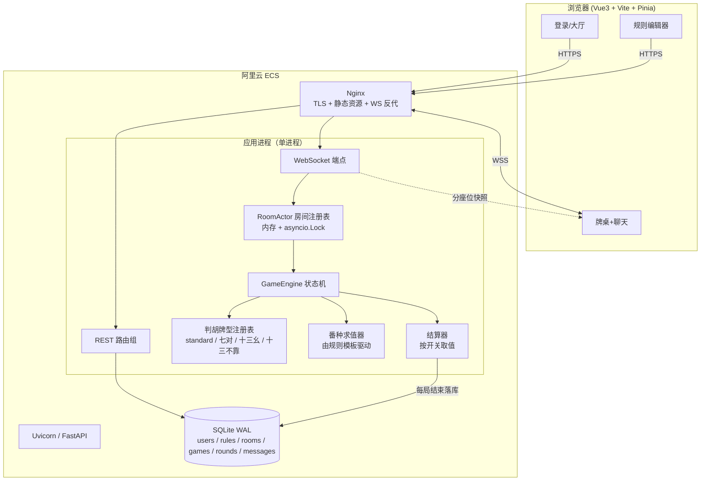

## 产品概述

一套面向家庭成员、部署在自有服务器上的在线麻将 Web 应用。家人用账号登录后凭邀请码开桌，系统自动洗牌发牌、判定吃碰杠胡并结算积分，牌桌旁配有实时文字聊天与局间系统播报。核心差异化能力是"规则模板"：房主在开局前选定一套可自定义的积分规则（底分、番种与番值、特殊牌型开关、杠分、封顶、出牌限时、听牌提示），选定后本局固定不变，从而让"自己定规矩"成为产品的一等公民。

## 核心功能

### 1. 家庭账号

- 管理员创建/停用家庭成员账号，家人用账号密码登录，登录状态可保持
- 个人昵称、头像色标；累计积分与历史战绩可长期留存
- 全站仅家庭内部使用，非公开注册

### 2. 自定义积分规则模板

- 规则模板可新建、复制派生、编辑、停用；预置若干套可直接用的模板
- 可配置项包括：底分、番数倍率算法（线性累加 / 2 的 N 次方）、封顶番数、番种清单及各番种的番值、番种之间的互斥关系、特殊牌型开关（标准胡、七对、十三幺、十三不靠）、吃牌是否允许、庄家与连庄处理、摸完荒庄是否罚分
- **三组「开关 + 从属配置」**（默认全部开启，与现有家庭玩法一致）：
- **出牌超时**：由 `turn_timeout.enabled` 控制是否限时，**仅在开关开启时**才显示并可填 `seconds`（默认 15 秒，范围 10–120）；关闭后轮到谁就无限等待，牌桌顶部显示"不限时"标记
- **杠分**：`kong_score.enabled` 总开关控制是否计分，**仅在开启时**才可填明杠 / 暗杠 / 补杠三个分值；关闭时**杠牌本身照常可以进行，只是不产生任何分数**（结算面板不出现杠分行、聊天播报仍记"杠"但无分数）
- **听牌提示**：`ting_hint.enabled` 控制轮到自己时是否展示"打这张能听什么牌"；关闭后服务端不下发听牌数据、前端不出现提示角标（既省算力也避免误看）
- 关闭状态下的从属值一律**忽略而非报错**：前端置灰禁用、后端在 `enabled=false` 时跳过对该字段的校验与取用，允许保留上次填写的值，方便来回切换开关
- 规则编辑采用表格化界面，可增删番种、填写番值与互斥组，保存前做合法性校验并给出中文错误提示
- 开桌时选定模板，牌桌顶部常驻显示当前规则摘要，对局中不可修改

### 3. 邀请码开桌与实时对局

- 房主创建房间后得到一个短邀请码，家人输入邀请码入座；支持观战/候补位
- 四人一桌，标准 136 张牌（不含花牌），庄家起手 14 张、闲家 13 张，杠后从牌尾补牌
- 支持出牌、吃、碰、明杠、暗杠、补杠、自摸胡、点炮胡、抢杠胡
- 系统自动校验每个操作的合法性，非法操作直接拒绝并提示原因；多人同时可操作时按"胡 > 碰/杠 > 吃"优先级仲裁，一炮单响
- 出牌限时（规则中开启时才生效）：倒计时可见，超时自动出牌或跳过，防止一人卡住全桌
- 听牌提示（规则中开启时才展示）：轮到自己时提示"打这张能听什么牌"
- 断线重连后自动恢复完整牌局视图，其他玩家的手牌始终不可见
- 每局结束弹出结算窗口：胡牌牌型、命中番种与番数、四家分数增减、当前累计积分；整局结束后可查看总账
- 移动端与桌面浏览器均可流畅使用，牌桌自适应布局

### 4. 实时聊天

- 牌桌侧边聊天面板，房间内所有成员（含观战者）可发送文字消息，消息实时到达
- 碰、杠、胡、超时等关键事件以系统消息形式自动播报在聊天流中，与玩家消息区分样式
- 后进入房间的人可看到本次房间的历史消息；支持消息频率限制与长度限制
- **语音聊天本期不做**：经确认不引入任何音频链路（既不做语音消息也不做 WebRTC 通话），全部沟通走文字 + 系统播报；协议与数据表不预留音频字段，保持链路干净

### 5. 战绩与统计

- 列表展示历史场次（时间、参与人、规则名、各自输赢分）
- 场次详情可查看每局明细，便于家人对账复盘
- 个人积分走势与常用规则的可视化概览

## 视觉要点

深墨绿麻将桌布配象牙白牌面、金色描边的东方雅致质感；牌面用矢量绘制（万用汉字数字、筒用圆点阵、条用竖向条纹），清晰易辨不依赖图片资源；出牌、吃碰杠、胡牌均有轻量的落位与高亮动效，当前可操作玩家座位有呼吸光环提示。

## 一、技术栈选型

| 层 | 选型 | 版本约束 | 选型理由 |
| --- | --- | --- | --- |
| 前端框架 | Vue 3 + TypeScript | vue ^3.5、typescript ^5.6 | 用户指定 Vue3；组合式 API 便于把"牌桌实时状态"收敛为可测的 composable |
| 构建工具 | Vite | vite ^5.4 | 冷启动快。**注意本机 Node 为 v16.20.0，Vite 5 要求 Node 18+**，见下方运行时决策 |
| 状态管理 | Pinia | ^2.2 | 官方推荐，store 可被 WS 事件直接驱动 |
| 路由 | vue-router | ^4.4 | 五页面路由 + 登录守卫 |
| 样式 | Tailwind CSS + 少量自定义 CSS 变量 | tailwindcss ^3.4 | 牌桌需要大量精确的手写定位与动效，Tailwind 做骨架、原生 CSS 做牌面绘制 |
| 组件库 | tdesign-vue-next | ^1.10 | 用于大厅列表、规则表格编辑器、弹窗、表单、开关；牌桌本体手写 |
| 后端框架 | FastAPI | fastapi >=0.115 | 原生 WebSocket + Pydantic 校验，规则配置的强校验直接复用 Pydantic |
| ASGI 服务器 | Uvicorn | uvicorn[standard] >=0.32 | `standard` 附带 websockets 与 uvloop |
| ORM / 迁移 | SQLAlchemy 2.0 + Alembic | sqlalchemy >=2.0.36、alembic >=1.14 | 同步 Session 足够（家庭规模），避免 async ORM 与内存房间状态混用带来的复杂度 |
| 数据库 | SQLite（WAL 模式） | — | 家庭规模（<20 用户、<10 并发）SQLite 完全够用且零运维；见 DB 选型说明 |
| 认证 | PyJWT ^2.9 + 标准库 `hashlib.scrypt` | — | 刻意不用 passlib（与新版 bcrypt 有兼容性坑），scrypt 为 Python 标准库，密码哈希零额外依赖，Python 3.13 无障碍 |
| 测试 | pytest ^8.3、pytest-asyncio ^0.24、httpx ^0.27 | — | 牌引擎与状态机必须有单测护栏 |


### 运行时硬约束与决策（必须先处理，否则装不上依赖）

1. **Node 16.20.0 无法运行 Vite 5**。主方案：升级本机 Node 至 20 LTS（Windows 用 nvm-windows 或官方 msi），升级后按上表锁定版本。备选方案（若用户拒绝升级）：降级为 `vite@4.5.5` + `@vitejs/plugin-vue@4.6` + `vue@3.4` + `typescript@5.4`，此组合支持 Node 16。计划采用**主方案**，并在 README 中写明备选。
2. **Python 3.13.7**：列出的依赖均支持 3.13；依赖清单必须写死版本下界，禁止 `latest`。虚拟环境用 `python -m venv .venv`。

### 数据库选型说明（家庭规模 vs 未来扩展）

选 **SQLite**：单文件、零运维、备份即拷文件，与"自有服务器、家庭自用"的定位完全匹配；开启 WAL 后并发读不阻塞。明确留好升级路径：所有表设计不依赖 SQLite 特有语法（JSON 字段用 SQLAlchemy 的 `JSON` 类型而非 `JSONB`），改用 `DATABASE_URL` 环境变量即可切换 PostgreSQL，无需改模型。

## 二、实现方案

### 2.1 总体策略

分三层推进，**先把"纯 Python 可验证的牌引擎"打透，再接实时通道，最后做界面**。牌引擎（洗牌、判胡、算番、结算）是不依赖网络与数据库的纯函数库，可以用 pytest 穷举验证；实时层只负责搬运状态与仲裁；前端只做展示与意图提交。这个顺序能把最易出错的逻辑隔离在可单测的边界内。

### 2.2 关键决策一：判胡采用"牌型插件注册表"

这是本项目最重要的架构决策。用户明确要求既支持标准胡又支持十三不靠，两者结构完全不同（十三不靠根本不构成面子），若把判胡写成单一递归函数，后期加牌型必然改核心代码。

方案：定义统一契约，所有牌型实现为独立模块并自注册到注册表。

```python
# app/game/patterns/base.py
class WinPattern(Protocol):
    id: str          # "standard" | "seven_pairs" | "thirteen_orphans" | "thirteen_unrelated"
    name: str        # 中文名，用于结算展示

    def match(self, ctx: "HandContext") -> bool: ...
    def calc_fan(self, ctx: "HandContext", rule: "RuleConfig") -> list["FanHit"]: ...
```

- 注册用装饰器 `@register_pattern`，`app/game/patterns/__init__.py` 导入即注册；引擎只做 `for p in registry: if p.match(ctx)` 的遍历，收集所有命中结果，取番数最高者。
- `HandContext` 携带：`counts: list[int]`（长度 34 的计数数组）、`melds: list[Meld]`（已吃碰杠的面子）、`win_tile: int`、`is_self_draw`、`seat_wind`、`round_wind`、`is_last_tile`、`is_robbing_kong`。
- 新增牌型（如"十三烂变体""组合龙"）只需加一个文件并实现两个方法，核心引擎零改动。

### 2.3 关键决策二：牌用 0-33 计数数组表示

牌型编码 `tile = suit * 9 + rank - 1`：0-8 万、9-17 筒、18-26 条、27-30 东南西北、31-33 中发白。手牌统一用 `list[int]` 长度 34 的计数数组。

- **算力**：34 元素数组的递归拆解，单次判胡在微秒级；听牌提示需对 34 种牌各试一次（约 34 次判胡），总耗时远小于 1ms，无需任何缓存或预计算表。杠后补牌、剩余牌数统计均为 O(1)。
- **避免的技术债**：不要用字符串或对象列表表示牌，否则判胡里的相邻/同花判断会充满 `if` 分支且速度慢十倍。

### 2.4 标准胡算法

递归拆解 + 回溯：对每个可能的将牌，尝试移除一个对子；再对剩余牌按"由小到大取第一张"，分别尝试移除刻子、移除顺子（仅数牌且同花色连续），递归至空则成功。每命中一种拆法都记录面子构成（用于计算"清一色""碰碰胡""一般高"等番），最终取全部拆法中番数最高的一种。已吃碰杠的面子先并入 `melds` 计数。

### 2.5 十三不靠的可配置实现

十三不靠在不同地区定义不一（是否要求字牌齐全、是否算 1 对将、数牌间隔要求），因此实现为**受规则模板参数驱动的单文件插件**：规则模板中该牌型带子参数 `require_all_honors`（七星不靠）、`allow_pair`（十三不靠 vs 全不靠）、`min_gap`（数牌最小间隔）。匹配条件：门前清（无吃碰杠）、各类牌不重复、同花色数牌间隔不小于 `min_gap`、按参数决定是否必须有 7 种字牌、可含 1 个对子。这样"改规则"是改配置而不是改代码，正是用户的核心诉求。

### 2.6 关键决策三：番种由"规则模板数据"驱动，不由代码写死

番种表是规则模板 JSON 的一部分：`fan_table: [{id, name, fan, exclusive_group, requires: [...], stackable}]`。

- 求值流程：牌型插件产出候选番种 id 集合 → 番种求值器按 `exclusive_group` 做去重（同组取番值最高）→ 按 `requires` 校验前置条件（如"清一色"蕴含"无字牌"）→ 汇总总番 → 按 `fan_mode`（线性 / 2 的 N 次方）与 `fan_cap` 折算为分数。
- 好处：用户新增一个"金钩钓 +2 番"的自定义番种，只需在界面加一行，无需发版。

### 2.7 关键决策四：可选规则项统一用「开关 + 从属配置」模型

出牌超时、杠分、听牌提示在语义上都是"可选能力 + 参数"，因此统一建模为**嵌套对象 + `enabled` 标志**，而不是用一个裸字段靠 `0` / `null` / `-1` 这类魔法值表达"未启用"。后者会让校验、界面禁用态、结算取值三处各自猜测语义，是最容易积累脏逻辑的地方。

```python
class ToggleValue(BaseModel):
    enabled: bool = True
    value: int | None = None          # enabled=False 时忽略，允许为 None

class TurnTimeout(BaseModel):
    enabled: bool = True              # 关闭 = 不限时
    seconds: int = 15                 # 仅 enabled=True 时校验，范围 10–120

class KongScore(BaseModel):
    enabled: bool = True              # 关闭 = 仍可杠，但不计分
    exposed: int = 1                  # 明杠
    hidden: int = 2                   # 暗杠
    added: int = 1                    # 补杠

class RuleConfig(BaseModel):
    ...
    turn_timeout: TurnTimeout
    kong_score: KongScore
    ting_hint: ToggleValue            # 仅使用 enabled
```

- **杠分粒度**：本期按用户确认实现为**总开关**——关闭后杠牌照常可进行（引擎不拦截吃碰杠的合法性），只是结算时三类杠分全按 0 处理。若日后要"只给暗杠计分"，把 `exposed/hidden/added` 各自升级为 `ToggleValue` 即可，引擎接口不变。
- **校验规则**：`enabled=True` 时才校验从属值范围（超时 10–120 秒、杠分 0–20）；`enabled=False` 时既不校验也不取用，但保留原值，让用户来回切开关时不会丢已经填好的数字。
- **取值纪律**：结算器与快照生成器必须先判 `rule.kong_score.enabled` 再读分值；**禁止直接读 `rule.kong_score.exposed` 参与运算**，否则关掉开关后会静默加分，且这种 bug 只在特定规则下出现，极难被察觉。
- **超时关闭不影响 ClaimWindow**：碰杠胡询问窗口的 8 秒超时是防"迟迟不响应"的保护机制，与"出牌限时"是两件独立的事，前者永远开启、不随该开关关闭。
- **听牌提示关闭的收益**：轮到自己时不再执行 34 次判胡，也不在快照里下发 `tenpai` 字段，前端连角标都不渲染。

### 2.8 关键决策五：对局状态机与动作仲裁窗口

显式状态：`WAITING → DEALING → TURN_DRAW → TURN_DISCARD → CLAIM_WINDOW → (回到 TURN_DRAW | SETTLE)`。

- 出牌后不立即执行碰杠，而是**开启 ClaimWindow**：引擎先算出所有合法动作，把候选集分别推给对应座位；用 `asyncio` 定时任务做 8 秒超时，或全部候选者都提交了"过/动作"后立即关闭窗口；关闭时按 **胡 > 碰/杠 > 吃** 仲裁，同优先级按打牌者的逆时针下家优先（一炮单响）。
- 为什么不用"先到先得"：网络抖动会让手速快的人拿到本不该属于他的碰，仲裁窗口能让结果与网络状况无关、可复现。
- 每个房间一个 `asyncio.Lock`，所有状态变更串行化，杜绝并发写坏状态。

### 2.9 关键决策六：服务端权威 + 分座位快照

- 所有合法性校验（能否吃/碰/杠/胡、是否轮到该座位）在服务端完成，前端提交的只是"意图"。
- 洗牌只用服务端 `secrets`/`random.SystemRandom`，牌墙绝不下发。
- 状态推送分两类：`event.*` 增量事件（谁打了什么牌，公开信息）+ `state.snapshot` 全量快照。**快照按连接逐座位生成**，只把自己的手牌明文下发，其他座位只给手牌张数与副露，从协议层杜绝"抓包看别人牌"。
- 断线重连：WS 断开后保留座位 3 分钟；重连携带 JWT 与房间码，服务端重新绑定连接并推一次分座位快照即可完整恢复。

### 2.10 关键决策七：为什么不上 Redis / 消息队列

家庭规模实际并发 < 10 人、最多 2-3 桌。房间状态放单进程内存 `dict[str, RoomActor]` + `asyncio.Lock` 即可，延迟最低、无额外依赖。代价是**进程重启会丢失进行中的牌局**——通过"每局结束立即把结果落库"来控制损失：重启最多丢当前未结束的一局，历史积分不受影响。该权衡在文档中显式说明，并预留 `RoomStore` 接口，日后要多进程部署时换成 Redis 实现即可。

### 2.11 WebSocket 协议

统一信封：`{"v":1,"type":"...","seq":n,"ts":1700000000,"data":{...}}`

- C→S：`auth`、`room.join`、`room.leave`、`seat.ready`、`game.start`、`game.action`（`{action:"discard|chow|pong|kong|hu|pass", tiles:[...]}`）、`chat.send`、`state.resync`、`ping`
- S→C：`state.snapshot`、`event.dealt|drawn|discarded|claimed|kongged|won|settled|turn_changed`、`chat.message`、`error`（带中文 `code` 与 `message`）、`pong`
- 快照中的可选字段随规则开关变化：`turn_timeout.enabled=false` 时不下发 `deadline`；`ting_hint.enabled=false` 时不下发 `tenpai_tiles`
- 所有 `error` 必须可读，例如 `{"code":"NOT_YOUR_TURN","message":"还没轮到你出牌"}`。

### 2.12 数据模型（表设计要点）

| 表 | 关键字段 | 说明 |
| --- | --- | --- |
| `users` | id, username(uniq), display_name, password_hash, role(admin/member), color, is_active, created_at | 密码存 `scrypt` 的 `salt$hash` 串 |
| `rule_templates` | id, owner_id, name, description, config(JSON), is_preset, is_active, created_at, updated_at | `config` 由 Pydantic `RuleConfig` 校验，内嵌 `turn_timeout` / `kong_score` / `ting_hint` 三组开关；预置模板 `owner_id` 为空 |
| `rooms` | id, code(uniq), name, host_id, rule_template_id, rule_snapshot(JSON), status, created_at, closed_at | **`rule_snapshot` 存开房时模板快照**，模板后续被改不影响历史对局 |
| `games` | id, room_id, rule_snapshot(JSON), status, started_at, ended_at | 一场牌 |
| `game_rounds` | id, game_id, round_no, dealer_seat, winner_seat, win_type(self_draw/discard/none), winning_tile, pattern_id, fan_items(JSON), fan_total, score_delta(JSON), finished_at | 每局结果，对账与复盘依据 |
| `game_players` | game_id, seat, user_id, total_score, UNIQUE(game_id, seat) | 座位与场次总分 |
| `room_messages` | id, room_id, user_id(nullable=系统消息), kind(chat/system), content, created_at | 索引 `(room_id, id desc)`；本期无音频字段 |


### 2.13 前端要点

- `api/ws.ts` 封装单例 WebSocket：自动重连（指数退避）、心跳、`seq` 去重、断线后自动 `state.resync`。
- `stores/game.ts` 只存服务端快照 + 已应用的事件，所有"我现在能不能吃/碰/杠/胡"由快照里的 `legal_actions` 决定，**前端不自行判断规则**。
- 牌面绘制：`Tile.vue` 纯 CSS/SVG 渲染（万用汉字数字，筒用 grid 圆点，条用竖向条纹，字牌用汉字），不依赖图片，任意分辨率清晰。
- **开关联动组件** `SwitchField.vue`：左侧开关、右侧从属输入，`enabled=false` 时从属控件 `disabled` 并降低透明度、保留原值不重置；三个规则项（超时/杠分/听牌）复用它，避免三份各写一遍禁用逻辑。
- 规则编辑器 `FanTableEditor.vue`：可增删行、设置番值、选择互斥组，保存前调后端校验接口，错误行内高亮。

## 三、系统架构



## 四、目录结构

```
004-majiang/
├── README.md                          # 项目说明、启动步骤、Node 版本要求与备选降级方案
├── docs/
│   ├── 规则设计.md                     # 规则模板全部字段（含三组开关的语义）、番种定义、十三不靠参数说明
│   ├── 协议.md                        # WebSocket 信封、全部消息类型与示例、错误码表
│   └── 部署.md                        # 阿里云部署全流程
├── backend/
│   ├── requirements.txt               # [NEW] 固定版本下界的依赖清单
│   ├── .env.example                   # [NEW] SECRET_KEY / DATABASE_URL / CORS / TOKEN_TTL
│   ├── alembic.ini                    # [NEW] 迁移配置
│   ├── alembic/versions/              # [NEW] 初始建表迁移
│   ├── app/
│   │   ├── main.py                    # [NEW] 应用装配：路由、CORS、启动时建预置模板、健康检查
│   │   ├── core/
│   │   │   ├── config.py              # [NEW] pydantic-settings 读环境变量
│   │   │   ├── security.py            # [NEW] scrypt 哈希校验、JWT 签发/解析
│   │   │   ├── deps.py                # [NEW] get_db / get_current_user / require_admin
│   │   │   └── logging.py             # [NEW] 统一日志格式，禁止记录密码与手牌明文
│   │   ├── db/
│   │   │   ├── base.py                # [NEW] Declarative Base、SessionLocal、engine（SQLite 开启 WAL）
│   │   │   └── models.py              # [NEW] 上述 7 张表的 ORM 模型
│   │   ├── schemas/
│   │   │   ├── auth.py                # [NEW] 登录/用户管理请求响应模型
│   │   │   ├── rule.py                # [NEW] RuleConfig / FanItem / PatternOptions / ToggleValue / TurnTimeout / KongScore，含跨字段校验器（封顶合法性、互斥组不冲突、番种 id 唯一、开关关闭时跳过从属校验）
│   │   │   ├── room.py                # [NEW] 建房/进房/房间信息
│   │   │   └── ws.py                  # [NEW] 信封与全部消息的 Pydantic 模型（前后端契约单一来源）
│   │   ├── api/
│   │   │   ├── router.py              # [NEW] 聚合路由前缀 /api
│   │   │   ├── auth.py                # [NEW] POST /login、GET /me
│   │   │   ├── users.py               # [NEW] 管理员增删改家庭成员
│   │   │   ├── rules.py               # [NEW] 规则模板 CRUD、复制、预置列表、POST /validate
│   │   │   ├── rooms.py               # [NEW] 建房（生成 6 位邀请码）、按码查询、开桌、关闭
│   │   │   ├── history.py             # [NEW] 场次列表、场次详情、个人统计
│   │   │   └── ws.py                  # [NEW] /ws 端点：鉴权 → 绑定连接 → 分发到 RoomActor
│   │   ├── game/
│   │   │   ├── tiles.py               # [NEW] 牌编码、名称映射、造墙、SystemRandom 洗牌、剩余牌数
│   │   │   ├── hand.py                # [NEW] HandContext 与手牌增删、副露结构、听牌计算
│   │   │   ├── patterns/
│   │   │   │   ├── base.py            # [NEW] WinPattern 协议、FanHit、注册表与 @register_pattern
│   │   │   │   ├── __init__.py        # [NEW] 导入全部牌型以触发注册
│   │   │   │   ├── standard.py        # [NEW] 标准 4 面子 1 将：递归拆解 + 多解取最大番
│   │   │   │   ├── seven_pairs.py     # [NEW] 七对（含豪华七对子参数）
│   │   │   │   ├── thirteen_orphans.py# [NEW] 十三幺
│   │   │   │   └── thirteen_unrelated.py # [NEW] 十三不靠/七星不靠，由 PatternOptions 驱动
│   │   │   ├── fan.py                 # [NEW] 番种求值：互斥组去重、requires 校验、总番汇总、封顶
│   │   │   ├── scoring.py             # [NEW] fan_mode 折算、杠分（先判 kong_score.enabled）、自摸/点炮分账、荒庄处理
│   │   │   ├── claims.py              # [NEW] ClaimWindow：候选计算、固定 8 秒超时、优先级仲裁
│   │   │   └── engine.py              # [NEW] GameEngine 状态机：发牌、摸打、吃碰杠胡、补牌、结算、可选出牌超时
│   │   ├── realtime/
│   │   │   ├── manager.py             # [NEW] 连接注册表、断线保座 3 分钟、心跳
│   │   │   ├── room.py                # [NEW] RoomActor：座位、状态锁、事件广播、聊天节流
│   │   │   └── snapshot.py            # [NEW] 逐座位生成快照（隐藏他人手牌、按开关裁剪 deadline / tenpai）
│   │   └── seeds/presets.py           # [NEW] 4 套预置规则模板（家庭标准 / 宽松无吃 / 带十三不靠 / 休闲不限时不计杠分）
│   └── tests/
│       ├── test_tiles.py              # [NEW] 牌编码、造墙张数 136、洗牌不丢牌
│       ├── test_patterns_standard.py  # [NEW] 大量已知胡/不胡牌例、带副露、多解取最大番、听牌计算
│       ├── test_patterns_special.py   # [NEW] 七对/十三幺/十三不靠各参数组合的正反例
│       ├── test_fan.py                # [NEW] 互斥去重、requires、封顶、线性与 2^N 两种折算
│       ├── test_rule_switches.py      # [NEW] 三组开关：关闭时杠不计分仍可杠、超时关闭不产生 deadline、听牌关闭不下发、从属脏值被忽略
│       ├── test_scoring.py            # [NEW] 自摸/点炮/杠分（含开关关闭）/荒庄的分账正确性
│       └── test_engine_flow.py        # [NEW] 完整一局流程、仲裁优先级、抢杠胡、超时跳过（纯逻辑，不含网络）
└── frontend/
    ├── package.json                   # [NEW] 锁定版本，engines 声明 node >=20
    ├── vite.config.ts                 # [NEW] 开发代理 /api 与 /ws 到后端
    ├── tailwind.config.js             # [NEW] 主题色、牌桌尺寸令牌
    ├── index.html                     # [NEW]
    └── src/
        ├── main.ts                    # [NEW] 挂载 Pinia、Router、TDesign
        ├── App.vue                    # [NEW] 全局布局与 Toast
        ├── router/index.ts            # [NEW] 五页面路由 + 登录守卫
        ├── api/http.ts                # [NEW] fetch 封装：JWT 注入、401 跳登录、错误提示
        ├── api/ws.ts                  # [NEW] WS 单例：重连退避、心跳、seq 去重、resync
        ├── stores/auth.ts             # [NEW] 当前用户与 token 持久化
        ├── stores/game.ts             # [NEW] 快照 + 事件规约，暴露 legal_actions 与派生 UI 状态
        ├── stores/chat.ts             # [NEW] 消息列表、未读计数、发送
        ├── views/LoginView.vue        # [NEW] 账号密码登录
        ├── views/LobbyView.vue        # [NEW] 房间列表、邀请码加入、建房选规则、成员管理入口
        ├── views/RulesView.vue        # [NEW] 规则模板列表 + 编辑器
        ├── views/RoomView.vue         # [NEW] 牌桌页：状态机驱动渲染、动作条、结算弹窗、聊天侧栏
        ├── views/HistoryView.vue      # [NEW] 战绩列表与场次详情、个人统计
        ├── components/table/Tile.vue          # [NEW] 纯 CSS/SVG 牌面渲染，支持大小与高亮态
        ├── components/table/HandTiles.vue     # [NEW] 自己手牌，可点选出牌，自动排序与听牌标记
        ├── components/table/DiscardRiver.vue  # [NEW] 四家牌河，按行折行排列
        ├── components/table/PlayerSeat.vue    # [NEW] 对手区：昵称、手牌数、副露、积分、状态光环
        ├── components/table/ActionBar.vue     # [NEW] 吃/碰/杠/胡/过/提示，仅在 legal_actions 允许时出现
        ├── components/table/TurnTimer.vue     # [NEW] 出牌倒计时环，规则关闭时不渲染
        ├── components/table/ResultModal.vue   # [NEW] 局末结算：番种明细、分数增减动画（杠分关闭时不显示杠分行）
        ├── components/table/ScoreBoard.vue    # [NEW] 顶部规则摘要（含「不限时」「杠不计分」标记）与四家累计分
        ├── components/ChatPanel.vue           # [NEW] 聊天流 + 输入框 + 系统消息样式区分（仅文字）
        ├── components/SwitchField.vue         # [NEW] 开关 + 从属输入的联动封装，关闭时置灰保留原值
        ├── components/RuleForm.vue            # [NEW] 规则基础字段 + 三组开关表单
        ├── components/FanTableEditor.vue      # [NEW] 番种表格增删改 + 行内校验错误提示
        └── styles/theme.css                   # [NEW] 设计令牌、牌桌布局、动效关键帧
```

## 五、实施注意

- **登录与密码**：密码用 `hashlib.scrypt` 加随机盐，存储格式 `scrypt$n$r$p$salt$hash`；JWT `SECRET_KEY` 从环境变量读取，`.env` 不入库；首个管理员通过启动时读取 `ADMIN_INIT_PASSWORD` 环境变量创建，避免默认弱口令。
- **规则开关的一致性**：开关"关闭"必须在**服务端**体现为不计算、不下发、不展示，而不只是前端隐藏控件；新增任何可选规则项一律遵循「`enabled` + 从属值」模型，**禁止用 0 / null / -1 表示未启用**。三处必须同时对齐：Pydantic 校验、结算取值、快照字段裁剪。
- **日志纪律**：记录房间码、座位、动作类型、耗时；**绝不记录手牌明文、密码、JWT**；每局结束打一条结构化汇总日志便于排查"分数不对"，并显式打印生效的规则开关状态，便于复盘"为什么这局没算杠分"。
- **性能**：判胡为 O(拆法数) 的微秒级操作，不做缓存；牌桌每步只广播必要的增量事件 + 受影响的快照，**不要每步广播全量快照**；聊天广播与会话广播分开处理，聊天节流 1 条/秒。
- **爆炸半径**：规则模板用"开房时快照"隔离，改模板绝不影响进行中或历史对局；牌型插件注册表新增文件不动引擎；前端不复制任何规则判断逻辑，防止规则双写。
- **可靠性**：所有 WS 消息处理包在同一 try/except 中，单条消息异常不得踢掉连接或影响房间其他人，只回 `error`；`game.action` 全部幂等（重复提交同一动作返回当前状态而非报错），防止网络重试导致重复出牌。
- **时区与显示**：数据库存 UTC，前端按本地时区渲染，避免家人在不同时区对账混乱。

## 设计风格

东方雅致 + 现代棋盘质感。以深墨绿桌布为视觉基底，象牙白牌面配金色细描边，形成"实体牌桌搬到屏幕"的沉浸感；信息层用克制的留白与轻玻璃拟态浮层，让规则与分数不抢牌局视觉焦点。整体关键词：沉稳、温润、精致、可读。

## 应用类型

Web 优先，桌面为基准设计（最小宽度 1280px 时牌桌完整展开），向下自适应到手机横屏与竖屏；移动端把聊天面板收起为抽屉，动作按钮放大到可拇指操作。

## 页面规划（5 页）

### 1. 登录页

- 左侧品牌区：深绿渐变底 + 缓慢漂浮的牌面剪影动效 + 「家庭麻将」题字与一句家训式副标题
- 右侧登录卡：账号、密码、登录按钮，玻璃拟态卡面，输入框聚焦时金色描边发光
- 底部状态条：服务连接状态指示灯与版本号
- 失败反馈：卡片上方滑入条状提示，不弹窗

### 2. 大厅

- 顶部导航：品牌标识、剩余积分概览、当前用户名与头像色标下拉（含退出）
- 主区左栏「我的房间」：卡片列表，展示房间名、规则名、人数、状态，点击进入；右上角「创建房间」主按钮
- 主区右栏「加入房间」：6 位邀请码输入，分成 6 个独立格，输入自动跳格，输满自动查询
- 快捷入口横条：我的规则模板、历史战绩、成员管理（管理员可见）
- 空状态：一张孤零零的牌面插画 + 「还没有房间，开一桌吧」行动按钮

### 3. 规则编辑器

- 顶部：模板名与版本信息，右侧「保存」「复制为新模板」按钮
- 基础设置卡片：底分、番数算法（线性 / 2 的 N 次方切换开关）、封顶番数、吃牌开关，两列栅格排布
- **联动开关区**（统一用 `SwitchField`：左开关、右从属输入，关闭时输入置灰不可点、数值保留）：
- 出牌超时：开关 + 秒数输入（默认 15，范围 10–120）；关闭后右侧显示「不限时」灰字说明
- 听牌提示：开关 + 说明「关闭后牌桌不再显示听牌角标，也不占用服务端算力」
- 杠分：开关 + 明杠 / 暗杠 / 补杠三个分值输入；关闭时三个输入整体置灰，并显示提示「关闭后仍可杠，但不计分」
- 牌型开关区：四张可切换卡（标准胡 / 七对 / 十三幺 / 十三不靠），启用十三不靠时展开进阶参数（必须全字牌、允许一对将、最小间隔）
- 番种表区：可编辑表格，列为番种名、番值、互斥组、是否可叠加、操作；支持行内联编辑与「添加番种」行；非法行整行浅红底并附中文提示
- 荒庄策略区：荒庄是否罚分单选 + 庄家连庄规则
- 右侧吸顶预览栏：实时显示「示例：底分 1，清一色 6 番 + 自摸 1 番 = 2^7 → 128 分」，并在下方用灰字列出当前生效开关摘要（限时 15 秒 / 杠分 1-2-1 / 听牌提示开）

### 4. 牌桌（核心）

- 顶部信息条：房间名与邀请码（可复制）、当前规则摘要胶囊（点击展开完整规则浮层，含三个开关的当前状态）、剩余牌数、本局序号、退出按钮
- 四家座位带：上、左、右为对手区，显示昵称、手牌数量（背面牌叠）、副露、本局已得分、状态标记（思考中 / 已过牌 / 断线）；当前行动者座位有金色呼吸光环；有出牌限时时座位旁显示倒计时环，不限时时**不显示**该环
- 中央牌河区：四家弃牌分区排布，最近一张打出牌有轻微放大与描边高亮；中央显示剩余牌堆叠厚度示意
- 底部自己的手牌区：牌面较大且可点选，选中上浮 8px，可打出的牌在听牌提示开启时带淡金底；右侧并排副露
- 浮动动作条：吃、碰、杠、胡、过，仅在服务端允许时出现，从下向上滑入，胡牌按钮使用暖红主色并带轻微脉动；杠分关闭时杠按钮的悬浮提示写「此规则下杠不计分」
- 结算浮层：居中卡片，逐条展开命中的番种与番数，右侧四家分数增减数字滚动动画，底部「下一局」按钮；杠分关闭时空分项不渲染
- 右侧聊天抽屉：默认展开宽 320px，消息气泡区分自己（金边）与他人（半透明底），系统消息为居中小字灰绿胶囊；顶部未读红点，输入框带发送快捷键提示（仅文字输入，无语音按钮）

### 5. 战绩

- 顶部筛选条：时间范围、参与人、规则模板三个下拉
- 场次列表：每行显示时间、规则名、参与人色标头像组、我的输赢分（正为金绿、负为暖红）
- 场次详情抽屉：逐局明细表，含胡牌者、牌型、番种、四家分数变化，支持按局号定位；顶部标注该场生效的规则开关，便于解释"这局为什么没有杠分"
- 个人统计卡：累计积分、参与场次、最高单局得分，配一条简洁的积分走势折线

## 交互与动效

- 牌面落桌采用 180ms 缓出缩放 + 轻微旋转归正；吃碰杠时副露组合从牌河滑入副露区
- 自己摸牌有 200ms 淡入上移；轮到行动时座位光环做 2.4s 呼吸循环，不刺眼
- 结算数字用 600ms 缓动计数；违规操作以牌桌中央短促抖动提示代替弹窗
- 规则编辑器里切换开关时，从属输入用 150ms 高度与透明度过渡收起/展开，让"联动"关系一眼可见
- 所有动效尊重 `prefers-reduced-motion`，关闭后仅保留状态切换
- 键盘与触屏双通道：数字键 1-9 快速选牌，回车出牌

## 响应式

- ≥1280px：四家座位环绕完整牌桌 + 常驻聊天侧栏
- 768-1279px：聊天折叠为可拖出抽屉，座位带压缩为紧凑版
- <768px：牌桌纵向布局，对手区收为顶部两行，手牌区横向可滑动，动作条底部固定并放大到 56px 高触控目标

## Agent Extensions

### Skill

- **playwright-cli**
- Purpose: 在牌桌页面开发完成后，用真实浏览器多标签页模拟两位家庭成员登录同一房间，走通"建房 - 加入 - 准备 - 开局 - 出牌 - 聊天 - 结算"完整链路，并额外验证规则开关联动（关闭出牌超时后倒计时环消失、关闭杠分后杠牌可执行但结算无杠分行、关闭听牌提示后无角标），截图核对视觉与交互
- Expected outcome: 产出可复现的联机冒烟验证结果（每步截图 + 关键断言通过），确认 WebSocket 实时联动、聊天广播、断线重连、三组开关的界面联动与结算结果一致

- **agent-browser**
- Purpose: 对部署到阿里云后的生产地址做一次端到端验证：检查 HTTPS 是否生效、WebSocket over TLS 能否正常握手、静态资源加载与登录流程是否可用
- Expected outcome: 得到生产环境的可访问性结论与关键页面截图，确认 Nginx 反向代理与 WSS 配置无误