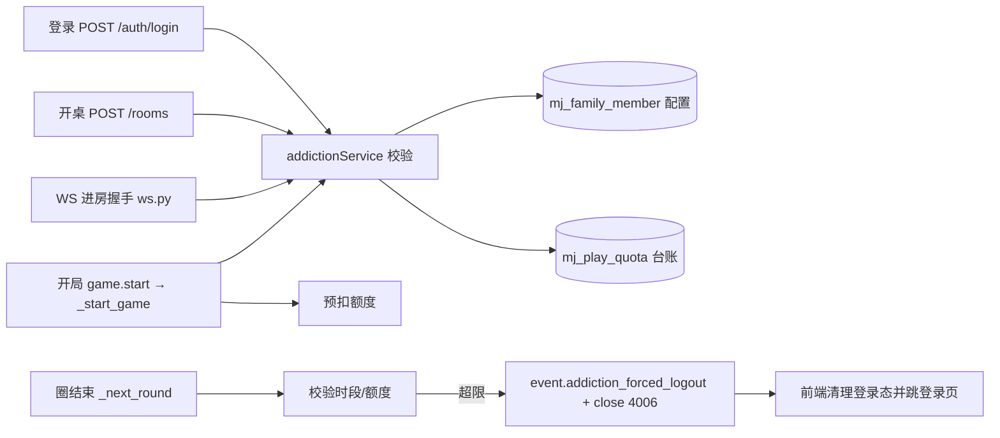

## 用户需求

为家庭麻将增加「防沉迷机制」，先产出一份设计文档 `plan/防沉迷机制.md`（后续按文档实施）。

## 产品概述

家庭管理员可为每位成员配置两项限制，系统在登录、开桌、进房、开局、每圈结束等关键节点校验，超限时给出明确中文提示并强制退出牌桌。

## 核心特性

**规则一：每日圈数上限**

- 按个人统计，自然日 0:00–24:00 一个周期，例如「每天最多 8 圈」。
- 采用「按开桌圈数预扣」口径：开局即按本桌设定圈数占用当日额度；提前散局时按实际完成圈数结算并回补剩余额度。
- 额度不限可配置为「不限」。

**规则二：禁玩时段（有孩子的成员）**

- 管理员为成员开启后设置禁玩时段，例如 17:00–22:00 禁止打牌，其余时间可玩。
- 支持跨零点时段（如 23:00–07:00）。
- 管理员/家长默认可豁免（可配置）。

**拦截点（4 个卡点）**

1. 登录：命中禁玩时段或当日额度已用完，登录被拒绝，登录页直接展示原因与「可玩时间 / 剩余圈数」。
2. 开桌与进房：受限成员无法创建房间，凭邀请码进房时被挡在门口，牌桌不出现该玩家。
3. 开局：四人中任一人受限则拒绝开局，并指明是谁、为什么；全员通过后完成额度预扣。
4. 每圈结束：系统检查时间与额度，超限者打完当前这一圈后被强制登出——牌桌即时广播「某某因休息时段已下桌」，该玩家界面弹窗说明原因并跳回登录页，其余三人可继续。

**配置与查看**

- 家庭管理员在家庭成员管理页为每位成员设置：是否启用、每日圈数上限、禁玩时段起止。
- 普通成员只读，可在牌桌/大厅看到自己的「今日剩余圈数 / 禁玩时段」标签。
- 被拦截或踢出时统一使用中文文案，说明具体规则与恢复时间，避免只显示错误码。

**视觉与交互**

- 成员行新增「防沉迷」入口与状态徽标（不限 / N 圈·时段 HH:MM-HH:MM），沿用现有深色牌桌主题与金色强调色。
- 设置以侧滑面板（PC 弹窗、手机底部抽屉）呈现，含开关、圈数选择（不限/4/8/12/16）、时段起止时间选择与实时预览文案；保存后行内徽标即时更新。

## 技术栈

沿用现有全栈，不引入新框架：

- 后端：Python 3.10 + FastAPI + MySQL 8.0（表定义源 `code/backend/src/database/*.txt`，生成器 `mysqlCodeGenerator.py`，建表 `tools/initTables.py`），实时牌桌为 `realtime/room.py` 的 `RoomActor`（进程内 actor + WebSocket）
- 前端：Vue3 + TypeScript + Pinia + Tailwind（PC 与 mobile 两套视图共用 store 与请求封装）
- 交付物：`plan/防沉迷机制.md` 设计文档（本次不改业务代码）

## 实现方案

**核心策略**：把「限制配置」放在家庭关系上、把「用量」放在按日台账表、把「校验」收敛到 4 个已有函数入口，另加 1 个强制登出动作。全部为新增能力，默认关闭，对存量玩家零影响。

关键决策与理由：

1. **配置落 `mj_family_member` 而非 `mj_user_pref`**：限制是「家庭管理员对成员」的关系，同一用户在不同家庭可有不同限制；`mj_user_pref` 按 loginID 唯一，无法表达家庭维度。生效家庭取 `current_family` 语义（`deps.py` 的 `current_family`）。
2. **用量用「预扣台账」而非实时聚合**：用户选择预扣口径，`mj_game_round` 只能表达"已打完"，无法表达"已占用未消耗"；因此新增 `mj_play_quota`，一行 = 一次开局的额度占用，`reservedCircles` 为预扣、`consumedCircles` 为已打圈数，散场时把 `reservedCircles` 收敛为 `consumedCircles` 完成回补。日占用 = `SUM(reservedCircles)`，口径单一、可审计。
3. **默认关闭 + 逐成员开关**：`addictionEnabledFlag='0'` 为默认，避免上线即误伤；管理员按需开启。
4. **强制登出复用 WS 通道**：`RoomActor` 已持有 `conns[loginID]` 的 websocket 集合（`room.py:739 send()`），新增 `event.addiction_forced_logout` 下行事件 + `close(code=4006)`，前端 `ws.ts` 的 onclose 兜底跳登录页，避免"只提示不生效"。
5. **时段判定用服务器本地时间字符串**：全站时间统一走 `common/miscCommon.py` 的 `getTime()`（Asia/Shanghai，`YYYYMMDDHHMMSS`），截取 `HHMM` 做整数区间比较，跨零点用 `start > end` 分支处理，不引入新时区库。

**性能与可靠性**

- 额度查询按 `(loginID, quotaDate)` 索引命中，单次 O(log n)；开局时 4 名玩家用一次 `IN` 批量查，避免 N+1。
- 预扣写入用 `INSERT ... ON DUPLICATE KEY UPDATE`（`quotaKey` 唯一），保证重复开局/重连幂等，不会重复扣额度。
- 圈结束校验为内存态计算（时间比较 + 已有台账行），无额外 DB 往返，不影响牌局节奏。
- 台账写失败按现有 `_persist` 口径处理（`persist.PersistError` → `_notifyWriteFailed`），不阻断打牌（内存态优先），与 `open_game/close_game` 的既有策略一致。

**错误码（沿用 04 协议风格）**

| 场景 | HTTP / WS | code | 文案示例 |
| --- | --- | --- | --- |
| 登录命中禁玩时段 | 403 | `ADDICTION_CURFEW` | 现在是休息时段（17:00-22:00 禁止打牌），22:00 之后再来 |
| 登录额度用尽 | 403 | `ADDICTION_QUOTA` | 今天的 8 圈额度已用完，明天再来 |
| 进房被拒 | WS close 4006 | `ADDICTION_FORBIDDEN` | 你今天不能打牌：额度已用完 |
| 开局被拒 | error 帧 | `ADDICTION_PLAYER_LIMITED` | 张三今天额度已用完，换人再来 |
| 圈结束踢出 | event + close 4006 | `ADDICTION_FORCED_LOGOUT` | 已到休息时段，本圈打完后已下桌 |


## 架构设计



组件关系：

- **配置层**：`main/api/families.py` 成员端点扩展字段 + `schemas/family.py` 模型扩展 + `processor/familyService.py` 校验与落库
- **判定层**：新增 `processor/addictionService.py`（纯逻辑：`checkCurfew` / `checkQuota` / `reserve` / `settle` / `quotaSummary`），被 4 个卡点调用
- **实时层**：`realtime/room.py` 的 `_start_game`（开局预扣 + 拒绝）、`_next_round`（圈结束校验与踢出）、`_finish_game`/`_end_game`（散场回补）
- **数据层**：`common/mysqlCommon.py` 手写区新增 `query_mj_play_quota_*` / `insert_mj_play_quota` / `update_mj_play_quota_reserved`

## 数据模型增量（草案，实施时并入 02-数据库设计.md）

`mj_family_member` 新增 4 列（沿用 `Flag` / `xxxID` 命名与审计尾列规范，无外键）：

- `addictionEnabledFlag CHAR(1) NOT NULL DEFAULT '0'`：启用防沉迷
- `dailyCircleLimit INT NOT NULL DEFAULT 0`：每日圈数上限，0 表示不限
- `forbidStartHHMM VARCHAR(4) NULL`：禁玩开始时刻 `HHMM`
- `forbidEndHHMM VARCHAR(4) NULL`：禁玩结束时刻 `HHMM`

新增表 `mj_play_quota`（一行 = 一次开局的额度占用）：

```text
recID INT AUTO_INCREMENT PRIMARY KEY
quotaKey VARCHAR(80) NOT NULL UNIQUE      -- quotaDate_familyID_loginID_gameID
familyID INT NOT NULL
loginID VARCHAR(32) NOT NULL
quotaDate VARCHAR(8) NOT NULL              -- YYYYMMDD（Asia/Shanghai）
roomID INT NOT NULL DEFAULT 0
gameID INT NOT NULL DEFAULT 0
reservedCircles INT NOT NULL DEFAULT 0     -- 预扣圈数
consumedCircles INT NOT NULL DEFAULT 0     -- 已完成圈数
quotaStatus VARCHAR(16) NOT NULL DEFAULT 'RESERVED'   -- RESERVED/SETTLED
label / memo / regID / regYMDHMS / modifyID / modifyYMDHMS / delFlag
```

索引（`database/indexes.txt` 追加）：`mj_play_quota idx_mjpq_login loginID,quotaDate`、`mj_play_quota idx_mjpq_family familyID,quotaDate`。

需同步：`database/*.txt` → 重新生成 `auto_generated/auto_gen_code_*.py` → `tools/initTables.py` 升 `_VERSION`/`SCHEMA_VERSION_CODE`（提案 `20261127_01`）；生产 DDL 走「备份 + 测试库 `mahjong_test` 演练 + 保留回滚语句（`DROP COLUMN`/`DROP TABLE`）」。

## 服务端改动清单（文档中逐条列出，附行号）

| 卡点 | 位置 | 改动 |
| --- | --- | --- |
| 登录 | `main/api/auth.py:37 login()` | 家庭列表解析后调 `addictionService.checkLogin`，命中抛统一错误体 |
| 开桌 | `processor/roomService.py:285 createRoom()` | 写库前校验开桌人今日额度（按 `circles` 预扣一次） |
| 进房 | `main/ws.py:88` 的 `assign` 之前 | 校验后 `_reject(..., "ADDICTION_FORBIDDEN", 4006)` |
| 开局 | `realtime/room.py:891 _start_game()` → `_begin_game()` | 4 人批量校验 + 预扣，失败 `send_error("ADDICTION_PLAYER_LIMITED")` |
| 圈结束 | `realtime/room.py:1080 _next_round()` 的 `_next_dealer_state` 之后 | 圈边界判定 `circleNo` 变化 → 逐座校验 → `event.addiction_forced_logout` + close 4006 + 释放座位 |
| 散场 | `realtime/room.py:1126 _finish_game()` / `_end_game()` | 结算 `consumedCircles` 并回补 `reservedCircles` |
| 查询 | 新增 `GET /api/families/{family_code}/members/{login_id}/quota` | 返回今日 `limit/used/remaining/curfew` |


## 前端改动清单

- `views/FamilyMembersView.vue`（PC）：成员行加载 `addiction` 摘要徽标；`canManage` 为真时打开设置弹窗；保存走 `PATCH /api/families/{code}/members/{login_id}`
- 新增 `components/AddictionSettingsDialog.vue`：开关 + 圈数选择 + 时段选择，含实时预览文案与校验（起止不可相同）
- `mobile/views/MobileFamiliesView.vue` + 新增 `mobile/components/MobileAddictionSheet.vue`：底部抽屉形态
- `stores/game.ts`：`handleEvent` 增加 `event.addiction_forced_logout` 分支（弹提示 → `auth.clear()` → `router.replace('/login?reason=addiction')`）；`error` 分支对 `ADDICTION_*` 走模态提示而非轻提示
- `stores/auth.ts` / `views/LoginView.vue`、`mobile/views/MobileLoginView.vue`：读取 `reason=addiction` 与登录 403 响应体，展示原因与恢复时间
- `types.ts`：`FamilyMember` 增加 `addiction_enabled` / `daily_circle_limit` / `forbid_start_hhmm` / `forbid_end_hhmm` / `today_used_circles`

## 文档结构（`plan/防沉迷机制.md` 章节大纲）

1. 状态与范围（草案；与 02/04 的权威关系：本文只写防沉迷语义，字段与协议实施时并入 02/04）
2. 规则定义（每日圈数、禁玩时段、预扣与回补、豁免与默认值、跨日与跨零点）
3. 数据模型增量（两处变更 + DDL + 索引 + 生成器流程 + 回滚语句）
4. 校验时序（4 个卡点 + 圈结束踢出的完整流程图与判定伪码）
5. 接口约定（REST 字段扩展、新增查询端点、WS 事件与错误码表）
6. 前端交互（PC 弹窗 / 手机抽屉 / 牌桌内强制登出 UX）
7. 边界与例外（中途离桌、跨日开局、房主被踢、观战者、重连、多家庭并存、管理员豁免）
8. 测试用例矩阵（登录/开桌/进房/开局/圈结束 + 边界时刻 16:59:59、17:00:00、21:59:59、22:00:00 + 跨零点）
9. 上线与回滚（备份 → 测试库演练 → 生产 DDL → 后端发布 → 前端双端 build → 版本号 1.2.1 → 1.3.0 → 回滚步骤）
10. 风险与后续（额度浪费概率、误封申诉、后续可加"周末例外/节日例外"）

## 目录结构

```text
plan/
├── 防沉迷机制.md   # [NEW] 防沉迷设计文档：规则定义、数据模型增量（mj_family_member 4 列 + 新表 mj_play_quota 的 DDL/索引/生成器与回滚语句）、4 个卡点校验时序（登录/开桌/进房/开局预扣/圈结束强制登出）、REST 与 WS 接口与错误码表、PC 与手机前端交互、边界例外、测试矩阵、上线与回滚。须沿用 plan 目录既有文档风格（状态行 + 上游链接 + 章节编号 + 表格），引用代码位置需写到 文件:行号，且不复制 02/04 的权威字段表，只标注"增量提案"。
└── README.md       # [MODIFY] 规划文档索引：在阅读顺序表中登记"防沉迷机制.md"，并在"权威来源"小节注明防沉迷语义以该文档为唯一来源、字段/协议实施后并入 02 与 04。
```

## 关键设计约束（写文档时必须遵守）

- 文档规范：时间字段 `VARCHAR(16)` `YMDHMS`、布尔 `xxxFlag CHAR(1)`、状态 `VARCHAR(16)` 大写枚举、组合唯一键用 `xxxKey` 单列内联 `UNIQUE`、不建外键、审计尾列顺序固定；`COMMENT` 禁止 `%` 与 `#`。
- 生成器无 migration（`tools/initTables.py:12-15` 红线），文档必须写清「改 txt → 重跑生成器 → 手工 DDL 到生产 + 回滚库存」。
- 生效家庭以 `current_family`（`deps.py:191`）为准，避免跨家庭串味。
- 不得改动 `mj_game_round` 既有字段语义；圈数统计不依赖新增列，只依赖 `mj_play_quota`。
- 强制登出后座位释放但**不惩罚积分**，房间其他人继续；房主被踢时按现有 `host_login_id` 迁移或收场口径处理，文档需给出明确方案。

## Agent Extensions

### SubAgent

- **code-explorer**
- Purpose: 在文档定稿前复核文中引用的每个代码位置（`auth.py`/`ws.py`/`room.py`/`roomService.py`/`families.py`/`familyService.py`/`mysqlCommon.py`/`initTables.py` 的行号与函数名、字段名、错误码是否与仓库一致）
- Expected outcome: 输出一份"引用核对清单"，标注已确认/需修正项；文档内所有 `文件:行号` 与符号名均与当前代码一致，无虚构接口