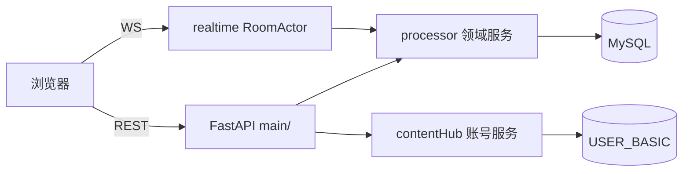

# 系统总览

> 本文是运行视角的系统说明；目标形态与决策见 [`plan/`](../plan/README.md)。

## 1. 系统做什么

家庭麻将是一套单实例部署的在线麻将服务：

- 家庭成员用 contentHub 账号登录，本地 JWT 维持会话。
- 在自己家庭内用 **6 位数字邀请码**开桌、入座、对局；邀请码也是入场凭证，可直接进入**其他家庭**的房间（跨家庭客队）。
- 服务端权威判定吃碰杠胡，按选定规则族与模板结算积分。
- 每局结束落库，支持战绩查询与家庭内排行（个人统计）。
- 房主可为家庭启用自定义牌面皮肤。

## 2. 角色与权限

| 角色 | 识别方式 | 能做什么 |
| --- | --- | --- |
| 系统管理员 | 账号服务角色映射 | 全部家庭只读、皮肤全局管理、审计 |
| 家庭 owner | `mj_family.ownerLoginID` | 家庭资料、成员、默认族/皮肤、家庭皮肤、房间 |
| 家庭 admin | `mj_family_member.memberRole=ADMIN` | 同 owner（不能移除 owner） |
| 家庭成员 | `memberRole=MEMBER` | 开桌、对局、聊天、建模板、选自己的皮肤 |
| 客队玩家 | 凭邀请码进入其他家庭的房间 | 入座对局、聊天；不能开桌、不能看该家庭列表/战绩 |
| 观战者 | 凭邀请码进房、四座已满 | 看牌桌、聊天，无手牌与操作 |

## 3. 能力地图

| 模块 | 能力 |
| --- | --- |
| 账号 | 登录、注册（可关，短信验证码）、找回密码（验证码重置）、登出、改密、当前用户 |
| 家庭 | 家庭列表/创建/切换、成员增删改、默认规则族与皮肤 |
| 规则 | 4 个全局规则族、家庭模板 CRUD、复制、校验、开桌快照 |
| 牌桌 | 创建/关闭房间、邀请码入房、准备、开局、动作判定、结算、聊天、断线重连 |
| 战绩 | 我的场次、场次详情、个人统计 |
| 皮肤 | 清单、上传 35 个资源、发布、设默认、启停、软删 |
| 审计 | 家庭成员/模板/皮肤变更留痕 |

## 4. 数据流

- 登录：账号服务校验口令 → 拉资料 → 同步 `USER_BASIC` → 签 JWT。
- 注册：发短信验证码（A6A0）→ 账号服务 `A0A0` 建号 → 同步 `USER_BASIC`；不签 JWT，回登录页。
- 找回密码：发码（A6A0）→ 账号服务 `A9A0` 校验码并改密 → 回写档案镜像；不签 JWT。
- 开桌：校验家庭成员 + 模板可见 → 生成 6 位邀请码 → 写 `mj_room`（含规则快照）。
- 对局：内存 `RoomActor` 处理动作与计时；每局结算写 `mj_game_round` 并累加 `mj_game_player.totalScore`。
- 战绩：按家庭与参与者查询，规则快照随场次保存。

## 5. 与 contentHub 的关系

| 共享项 | 说明 |
| --- | --- |
| 账号服务 | HTTP CMD 协议；登录/注册 `A0A0`、资料 `A3A0`、存在性 `AIA0`、短信验证码 `A6A0`、改密/找回口令 `A9A0`、登出 `A5A0` |
| `USER_BASIC` | 44 列原样移植（与 contentHub `userBasic.txt` 一致），主键 `loginID`；麻将侧只读写档案，不校验口令 |
| 验证码 | 生成、存储（10 分钟 TTL）、一次性校验都在账号服务；麻将侧不建表、不缓存 |
| 不共享 | 麻将的房间、模板、皮肤、战绩、审计 |

账号服务不可用时无法登录，已签发 JWT 在过期前仍可用于已登录会话。

## 6. 关键约束

- 单进程运行（`--workers 1`）；房态在内存，重启只丢当前未结算的一局。
- 所有家庭域查询必须带 `familyID`；跨家庭访问返回 403。唯一例外是**凭邀请码入房**：`GET /api/rooms/code/{room_code}` 与 WS 握手不要求家庭成员，但房间列表、按 `room_id` 的详情/聊天、开桌仍限本家庭成员。
- 业务层禁止裸 SQL；表结构只能通过 `database/*.txt` + 生成器变更。
- 邀请码 `^[1-9][0-9]{5}$`，全局唯一。
- 注册默认关闭（`ACCOUNT_ALLOW_REGISTER=false`），开放时手机号 `^1[3-9]\d{9}$` 且必须短信验证码；找回密码默认开启（`ACCOUNT_ALLOW_PASSWORD_RESET=true`）。
- 口令只以 `md5(passwd+loginID)` 形式转发账号服务；日志、审计、错误响应不得出现口令明文、验证码与哈希值。
- 时间统一 Asia/Shanghai；DB 时间列 `VARCHAR(16)`。

## 7. 文档索引

| 文档 | 用途 |
| --- | --- |
| [开发指南.md](开发指南.md) | 本地启动、目录约定、时间与日期处理、表结构变更、调试 |
| [部署.md](部署.md) | MySQL、systemd、Nginx、HTTPS/WSS、发版 |
| [运维与备份.md](运维与备份.md) | 备份恢复、日志、健康检查、故障处理 |
| [../plan/家庭麻将总体规划文档.md](../plan/家庭麻将总体规划文档.md) | 目标、范围、决策、里程碑 |
| [../plan/04-协议设计.md](../plan/04-协议设计.md) | REST/WS 契约与错误码 |
