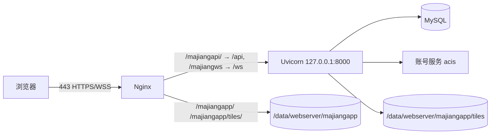

# 部署

目标拓扑：单台 ECS（Ubuntu 22.04）+ Nginx（HTTPS/WSS）+ Uvicorn 单进程 + MySQL 8.0（同机或同 VPC RDS）+ 外部 contentHub 账号服务。



## 1. 前置

| 项 | 要求 |
| --- | --- |
| 系统 | Ubuntu 22.04 LTS，2C4G 起 |
| 域名/证书 | **不占独立域名**：复用主机现有 nginx 的 80/443 与证书；本项目以 `/majiangapp/`、`/majiangapi/` 挂在同一 server 下 |
| 账号服务 | `ACCOUNT_SERVICE_URL` 可从服务器访问（默认 `http://127.0.0.1:8160/acis`） |
| 端口 | 开放 22/80/443；8000、3306 只监听回环 |

## 2. 安装依赖

```bash
sudo apt update
sudo apt install -y mysql-server git rsync
node -v   # 需 20+；不足时用 nvm 安装
```

nginx 是主机既有的共享实例（编译安装，配置见 §6），不再用 apt 装第二份；`nginx -t` / `nginx -s reload` 用主机现有二进制与配置目录。

Python 不装系统包，统一用主机已有的 `/data/userbin/python3/bin/python3`（应用、`tools/*`、`schedule/*`、`monitor/*` 共用，第三方依赖 `pip install` 到该解释器）：

```bash
/data/userbin/python3/bin/python3 -V     # 需 3.11+
```

## 3. MySQL

### 3.1 建库与账号

```sql
CREATE DATABASE mahjong_data DEFAULT CHARACTER SET utf8mb4 COLLATE utf8mb4_0900_ai_ci;
CREATE USER 'mjapp'@'localhost' IDENTIFIED BY '<强口令>';
GRANT SELECT, INSERT, UPDATE, DELETE, CREATE, INDEX, ALTER, REFERENCES ON mahjong_data.* TO 'mjapp'@'localhost';
FLUSH PRIVILEGES;
```

> 应用账号不需要 `DROP`、`GRANT`；需要执行 `CREATE TABLE`/`CREATE INDEX`，故保留 `CREATE`/`INDEX`/`ALTER`。

### 3.2 参数建议（`/etc/mysql/mysql.conf.d/mysqld.cnf`）

```ini
[mysqld]
character-set-server = utf8mb4
collation-server = utf8mb4_0900_ai_ci
default-time-zone = '+08:00'
max_connections = 100
innodb_buffer_pool_size = 512M
log_bin = mysql-bin
binlog_expire_logs_seconds = 604800
slow_query_log = 1
long_query_time = 0.5
```

改完 `sudo systemctl restart mysql`。`bind-address` 保持 `127.0.0.1`（RDS 场景除外）。

### 3.3 初始化

> 依赖 §5.1 已把代码复制到 `/data/majiang/src`，本节在建库之后、首次启动之前执行。

```bash
cd /data/majiang/src
sudo -u majiang /data/userbin/python3/bin/python3 tools/initTables.py --env server_01 --seed
sudo -u majiang /data/userbin/python3/bin/python3 tools/bootstrapFamily.py --owner <loginID> --name "廉家" --code lianjia
```

## 4. 账号服务联通

```bash
curl -s -m 5 -X POST "$ACCOUNT_SERVICE_URL" \
  -H 'Content-Type: application/json' \
  -d '{"CMD":"AIA0","loginID":"<测试账号>"}' | head -c 400
```

- 返回 `B0` 视为可达；`CI` 或超时先修网络/服务，再上线麻将。
- 账号服务与麻将不同机时，把地址写进 `/data/majiang/src/.env`。
- 生产不开放自助注册（`ACCOUNT_ALLOW_REGISTER=false`），账号由管理员在账号服务侧创建；开放自助注册时须同时打通账号服务的短信验证码通道（`A6A0`）。
- 忘记密码（自助重置）默认开启：`ACCOUNT_ALLOW_PASSWORD_RESET=true`，依赖同一条短信通道；需要专人代办时置 `false`，前端会隐藏「忘记密码」入口。
- 两个开关与限流参数（`AUTH_VERIFY_CODE_COOLDOWN_SECONDS=60`、`AUTH_VERIFY_CODE_MAX_ATTEMPTS=5`）都在 `.env`，改完 `systemctl restart mahjong` 生效；`GET /api/auth/options` 可直接验证当前生效值。
- 注册/找回链路只写 `USER_BASIC`，不新增表；账号服务侧的验证码 TTL 与短信配额由账号服务运维负责。

## 5. 部署应用

### 5.1 目录与用户

本仓库只是**代码存储目录**，与服务器目录的对应关系固定为：

| 本仓库 | 服务器 | 发布动作 |
| --- | --- | --- |
| `code/backend/src/` | `/data/majiang/src/` | rsync 覆盖（`--delete`，排除 `.env`、`.venv`、`__pycache__`） |
| `code/backend/log/` | `/data/majiang/log/` | 不发布，服务器上运行期生成 |
| `code/backend/data/` | `/data/majiang/data/` | 不发布，服务器上运行期生成（`db/`、`test/`、`backup/`） |
| `code/backend/data/webserver/majiangapp/` | `/data/webserver/majiangapp/` | 不发布；**例外**：图片目录落在站点树下，生产用 `.env` 的 `UPLOAD_DIR` 显式指向 |
| `code/frontend/` | 不部署 | 源码只在本机/CI 构建，取 `dist/` 产物 |
| `code/frontend/dist/` | `/data/webserver/majiangapp/` | 平铺（排除 `tiles/`，见 5.3） |

一句话：`code/backend` 整体对应 `/data/majiang`（`src`、`log`、`data` 一一对应），`code/frontend/dist` 对应 `/data/webserver/majiangapp`。

```bash
sudo useradd -r -s /usr/sbin/nologin majiang || true
sudo mkdir -p /data/majiang/src /data/majiang/build/frontend \
              /data/majiang/log/schedule \
              /data/majiang/data/db /data/majiang/data/test /data/majiang/data/backup \
              /data/webserver/majiangapp/tiles
sudo chown -R majiang:majiang /data/majiang
sudo chown -R majiang:majiang /data/webserver/majiangapp

# 后端: 只发布代码树, 直接复制到 /data/majiang/src(运行目录即最终路径, 不建软链)
# log/ 与 data/ 在 src 之外, 服务器上独立存在, 不会被 --delete 碰到
sudo -u majiang rsync -a --delete \
  --exclude '.env' --exclude '__pycache__/' --exclude '.venv/' \
  <发布包>/code/backend/src/ /data/majiang/src/

# 前端: 源码可临时放到构建工作区(不是仓库映射目标, 构建完可删), 产物再平铺到站点(见 5.3)
sudo -u majiang rsync -a --delete --exclude 'node_modules/' --exclude 'dist/' \
  <发布包>/code/frontend/ /data/majiang/build/frontend/
```

服务器上各目录职责：

| 目录 | 内容 | 谁用 |
| --- | --- | --- |
| `/data/majiang/src` | 后端代码（← 仓库 `code/backend/src`） | Uvicorn |
| `/data/majiang/log` | 所有日志：`mahjong.log` + `schedule/*.log`（← 仓库 `code/backend/log`） | 应用与 cron |
| `/data/majiang/data` | 所有附属数据：`db/`、`test/`、`backup/`（← 仓库 `code/backend/data`） | 应用与 cron |
| `/data/majiang/build/frontend` | 前端源码与构建工作区（临时，非发布物） | 只在发版时用 |
| `/data/webserver/majiangapp` | **前端构建产物（平铺，不含 dist 层）** + `tiles/` 皮肤图片 | Nginx `location /majiangapp/` |

后端不再托管 SPA：`app/main.py` 只在本地开发时探测 `code/frontend/dist`，生产目录不存在则跳过静态挂载。没有 `rsync` 时用 `git archive <tag> | tar -x -C /tmp` 解包后 `cp -a`，或 WinSCP 上传——同样不要覆盖 `.env`。

### 5.2 后端

```bash
cd /data/majiang/src
# 目标机统一使用共享解释器, 应用与 schedule/monitor 脚本共用同一份依赖
sudo -u majiang /data/userbin/python3/bin/python3 -m pip install -r requirements.txt
sudo -u majiang cp .env.example .env
sudo -u majiang chmod 600 .env
# 编辑 .env：MYSQL_*、SECRET_KEY（openssl rand -hex 32）、ACCOUNT_SERVICE_URL、CORS_ORIGINS
# 目录约定：不填时按代码位置推算，即 src 上一层的 log/ 与 data/，与仓库布局一致；
# 生产建议显式写出，避免误判：
#   LOG_DIR=/data/majiang/log
#   DATA_DIR=/data/majiang/data
#   BACKUP_DIR=/data/majiang/data/backup
#   UPLOAD_DIR=/data/webserver/majiangapp   # 必须显式写：图片不随 code/backend 映射，
#                                           # 缺省会落到 /data/majiang/data/webserver/majiangapp，
#                                           # 与 Nginx 的站点根 /data/webserver 对不上
sudo -u majiang mkdir -p /data/webserver/majiangapp/tiles
```

> 若改用项目 venv，必须**同时**修改 `systemd` 的 `ExecStart` 与 `restore_*.sh` 的 `MAHJONG_PYTHON`，两处不一致会导致脚本找不到 `pymysql`。

### 5.3 前端

```bash
cd /data/majiang/build/frontend
sudo -u majiang npm ci
sudo -u majiang npm run build          # 需先按下方表格设置 base，产物在 dist/

# 把 dist 的内容平铺到站点目录(Nginx root /data/webserver + location /majiangapp/)
# tiles/ 是运行时上传的皮肤图片, 必须排除, 否则 --delete 会把它们删光
sudo -u majiang rsync -a --delete --exclude 'tiles/' dist/ /data/webserver/majiangapp/
sudo -u majiang chmod -R a+rX /data/webserver/majiangapp
```

访问地址 `https://<host>/majiangapp/`。

> **当前未接入（发版前必须先改，否则整站 404）**
>
> 仓库里的前端仍是本地开发形态：`vite.config.ts` 没有 `base`（构建产物引用 `/assets/*.js`），`router/index.ts` 用默认 `createWebHistory()`，`api/http.ts` 把 `BASE` 写死成 `'/api'`。产物平铺到 `/data/webserver/majiangapp/` 后，这些绝对路径都会落在站点根，与 `location /majiangapp/`、`/majiangapi/` 对不上。
>
> 三项改动（改完只需重新 `npm run build` + rsync，不用重启后端）：

| 文件 | 现状 | 目标 |
| --- | --- | --- |
| `code/frontend/vite.config.ts` | 无 `base` | 构建时 `base: '/majiangapp/'`；dev 保持 `'/'`，否则 dev 的 `/majiangapp` 代理会与静态资源路径冲突 |
| `code/frontend/src/router/index.ts` | `createWebHistory()` | `createWebHistory(import.meta.env.BASE_URL)`（dev 下自动等于 `/`） |
| `code/frontend/src/api/http.ts` | `const BASE = '/api'` | `import.meta.env.VITE_API_BASE \|\| '/api'`，生产构建时设 `VITE_API_BASE=/majiangapi` |

WS 地址同源处理：生产是 `wss://<host>/majiangws`（Nginx 改写到后端 `/ws`），本地由 `vite.config.ts` 代理 `/ws`；切换方式与 REST base 一致，别在代码里写死域名。

构建后无需重启后端，也不需要 `reload nginx`（静态文件按请求读取）。Nginx worker（通常 `www-data`）需要能读产物，故有上面那条 `chmod`。

### 5.4 systemd

`/etc/systemd/system/mahjong.service`：

```ini
[Unit]
Description=Family Mahjong (FastAPI)
After=network.target mysql.service

[Service]
Type=simple
User=majiang
Group=majiang
WorkingDirectory=/data/majiang/src
EnvironmentFile=/data/majiang/src/.env
ExecStart=/data/userbin/python3/bin/python3 -m uvicorn app.main:app --host 127.0.0.1 --port 8000 --workers 1
Restart=always
RestartSec=3
TimeoutStopSec=20
LimitNOFILE=65535

[Install]
WantedBy=multi-user.target
```

```bash
sudo systemctl daemon-reload
sudo systemctl enable --now mahjong
sudo systemctl status mahjong --no-pager
```

`--workers 1` 是硬约束：多 worker 会分裂内存房态。

### 5.5 定时任务与监控

四个任务全部由 crontab 拉起 `restore_*.sh`，不使用进程内调度；解释器统一 `/data/userbin/python3/bin/python3`（`MAHJONG_PYTHON` 可覆盖）。

```bash
# 1. 创建日志目录(脚本与 crontab 重定向都写这里)
sudo mkdir -p /data/majiang/log/schedule
sudo chown -R majiang:majiang /data/majiang/log

# 2. 建表后确认清理索引已存在(见 plan/02 §4)
mysql -u root -p mahjong_data -e "SHOW INDEX FROM mj_room_message;"

# 3. 手工验证(先 dry-run, 确认 candidates 符合预期)
cd /data/majiang/src
sh schedule/restore_clean.sh --dry-run
sh schedule/restore_backup.sh
sh schedule/restore_logslice.sh

# 4. monitor 首次运行: 生成 tempMonitorFileName.json 基线, 会重启一次应用
sh monitor/restore_monitor.sh
```

```bash
# 5. 应用 crontab(内容见 src/schedule/crontab.txt 与 src/monitor/crontab.txt)
crontab -u majiang -e
```

最低 sudoers（`monitor` 需要重启服务）：

```
majiang ALL=(root) NOPASSWD: /bin/systemctl restart mahjong, /bin/systemctl start mahjong
```

注意事项：

- `restore_clean.sh` 无参数即 `--apply`，手工排查必须显式 `--dry-run`。
- `monitor` 每 5 分钟运行一次，**首次运行会杀掉应用一次**（文件快照为空，全部算变更），请在部署窗口先手工跑一次建基线，再启用 cron。
- `monitorConfig.py` 是唯一按项目维护的监控文件；`monitor.py` 从 contentHub 原样复制，出现需要改 `monitor.py` 的需求时先确认是不是配置写错了（`param` 空串、`host` 带端口、不填 `num`）。
- 服务器时区必须是 `Asia/Shanghai`（`timedatectl`），否则 cron 的 0 点与 `YMDHMS` 的 0 点不是同一个点。

## 6. Nginx

目标机是**共享 nginx**：一份 `nginx.conf`，多个项目用 `location /xxxapi/` 挂在同一个 server 下（`/hotelapi/`、`/mindgramapi/`、`/museumapi/`、`/chapi/`）。本项目**不新建** `sites-available/mahjong`、不占独立域名，只在现有 80 / 443 两个 server 内追加 location，风格与 `chin_mindgram/code/shell/conf/nginx.conf` 一致：前缀化路由、`proxy_pass` 不带尾部 URI、静态统一从 `/data/webserver/` 出。

### 6.1 追加的 location（80 与 443 两个 server 各一份）

```nginx
        # mahjong api: /majiangapi/xxx -> 后端 /api/xxx
        location /majiangapi/ {
            proxy_pass http://127.0.0.1:8000/api/;
            proxy_set_header Host $host;
            proxy_set_header X-Server-Addr $server_addr;
            proxy_set_header X-Server-Port $server_port;
            proxy_set_header X-Protocol-Used $scheme;
            proxy_set_header X-Forwarded-For $proxy_add_x_forwarded_for;
            proxy_set_header X-Forwarded-Proto $scheme;
        }

        # mahjong websocket: /majiangws?token=...&code=... -> 后端 /ws
        location /majiangws {
            proxy_pass http://127.0.0.1:8000/ws;
            proxy_http_version 1.1;
            proxy_set_header Upgrade $http_upgrade;
            proxy_set_header Connection "upgrade";
            proxy_set_header Host $host;
            proxy_set_header X-Real-IP $remote_addr;
            proxy_set_header X-Forwarded-For $proxy_add_x_forwarded_for;
            proxy_set_header X-Forwarded-Proto $scheme;
            proxy_read_timeout 3600s;
            proxy_send_timeout 3600s;
        }

        # 皮肤图片: 前端直访, 落在站点目录的 tiles/ 下, 由 Nginx 直接出静态
        location /majiangapp/tiles/ {
            root /data/webserver;
            expires 365d;
            add_header Cache-Control "public, immutable";
            access_log off;
        }

        # 前端 SPA(含 history 路由回退)
        location /majiangapp/ {
            root /data/webserver;
            index index.html;
            try_files $uri $uri/ /majiangapp/index.html;
        }
```

与参考配置对齐的取舍：

- `location /majiangapi/` 的 `proxy_pass` 末尾**必须带 `/api/`**，nginx 用它替换掉前缀，后端路由不用改；其余项目都是不带尾部 URI（路径原样透传），只有本项目需要改写。
- 不引入 `map $http_upgrade`，WebSocket 直接写 `Connection "upgrade"`；共享 conf 里没有这个 map，避免动全局。
- `charset utf-8`、`server_tokens off`、`client_max_body_size 300m`、`keepalive_timeout 125` 已由 http 段提供（300m 远大于本项目 512KB 上限，实际上限由后端 `MAX_UPLOAD_BYTES` 把关）。
- 主机 `gzip off`（原注释 "gzip off for CKR"），前端 JS/CSS 不压缩。要开只对 `/majiangapp/` 局部开 `gzip on; gzip_types ...`，不要改全局。
- 前端产物必须**直接铺在** `/data/webserver/majiangapp/`，不能再套一层 `dist/`；否则 `location /majiangapp/` 与 `root` 的拼接对不上，SPA 回退也会错。用 `root` 而非 `alias`，规避 `try_files + alias` 的老问题。
- `tiles/`（运行时上传的皮肤图片）与前端产物同在一个站点目录，发版 rsync 必须带 `--exclude 'tiles/'`，否则 `--delete` 会连图片一起删掉。后端 `.env` 的 `UPLOAD_DIR` 指向 `/data/webserver/majiangapp`。

```bash
sudo nginx -t && sudo systemctl reload nginx
```

证书与 443 已由主机现有配置提供（`/data/cert/...`），本项目不涉及 certbot。

### 6.2 前端地址与资源前缀

| 项 | 生产目标值 | 代码现状 |
| --- | --- | --- |
| 访问地址 | `https://<host>/majiangapp/` | — |
| Vite `base` | `/majiangapp/`（构建时） | **未设置**，dev 为 `/` |
| 路由 base | `createWebHistory(import.meta.env.BASE_URL)` | **未设置**，等价 dev 的 `/` |
| REST base | `/majiangapi` | **硬编码** `'/api'` |
| WS 地址 | `wss://<host>/majiangws`（`/ws` 由 nginx 改写） | 走 dev 代理 `/ws` |
| 皮肤图片 | 前后端统一前缀 `/majiangapp`（本地由后端挂载 `code/backend/data/webserver/majiangapp`，生产由 Nginx 从同路径出）；DB 与接口用相对 `tiles/{skinCode}/{file}`，由前端拼前缀 | 前缀已统一，接口尚未落地 |
| 健康检查 | `https://<host>/majiangapi/health` | — |

后端本地开发仍用 `/api`、`/ws`、`/majiangapp`，由 `vite.config.ts` 的代理转 8000。上表「代码现状」三处未接项的具体改法见 §5.3 的表格；改完才具备上线条件，属 P7 联调前置。

## 7. 发版

```bash
# 1) 先备份(直接复用定时任务脚本, 不用另写)
sh /data/majiang/src/schedule/restore_backup.sh

# 2) 复制代码(--delete 只清代码树; .env / __pycache__ / .venv 必须排除)
#    映射: code/backend/src -> /data/majiang/src; code/frontend/dist -> /data/webserver/majiangapp
sudo -u majiang rsync -a --delete \
  --exclude '.env' --exclude '__pycache__/' --exclude '.venv/' \
  <发布包>/code/backend/src/ /data/majiang/src/
sudo -u majiang rsync -a --delete --exclude 'node_modules/' --exclude 'dist/' \
  <发布包>/code/frontend/ /data/majiang/build/frontend/

# 3) 依赖与前端构建
cd /data/majiang/src && sudo -u majiang /data/userbin/python3/bin/python3 -m pip install -r requirements.txt
cd /data/majiang/build/frontend && sudo -u majiang npm ci && sudo -u majiang npm run build
sudo -u majiang rsync -a --delete --exclude 'tiles/' dist/ /data/webserver/majiangapp/
sudo -u majiang chmod -R a+rX /data/webserver/majiangapp

# 4) 表结构(仅本次有变更时)
cd /data/majiang/src && sudo -u majiang /data/userbin/python3/bin/python3 tools/initTables.py --env server_01

# 5) 重启
sudo systemctl restart mahjong
```

发版与 monitor 的联动：`monitorConfig.py` 的 `fileList` 含 `app/main.py`、`app/core/*`、`requirements.txt`、`.env`，复制代码会改这些文件的 mtime，monitor 在 5 分钟内会再 kill 一次（systemd 自动拉起）。不想与第 5 步的 restart 叠加重启，就在发版前临时注释 monitor 那条 cron，发版后恢复。

发版窗口：

- 有对局时避免重启（重启会中断当前局，已结算场次不受影响）。
- 表结构变更前必须先备份；只做 `ALTER`，禁止 `DROP`。
- 发版后执行 §8 的健康检查。

## 8. 上线验证

```bash
# 1) 健康
curl -s https://<host>/majiangapi/health
# 2) 登录（替换账号）
curl -s -X POST https://<host>/majiangapi/auth/login \
  -H 'Content-Type: application/json' \
  -d '{"login_id":"<loginID>","passwd":"<口令>"}' | head -c 300
# 3) 认证能力（注册/找回开关是否与预期一致）
curl -s https://<host>/majiangapi/auth/options
# 4) 静态与图片
curl -sI https://<host>/majiangapp/ | head -3
curl -sI https://<host>/majiangapp/assets/index.js | grep -i cache-control
curl -sI https://<host>/majiangapp/tiles/css-classic/back.png | head -5
# 5) WSS（需 wscat）
wscat -c "wss://<host>/majiangws?token=<JWT>&code=428915"
# 6) SPA 回退（任意前端路由都应返回 index.html 而非 404）
curl -sI https://<host>/majiangapp/rooms | head -3
# 7) 前端前缀自检：index.html 里的资源必须是 /majiangapp/assets/...（不是 /assets/...）
curl -s https://<host>/majiangapp/ | grep -o 'src="[^"]*"' | head -3
```

人工验收：登录 → 选家庭 → 开桌 → 四个账号入座 → 打完一局 → 战绩出现 → 切换皮肤。

## 9. 回滚

| 场景 | 操作 |
| --- | --- |
| 应用异常 | 用上一版发布包重新 rsync 覆盖 `src`（与 `majiangapp`）+ 重装依赖 + `systemctl restart mahjong` |
| 表结构异常 | 停服 → 用备份恢复 → `mj_schema_version` 回退 → 启服 |
| 皮肤功能异常 | `.env` 设 `SKIN_ENABLED=false` 并重启；前端回退 `css-classic` |
| 账号服务故障 | 已登录会话可用至 JWT 过期；新登录返回 503，恢复后自动可用 |
| 短信通道故障 | 注册与找回密码返回 503/`VERIFY_CODE_SEND_FAILED`，登录与对局不受影响；可临时关注册、改用管理员代重置 |

## 10. 防火墙

```bash
sudo ufw allow 22/tcp
sudo ufw allow 80/tcp
sudo ufw allow 443/tcp
sudo ufw enable
# 确认 8000/3306 未对外：
sudo ss -lntp | grep -E ':8000|:3306'
```

## 11. 备份

见 [运维与备份.md](运维与备份.md)。上线前至少完成一次「备份 → 空库恢复 → 启动校验」演练。
