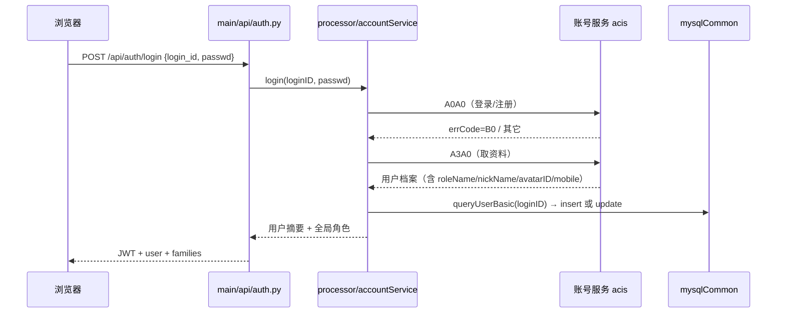
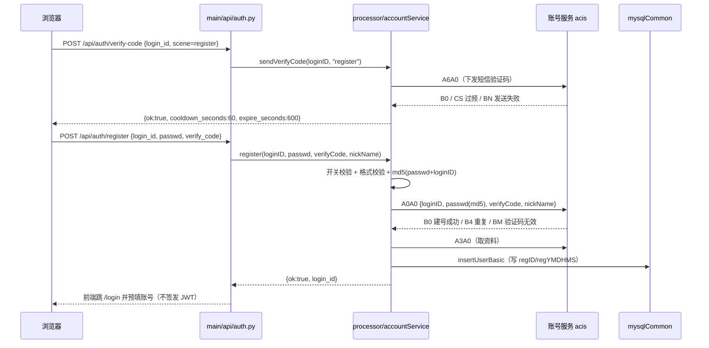
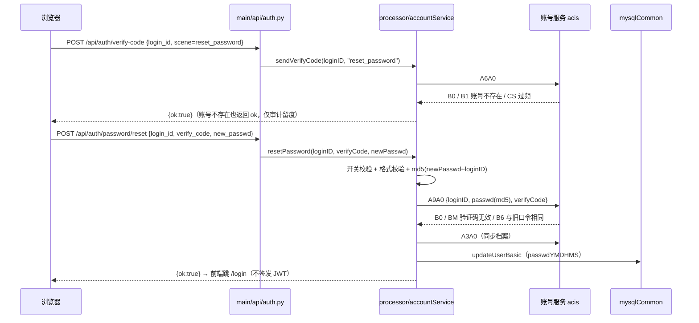
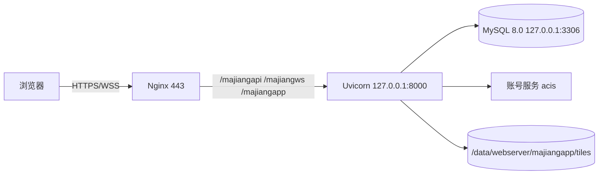

# 01 · 系统架构设计

> 状态：已评审（2026-10-27）
> 上游：[家庭麻将总体规划文档.md](家庭麻将总体规划文档.md)
> 下游：[02-数据库设计.md](02-数据库设计.md)、[04-协议设计.md](04-协议设计.md)、[06-实施计划.md](06-实施计划.md)

## 1. 架构目标

1. `code/backend` 的目录骨架与 contentHub 的 `code/src` 对齐，团队在两套工程间切换时不需要重新理解分层。
2. 数据访问只有一个入口（`mysqlCommon`），业务代码禁止出现裸 SQL，也禁止再出现 ORM 模型。
3. 账号不是本系统的资产：只做账号服务的客户端与档案镜像。
4. 家庭（family）是数据隔离边界；规则族（rule family）是玩法边界，两者正交。
5. 实时层（内存房态）与持久层（MySQL）职责清晰：房态在内存，结算立即落库，重启只丢当前局。

## 2. 分层与职责

| 层 | 目录 | 职责 | 禁止 |
| --- | --- | --- | --- |
| 入口 | `main/app.py` | FastAPI 装配、生命周期、静态托管、异常映射 | 业务判断、SQL |
| 路由 | `main/api/*.py`、`main/ws.py` | 解析参数、JWT 鉴权、Pydantic 校验、调用 processor、映射错误码 | SQL、跨表事务、内存房态修改 |
| 领域服务 | `processor/*.py` | 业务规则、权限、家庭上下文、事务编排、审计 | 直接拼 SQL |
| 规则引擎 | `game/families/*` | 发牌、合法动作、牌型、番种、结算 | 触库、读环境变量、写日志以外副作用 |
| 实时 | `realtime/*` | `RoomActor` 房态、座位、计时器、快照、事件广播 | 直接写 SQL（只经 `persist`） |
| 数据访问 | `common/mysqlCommon.py` | 唯一 SQL 出口：生成段 + 手写查询段 | 业务语义 |
| 连接 | `common/mysqlHandle.py` | 连接池、句柄 `dbW/dbR`、事务辅助、重连 | 业务判断 |
| 账号客户端 | `common/accountClient.py` | 账号服务 HTTP 转发、超时、错误收敛 | 写库 |
| 配置 | `config/*.py` | 环境映射、连接参数、常量、口令来自环境变量 | 提交真实口令 |
| 工具 | `tools/*` | 表定义 → 代码 → 合并 → 建表 → 种子 | 运行期依赖 |

调用方向：`main → processor → (game | mysqlCommon)`；`realtime → (game | mysqlCommon)`；`game` 不反向依赖任何上层。

## 3. 目录映射（旧 → 新）

### 3.1 后端

> 目录纪律（2026-10-27 已落地）：后端代码整体下沉一层，即 `code/backend/src/*`；运行时产物与代码分离——日志只进 `code/backend/log`，其他附属数据只进 `code/backend/data`。下表「目标路径」为便于阅读省略了 `src/` 前缀，实际均为 `code/backend/src/...`。

| 现状路径 | 目标路径 | 处理 |
| --- | --- | --- |
| `backend/app/main.py` | `code/backend/main/app.py` | 重写装配；`dist_dir` 改用 `settings`/`config` 给出的 `FRONTEND_DIST`（本地开发用）**且目录不存在时跳过挂载**，生产静态由 Nginx 托管 |
| `backend/app/api/*.py` | `code/backend/main/api/*.py` | 路由保留，内部改调 processor |
| `backend/app/api/ws.py` | `code/backend/main/ws.py` | 握手鉴权改为 JWT + 家庭校验 |
| `backend/app/core/config.py` | `code/backend/config/basicSettings.py` + `localSettings.py` | 拆环境映射与常量 |
| `backend/app/core/security.py` | `code/backend/common/securityCommon.py` | 保留 JWT 签发/校验；删除 scrypt 口令逻辑（口令由账号服务管） |
| `backend/app/core/deps.py` | `code/backend/main/deps.py` | JWT → 用户上下文 + 家庭上下文 |
| `backend/app/db/base.py` | 删除 | 连接改 `mysqlHandle`，建表改 `tools/initTables.py` |
| `backend/app/db/models.py` | 删除 | 表定义改 `database/*.txt` |
| `backend/app/schemas/rule.py` | `code/backend/schemas/rule.py` | 按规则族扩展 |
| `backend/app/schemas/{auth,room,ws}.py` | `code/backend/schemas/*.py` | 按协议文档调整 |
| `backend/app/game/*` | `code/backend/game/*` | 纯逻辑平移；番种/牌型改为族内注册 |
| `backend/app/game/patterns/*` | `code/backend/game/families/generic/patterns/*` | 归入通用族 |
| `backend/app/realtime/*` | `code/backend/realtime/*` | 落库改 `mysqlCommon`，其余逻辑保留 |
| `backend/app/seeds/presets.py` | `code/backend/tools/seedPresets.py` + `database` 种子 | 模板按族组织 |
| `backend/scripts/bootstrap_family.py` | `code/backend/tools/bootstrapFamily.py` | 改为家庭初始化 |
| `backend/tests/*` | `code/backend/tests/*` | 76 用例平移 + 新增用例 |
| `backend/requirements.txt` | `code/backend/requirements.txt` | 去 SQLAlchemy/alembic，加 pymysql/DBUtils/requests |
| `backend/.env.example` | `code/backend/.env.example` | 改 MySQL 与账号服务配置 |
| — | `code/backend/database/*` | 新增表定义、生成器、产物 |
| — | `code/backend/common/mysqlCommon.py` 等 | 新增数据层 |
| — | `code/backend/processor/*` | 新增领域服务 |
| — | `code/backend/data/webserver/majiangapp/tiles/` | 新增皮肤文件目录（运行期，前端直访） |
| — | `code/backend/schedule/*` | 新增 crontab 驱动的运维脚本：`dataClean.py`、`dataBackup.py`、`logslice.sh` + 三个 `restore_*.sh` + `crontab.txt`；非运行期依赖，不进 `mysqlCommon` 业务层 |
| — | `code/backend/monitor/*` | 新增 `monitor.py`（从 contentHub 原样复制，不改一行）+ `monitorConfig.py`（唯一按项目维护）+ `restore_monitor.sh` + `crontab.txt` |

### 3.2 前端

| 现状路径 | 目标路径 | 处理 |
| --- | --- | --- |
| `frontend/*` | `code/frontend/*` | 整体迁移；`vite.config.ts` 代理不变（`/api`、`/ws` → 8000） |
| `frontend/src/views/*` | `code/frontend/src/views/*` | 新增家庭选择、皮肤管理、成员页 |
| `frontend/src/components/table/Tile.vue` | 同路径 | 改为图片优先、CSS 回退 |
| `frontend/src/utils/tile.ts` | 同路径 | 增加 `tileKey(tile)` 映射（皮肤资源键） |
| `frontend/src/api/http.ts` | 同路径 | BASE 保持 `/api`；401 处理保留 |
| `frontend/src/api/ws.ts` | 同路径 | 入房需 `familyCode` 校验；保留退避与 resync |
| `frontend/src/stores/auth.ts` | 同路径 | 增加 families、currentFamily、切换动作 |
| `frontend/src/stores/game.ts` | 同路径 | 保留整包快照归约；增量事件追加音效调用 |
| — | `code/frontend/src/audio/*` | 新增 `soundKeys.ts` / `audioManager.ts` / `useGameSounds.ts`（纯前端 SFX，无 BGM） |
| — | `code/frontend/public/audio/sfx/*` | 新增 15 个音效资源与授权清单；由 Vite 打包进 `dist`，后端无需额外挂载 |
| — | `code/frontend/src/stores/skins.ts` | 新增皮肤清单与选择 |
| — | `code/frontend/src/views/FamilyView.vue`、`views/admin/SkinsView.vue` | 新增 |

### 3.3 迁移后必须同步的硬编码

| 位置 | 现状 | 目标 |
| --- | --- | --- |
| `app/main.py` | `FRONTEND_DIST`（由 `core/config.py` 按 `__file__` 推算，指向 `code/frontend/dist`） | 仅本地开发挂 `code/frontend/dist`（目录不存在则跳过）；生产由 Nginx 托管 `/data/webserver/majiangapp/` |
| `vite.config.ts` | 代理目标 `http://127.0.0.1:8000` | 不变 |
| `tests/conftest.py` | `tests/test_mahjong.db` + 删 WAL | 改为测试库 `mj_test`，建表/清表走 `initTables.py --test` |
| `.env.example` | `DATABASE_URL=sqlite:///...` | `MYSQL_*` + `ACCOUNT_SERVICE_URL` |
| systemd | `WorkingDirectory=/opt/mahjong/app/backend` | `/data/majiang/src`（目标机部署根目录） |
| Nginx | 静态 `/assets/` 反代 8000 | 复用主机共享 `nginx.conf`：`/majiangapi/`→`8000/api/`、`/majiangws`→`8000/ws`、`/majiangapp/tiles/`→`root /data/webserver`（皮肤图片）、`/majiangapp/`→`root /data/webserver` + SPA `try_files` |
| README/docs | 所有 `cd backend` / `cd frontend` | `cd code/backend/src` / `cd code/frontend` |

## 4. 请求链路

### 4.1 HTTP

```
请求
 → CORS / 访问日志
 → main/api 路由：解析 path/query/body
 → JWT 校验（loginID、roleName、exp）
 → 家庭上下文解析（familyCode 或资源归属）
 → 成员/角色校验
 → processor 业务编排（可能开启事务）
 → mysqlCommon（dbW/dbR）
 → MySQL
 → Pydantic 响应模型
 → 统一错误映射（HTTP 4xx/5xx + 中文 detail）
```

约定：

- 同步路由（`def`）直接跑在线程池；**异步路由（`async def`）禁止直接触库**，如需触库用 `run_in_threadpool` 或改为同步路由。
- 事务边界在 processor：一个业务动作一个事务；跨表写入（开桌、结算、成员变更）必须在一个事务内完成。
- 错误：业务异常用 `BizError(code, message, httpStatus)`，路由层统一转 JSON；不把数据库异常原样抛给前端。

### 4.2 WebSocket

```
GET /ws?token=<JWT>&code=<6位邀请码>
 → JWT 校验失败：error{UNAUTHORIZED} + close(4001)
 → 按 code 查 mj_room（dbR）
 → 房间不存在/已关闭：error{ROOM_NOT_FOUND} + close(4004)
 → 解析 room.familyID 校验家庭可用：家庭停用 error{FAMILY_DISABLED} + close(4003)
   （邀请码即入场凭证：非本家庭的登录用户同样可入房，不再要求成员关系）
 → RoomManager 取/建 RoomActor
 → 座位未满：入座
 → 座位已满：进入观战（观战位 4×10 已满则 error{ROOM_SPECTATE_FULL} + close(4005)），
   未选目标只下发公共状态，收到 spectate.target 后按目标视角下发
 → room.welcome + state.snapshot（按座位或观战目标生成）
```

- 信封：`{"v":2,"type":"...","ts":<epoch秒>,"data":{}}`；`v!=2` 一律 `BAD_VERSION` 并关闭 4002；客户端可选 `seq`，服务端不回 `seq`（见 [04 §9.2](04-协议设计.md)）。
- 心跳 `ping/pong`；断线 3 分钟保留座位；同一账号多连接互不影响；观战关系按 `loginID` 去重计数，多标签页不重复占位。
- 房态只在内存；每局结算、聊天、开桌/结束场次立即落库。

## 5. 账号链路

### 5.1 组件

| 组件 | 路径 | 说明 |
| --- | --- | --- |
| 账号客户端 | `common/accountClient.py` | 复用 contentHub 实现：CMD 常量、30s 超时、异常收敛、`B0` 成功、`CI` 下游不可达 |
| 账号服务 | `processor/accountService.py` | 登录/注册、发验证码、找回口令、取资料、改密、登出、角色映射、`USER_BASIC` upsert |
| 家庭服务 | `processor/familyService.py` | 家庭 CRUD、成员关系、默认规则族/皮肤、隔离校验 |
| 会话 | `common/securityCommon.py` | 签发/校验 JWT（HS256） |

### 5.2 登录时序



### 5.3 注册时序



### 5.4 找回口令时序



### 5.5 约定

1. **账号服务地址**：`ACCOUNT_SERVICE_URL`，默认 `http://127.0.0.1:8160/acis`，按环境在 `config/localSettings.py` 的 `_SYS` 映射。
2. **角色映射**：账号服务 `roleName` 在 contentHub 的 `USER_ADMIN_ROLE_LIST`（`administrator`/`manager`）内 → 本系统 `admin`；否则 `member`。未返回或不在白名单时回落 `ACCOUNT_DEFAULT_ROLE`；写回 acis 时经 `ROLE_ACCOUNT_ROLE` 反查（与 contentHub `main/subfunc/accountSvcClient.py` 一致）。
3. **JWT 载荷**：`sub=loginID`、`role`（全局角色）、`iat`、`exp`；TTL 由 `TOKEN_TTL_HOURS`（默认 720）控制；不放家庭。
4. **本地不校验口令**：`USER_BASIC.passwd` 仅按账号服务回包镜像，不参与登录；日志不得打印。
5. **账号服务不可达**：返回 HTTP 503 + 「账号服务暂时不可用，请稍后再试」；不产生半登录状态。
6. **注册开关**：`ACCOUNT_ALLOW_REGISTER=true` 时才暴露注册入口。关闭时 `POST /api/auth/register` 直接 403 `ACCOUNT_REGISTER_DISABLED`，**不触达账号服务**；`GET /api/auth/options` 回报 `register_enabled=false`，前端只隐藏注册入口（找回密码入口不受影响）。注册本身仍由账号服务校验短信验证码（A0A0 + `verifyCode`），本地不做验证码比对。
7. **找回口令开关**：`ACCOUNT_ALLOW_PASSWORD_RESET`（默认 `true`，家庭场景需要自助找回）。关闭时 `POST /api/auth/password/reset` 返回 403 `PASSWORD_RESET_DISABLED`；发码步骤同样拒绝，避免无意义短信消耗。
8. **验证码归属账号服务**：验证码的生成、存储（10 分钟 TTL）、重发频率与一次性校验全部在 acis 侧；本地**不建表、不落 Redis、不缓存明文**，只在进程内维护「60 秒冷却 + 5 次失败」的限流计数（单进程，重启清零）。不启用 A7A0 独立校验接口，防止验证码被复用（详见 [04 §2.3](04-协议设计.md)）。
9. **口令哈希口径**：前端提交明文（HTTPS），`processor/accountService` 调 acis 前统一计算 `md5(passwd + loginID)`；登录/注册/改密/找回共用同一口径。禁止前端做 md5（museum 实现的做法，会把等价口令留在浏览器与日志里）。
10. **注册成功不建会话**：注册与找回口令均不签发 JWT，只返回 `{ok:true}`，由前端跳转登录页；避免账号服务回包不含会话时出现半登录态。
11. **登出**：调用 A5A0（尽力而为），本地丢弃 JWT；WS 由前端主动关闭。
12. **`USER_BASIC` 结构**：44 列与 contentHub `code/src/database/userBasic.txt` 逐列一致，由静态测试锁定；不新增家庭字段（家庭关系放 `mj_family_member`）。找回口令成功后只更新 `passwd`/`passwdYMDHMS` 的镜像值。

## 6. 家庭上下文

### 6.1 解析规则

| 场景 | 家庭来源 | 校验 |
| --- | --- | --- |
| 列表接口（房间/模板/皮肤/战绩） | `?family_code=xxx`；缺省用 `mj_user_pref.lastFamilyID` 对应家庭 | 必须是成员 |
| 创建接口（房间/模板/皮肤） | 请求体 `family_code` | 必须是成员（owner/admin 才能建家庭级皮肤） |
| 详情/操作接口（template_id、skin_code） | 资源自身的 `familyID` | 资源存在 + 成员 + 角色 |
| 凭码入房（room_code → 房间归属） | 房间自身的 `familyID` | 登录即可（邀请码即入场凭证）；按 room_id 的详情/聊天仍限成员 |
| WS 入房 | `mj_room.roomCode` → `familyID` | 家庭必须可用（停用 4003）；不要求成员 |
| 系统管理接口 | 显式 `family_code` 或全局 | 全局管理员 |

### 6.2 数据结构

- `mj_family`：家庭主档，含 owner、默认规则族、默认皮肤、状态。
- `mj_family_member`：`familyMemberKey = "{familyID}_{loginID}"` 唯一；`memberRole ∈ OWNER/ADMIN/MEMBER`；`memberStatus ∈ ACTIVE/DISABLED/LEFT`。
- `mj_user_pref.lastFamilyID`：当前家庭；切换即更新该字段。

### 6.3 隔离红线

1. 任何家庭域查询必须带 `familyID = ?`，不得先全量再在内存过滤。
2. 跨家庭读取一律 403，且不泄露资源是否存在（统一「无权访问该家庭资源」）。
3. `mj_game`、`mj_game_player`、`mj_game_round`、`mj_room_message` 经 `roomID` 归属，同时冗余 `familyID` 便于查询与校验。
4. 审计日志记录 `familyID` 与 `operatorLoginID`，跨家庭操作可追溯。

## 7. 数据访问设计

### 7.1 生成链路

```
database/mj_*.txt
  → (cd database && python mysqlCodeGenerator.py -i mj_room.txt -t room)
  → database/auto_generated/auto_gen_code_mj_room.py
  → python tools/mergeMysqlCommon.py
  → common/mysqlCommon.py 生成区（BEGIN/END 标记）
```

- 手写区与生成区物理隔离；重跑不覆盖手写代码。
- 只使用产物中的数据层段；`#http interface` 段不装配（本项目是 REST + WS，不引入 CMD 信封）。
- `USER_BASIC` 不走生成器，按 contentHub 手写 user family 的 7 个函数移植（`create/drop/query/insert/update/delete/statUserBasic`，可选 `getUserInfoMysql`）。

### 7.2 函数命名

| 类型 | 命名 | 示例 |
| --- | --- | --- |
| 表名转换 | `tablename_convertor_{table}()` | `tablename_convertor_mj_room()` |
| 建表 | `create_{table}(tableName)` | `create_mj_room("mj_room")` |
| 插入 | `insert_{table}(tableName, dataSet)` | 返回影响行数 |
| 更新 | `update_{table}(tableName, recID, dataSet)` | 返回影响行数 |
| 软删 | `delete_{table}(tableName, recID)` | 置 `delFlag='1'` |
| 手写查询 | `query_{table}_by_xxx(...)` | `query_mj_room_by_code(code)` |
| 用户表 | `createUserBasic()`、`dropUserBasic()`、`queryUserBasic(loginID)`、`insertUserBasic`、`updateUserBasic`、`deleteUserBasic`、`statUserBasic()`（可选 `getUserInfoMysql`） | 与 contentHub 同名同签名（7+1 个） |

### 7.3 红线

1. 业务层禁止裸 SQL、禁止拼字符串；条件值一律参数化。
2. 查询必须显式 `delFlag='0'`（或 `delFlag IS NULL` 兼容），由手写 `query_*` 统一处理。
3. 写库前 JSON 列统一 `normalizeJsonValue4DB`（dict/list → `json.dumps(ensure_ascii=False)`，空串 → `NULL`），列名登记 `MYSQL_JSON_COLUMN_NAME_LIST`。
4. 时间统一 `misc.getTime()` → `YYYYMMDDHHMMSS`（Asia/Shanghai），写入 `VARCHAR(16)`。
5. 可空数值列约定 `0 = 未设置`；不得用 `NULL` 表达业务默认值。
6. 分页必须有上限（默认 20、最大 100，战绩/审计默认 30，与 [04 §1](04-协议设计.md) 一致），聊天/日志查询必带 `LIMIT`（聊天默认 50）。
7. 禁止 `SELECT *` 用于列表接口；按 `getShortColumns()` 取列。

### 7.4 事务

- `mysqlHandle` 提供 `begin()/commit()/rollback()`；`mysqlCommon` 每条写操作默认自动提交。
- 需要原子性的业务用 `with mysqlCommon.transaction() as tx:`（`tx` 暴露 `dbW` 游标），在 processor 内使用。
- 必须使用事务的动作：开桌（`mj_room` + `mj_game` + `mj_game_player`）、每局结算（`mj_game_round` + `mj_game_player.totalScore`）、成员变更（`mj_family_member` + `mj_audit_log`）、皮肤上传（`mj_tile_skin` + `mj_tile_skin_asset`）。
- 实时层落库失败：记录错误日志 + 向该用户发 `error{DB_WRITE_FAILED}`；不阻塞继续对局（内存态优先），但该局结算必须在下一局开始前补写成功或标记异常。

## 8. 连接与并发

### 8.1 连接池

| 项 | 值 |
| --- | --- |
| 驱动 | `pymysql`（`charset=utf8mb4`, `autocommit=False`） |
| 池 | `DBUtils.PooledDB`，`maxconnections=10`（可配 5–20）、`blocking=True`、`ping=1` |
| 写句柄 | `dbW`（autocommit=False，显式提交） |
| 读句柄 | `dbR`（默认同实例；开启只读实例时 `autocommit=True`） |
| 连接参数 | `connect_timeout=5`、`read_timeout=30`、`write_timeout=30` |
| 健康检查 | `pool_pre_ping` 等价：取连接前 `ping()`；失败重连一次后抛 `DB_UNAVAILABLE` |

### 8.2 线程模型

- FastAPI 同步路由跑在 AnyIO 线程池；`PooledDB` 线程安全，按调用取还连接，不共享游标。
- 异步代码（`RoomActor` 协程）调用 `persist.*` 时是同步阻塞：**写库操作放到 `run_in_threadpool`**，避免阻塞事件循环；`RoomActor` 内不得长时间持有连接。
- 单进程单 Uvicorn worker；`--workers 1` 硬约束（多 worker 会分裂内存房态）。

### 8.3 时区与时间

| 类型 | 格式 | 用途 |
| --- | --- | --- |
| DB 时间列 | `VARCHAR(16)` `YYYYMMDDHHMMSS`（Asia/Shanghai） | 创建/修改/结算/聊天时间 |
| REST 输出 | ISO 8601 带 `+08:00` | 前端展示 |
| WS 倒计时 | epoch 秒（float） | `deadline`、`claim_deadline` |
| JWT | epoch 秒 | `iat`/`exp` |

统一由 `misc.getTime()`、`misc.ymdhmsToIso()` 转换，禁止各端点自行格式化。

## 9. 实时层设计

- `RoomManager`：`dict[roomCode, RoomActor]` + 全局锁；创建/获取/移除。
- `RoomActor`：4 个 `PlayerSlot`、`dict[loginID, list[WebSocket]]` 多连接、`asyncio.Lock`、两个计时任务（出牌超时、询问窗口）；另持抽座结果 `seat_wind_map`、`dealer_seat`、`round_wind`、`restart_count`（对应 03 §3.4–3.6），以及观战绑定 `spectators: dict[loginID, SpectateBinding]`（`targetLoginID`、`targetSeat`、`reserveUntil`）。
- 座位：进桌按先到先得占 `PlayerSlot`；**每场首局**按 03 §3.4 抽座，把 slot 映射到座位 `0..3` 并定首局庄家，整场座位不再变动；庄家按座位顺延、庄家胡牌连庄，门风随之整体转动。满座观战；断线 3 分钟内保留座位（`seat_reserve_seconds`），到期回收（**现状未实现回收，本次必须补上**）。
- 观战（04 §9.3/§9.5）：绑定以 `targetLoginID` 为准（抽座后 `targetSeat` 自动跟随，不跟错人）；每个 `loginID` 只保留 1 条绑定；每名在座玩家最多 `SPECTATE_LIMIT_PER_SEAT=10` 名观战者，房间观战总上限 40；切换目标与离座回收都在 `asyncio.Lock` 内完成并广播 `event.spectate_changed`；观战连接全部断开后绑定保留 `SPECTATE_RESERVE_SECONDS=60` 秒再释放；目标离座/房间关闭立即失效；**观战关系不写库**。
- 快照：逐连接生成，本人或观战目标的手牌明文；暗杠对他人隐藏；`tenpai`/`deadline` 按开关下发；观战者 `self_seat=null`、`legal.actions` 恒空。
- 落库：`open_game`、`save_round`、`close_game`、`save_message` 四个时机，全部走 `mysqlCommon` + 事务。
- 可选抽象：`RoomStore` 接口（内存实现），为后续 Redis 预留；本轮不实现 Redis 实现。

## 10. 文件存储与静态托管

| 项 | 约定 |
| --- | --- |
| 根目录 | `code/backend/data/webserver/majiangapp/`（生产 `/data/webserver/majiangapp/`），即 `settings.public_dir` |
| 皮肤路径 | `tiles/{skinCode}/{tileKey}.{ext}`，文件名追加内容哈希：`{tileKey}.{hash8}.{ext}` |
| 访问 URL | `/majiangapp/tiles/{skinCode}/{file}`（本地与生产同一前缀） |
| 静态路由 | 本地：`app/main.py` 把 `settings.public_dir` 挂到 `/majiangapp`；生产：Nginx `location /majiangapp/tiles/` 直出，`Cache-Control: public, max-age=31536000, immutable` |
| 前端产物 | 生产：`/data/webserver/majiangapp/`（平铺产物）+ `location /majiangapp/`（`root /data/webserver`、`try_files $uri $uri/ /majiangapp/index.html`），`vite base='/majiangapp/'`；本地开发：后端探测 `code/frontend/dist` 并挂 `/assets` + SPA fallback；未匹配 `/api/*` 返回 JSON 404 |
| 上传限制 | 单文件 ≤ 512 KB，单皮肤 35 张 ≤ 8 MB；仅 `png/webp`（SVG 拒绝，避免脚本注入） |
| 清理 | 皮肤软删不删文件；物理清理由运维脚本按 `delFlag=1` 且 30 天前处理 |

## 11. 配置与环境

`.env`（只列键，值按环境注入）：

```ini
# 运行环境 local | test_server | server_01
APP_ENV=local
# MySQL
MYSQL_WRITE_HOST=127.0.0.1
MYSQL_WRITE_PORT=3306
MYSQL_WRITE_DB=mahjong_data
MYSQL_WRITE_USER=mjapp
MYSQL_WRITE_PASSWD=
MYSQL_READ_HOST=127.0.0.1
MYSQL_READ_PORT=3306
MYSQL_READ_DB=mahjong_data
MYSQL_READ_USER=mjapp
MYSQL_READ_PASSWD=
MYSQL_POOL_MAX=10
# 账号服务
ACCOUNT_SERVICE_URL=http://127.0.0.1:8160/acis
ACCOUNT_ALLOW_REGISTER=false          # 生产默认关；注册仍需短信验证码
ACCOUNT_ALLOW_PASSWORD_RESET=true     # 忘记密码（自助重置）默认开
ACCOUNT_DEFAULT_ROLE=member
# 验证码本地限流（非存储）
AUTH_VERIFY_CODE_COOLDOWN_SECONDS=60
AUTH_VERIFY_CODE_MAX_ATTEMPTS=5
# 会话
SECRET_KEY=
TOKEN_TTL_HOURS=720
# 跨域
CORS_ORIGINS=*
# 实时
CLAIM_WINDOW_SECONDS=8
SEAT_RESERVE_SECONDS=180
CHAT_RATE_WINDOW=5
CHAT_RATE_LIMIT=3
# 观战（一人一目标；每名在座玩家最多 10 人；房间合计 4×10=40）
SPECTATE_LIMIT_PER_SEAT=10
SPECTATE_ROOM_MAX=40
SPECTATE_RESERVE_SECONDS=60
# 上传（前端直访图片；本地默认 code/backend/data/webserver/majiangapp，生产 /data/webserver/majiangapp）
UPLOAD_DIR=/data/webserver/majiangapp
MAX_UPLOAD_BYTES=524288
```

约束：`SECRET_KEY` 与数据库口令只从环境变量读取；代码库不出现真实值；启动日志打印环境/库名/池大小，不打印口令。

## 12. 部署拓扑



- 单台 ECS；Nginx 终止 TLS；Uvicorn 单进程；MySQL 同机或云 RDS（延迟敏感，建议同地域同 VPC）。
- 主机是共享 nginx（`/hotelapi/`、`/mindgramapi/`、`/museumapi/` 同挂一个 server），本项目以 `/majiangapi/`、`/majiangws`、`/majiangapp/tiles/`、`/majiangapp/` 四个前缀接入，不占独立域名；静态站点根为 `/data/webserver/`，产物平铺在 `/data/webserver/majiangapp/`。
- 仓库与服务器的映射固定：`code/backend`（`src/`、`log/`、`data/`）→ `/data/majiang`，`code/frontend/dist` → `/data/webserver/majiangapp`；前端源码不部署，只在临时工作区构建。
- systemd `WorkingDirectory=/data/majiang/src`，`EnvironmentFile=/data/majiang/src/.env`，`Restart=always`；`src` 由仓库 `code/backend/src` **复制**而来（不建软链），与前端目录无父子关系。

## 13. 迁移检查清单（P1 验收）

- [ ] `code/backend`（含 `src/`、`log/`、`data/`）、`code/frontend` 目录存在，旧目录删除或保留只读副本。
- [ ] `grep -r "sqlite" code/` 无运行期命中（仅文档/注释说明历史）。
- [ ] `grep -r "frontend/dist\|frontend\\\\dist" code/backend/src` 指向 `code/frontend/dist`。
- [ ] `cd code/backend/src && python -c "from main.app import app"` 可导入，`/api/health` 返回 200。
- [ ] `npm run build` 产物落到 `code/frontend/dist`，后端能托管 `/` 与 `/assets`。
- [ ] pytest rootdir 指向 `code/backend/src`，76 个用例全绿。
- [ ] `.env.example` 与 06 文档一致，无 SQLite/ORM 残留。

## 14. 验收清单

1. 启动后可访问 `/api/health`、登录、进入家庭、打开房间。
2. 账号服务断开时登录返回 503 与中文提示，且不产生 `USER_BASIC` 半条记录。
3. 同一用户多标签页在线，断开任意一个不影响座位。
4. 进程重启后 `mj_game.status='playing'` 的场次全部变 `aborted`，历史战绩可查。
5. 跨家庭请求返回 403，且响应体不含目标资源名称。
6. `grep` 业务层无 `SELECT`/`INSERT` 字面 SQL，全部经 `mysqlCommon`。
7. 注册：`ACCOUNT_ALLOW_REGISTER` 关时入口不显示且接口 403；开时走「发码 → 注册」两步，注册成功后可直接登录。
8. 找回口令：不存在的手机号发码不报「账号不存在」；重置成功后旧口令失效、新口令可登录。
9. 账号服务断开时 `verify-code`、注册、找回均返回 503 `ACCOUNT_SERVICE_UNAVAILABLE`，不写 `USER_BASIC`、不消耗本地验证码计数。
10. 日志与审计中无口令明文、验证码明文与 `md5` 结果。
11. 观战：同一账号多标签页只占 1 个观战名额；切换目标后旧目标计数立即释放；目标离座后观战者回到未选择态且不残留计数；`grep -rn "mj_spectator" code/backend` 无命中（观战不落库）。
