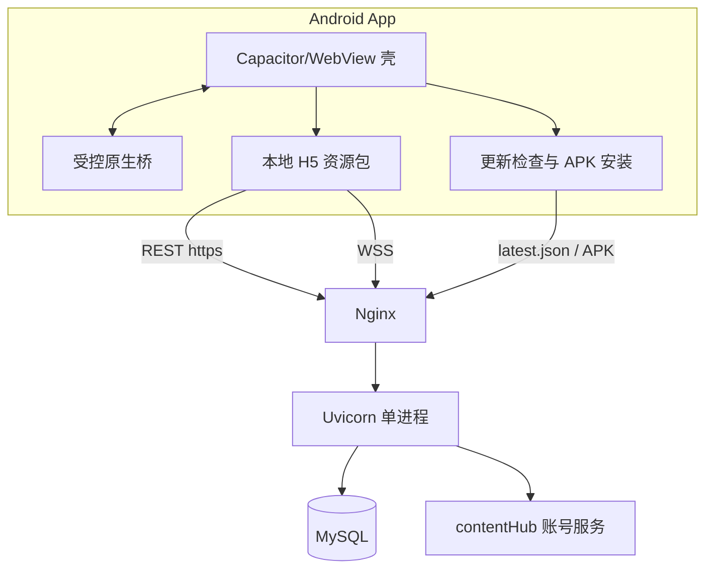

# Android 家庭麻将客户端 · 可行性分析与开发计划

> 版本：v1（2026-11-02）
> 状态：立项评估稿（待决策确认）
> 范围：Android 客户端（家庭内部分发，不上架应用商店），复用现有后端、数据库、账号体系与 WebSocket 协议
> 上游依据：[01-系统架构设计.md](01-系统架构设计.md)、[04-协议设计.md](04-协议设计.md)（协议唯一来源）、[05-UI设计.md](05-UI设计.md)、[家庭麻将移动侧界面.md](家庭麻将移动侧界面.md)、[../docs/系统总览.md](../docs/系统总览.md)、[../docs/部署.md](../docs/部署.md)（部署唯一来源）
> 本文不含任何代码，只给判断、边界、阶段、工作量与验收口径。

---

## 1. 结论摘要

### 1.1 一句话结论

**可行，且代价可控。** 现有系统已经具备 Android 客户端所需的全部服务端能力（HTTPS REST、WSS、JWT、服务端权威判定、全量快照重同步、动作幂等、断线保留座位），客户端可以做成一款「同一后端、可与网页端同桌」的独立 App。推荐路线为**两阶段**：

1. **一期（M0–M3）**：Capacitor/WebView 壳 + 复用现有手机版 H5（`/mjmobile/` 同一份构建产物），补齐原生能力（横屏锁定、屏幕常亮、音频焦点、更新下载、生命周期恢复）。**后端协议零改动**，只需前端构建增加一个「Android 模式」与一个静态更新清单。
2. **二期（M4–M6）**：牌桌界面用 Compose/Canvas 原生重写（其余页面继续 H5），在保留同一协议的前提下换取帧率、触控跟手与内存表现，用开关灰度切换、H5 牌桌保留兜底。

### 1.2 关键指标（估算，口径见 §8）

| 项目 | 结论 |
| --- | --- |
| 技术可行性 | 高。协议与服务端能力已就绪，无阻断项 |
| 后端改动 | **一期零协议改动**；仅新增静态更新清单与一个静态目录（可选加一个客户端标识日志字段） |
| 总工作量 | **50–75 人日**（一期 20–30，二期 30–45） |
| 日历周期（全职 1 人） | 10–15 周（约 2.5–3.5 个月） |
| 日历周期（兼职，1–1.5 人日/周） | 一期 3–6.5 个月；二期 5–10 个月；建议分期决策 |
| 费用区间（800–1500 元/人日） | **4.0–11.0 万元**；中位落点 6–7 万元 |
| 一期可交付的最小闭环 | 登录 → 大厅 → 建桌/邀请码进桌 → 横屏打完一场 → 结算 → 战绩 |
| 最大风险 | WebView 内核碎片（华为设备）与后台断连恢复；均有明确兜底手段 |

### 1.3 三条关键判断

1. **后端不需要为客户端做架构改造。** 单实例 `--workers 1`、内存房态、服务端权威判定这套形态，对「家庭 4–8 人在线、最多 1–3 桌」完全够用；客户端的连接数与消息量相对 2C3G 的余量极大（§4.2）。
2. **一期真正的工程内容不在「连得上」，而在「断得起、回得来、声音出得来、屏幕不黑」。** 协议与页面已经存在，工作量集中在 Android 生命周期、音频策略、横屏与兼容性这些「壳层细节」。
3. **二期原生牌桌是体验投资，不是可行性必需。** 若一期上线后无掉帧/误触投诉，二期可以延后或缩范围（只做牌桌主体，不做大厅/战绩）。

---

## 2. 现状基线

### 2.1 服务端与部署

| 维度 | 现状（已核实） |
| --- | --- |
| 后端 | `code/backend/src/`，FastAPI + Uvicorn，**硬性 `--workers 1`**（多 worker 会分裂内存房态，见 `docs/部署.md` §5.4） |
| 房态 | 内存 `realtime/RoomActor`，按房间码聚合；重启只丢当前未结算的一局，已结算场次落库不受影响 |
| 数据 | MySQL 8（同机），业务层不写裸 SQL；账号资料镜像 `USER_BASIC` |
| 账号 | 外部 contentHub 账号服务（HTTP CMD）；JWT HS256，载荷仅 sub/role/iat/exp，`DEFAULT_TOKEN_TTL_HOURS = 720`（30 天） |
| 生产入口 | `https://www.test.com`：`/majiangapp/`（桌面）、`/mjmobile/`（手机）、`/majiangapi/` → 后端 `/api/`、`/majiangws` → 后端 `/ws`（`proxy_read_timeout 3600s`） |
| 主机 | 阿里云 ECS 2C3G，共享 nginx（编译版），HTTPS 证书已就绪 |
| 版本 | 1.1.4；`GET /api/health` 回显 `{ok, version}`，可直接作为客户端版本门禁依据 |

### 2.2 现有客户端能力

| 能力 | 现状 |
| --- | --- |
| 桌面网页版 | `code/frontend/index.html` → `dist` → `/majiangapp/` |
| 手机网页版 | `code/frontend/mobile.html` → `dist-mobile`（`--mode mjmobile`，base `/mjmobile/`），横屏沉浸、竖屏闸门、点选确认出牌、底部操作槽 |
| 代码复用 | 逻辑层（api/store/audio/types/utils）单一来源；手机版与 PC 版共用协议与状态库 |
| 资源体量 | `public/` 92 个文件约 688 KB（55 个 mp3：15 个 SFX + 40 个报牌人声；35 个 SVG 牌面）；手机版产物 74 个文件约 686 KB |
| 老内核适配 | 构建 target 已降到 chrome78/safari13（家里华为 Android 12 预装 Chrome 78 曾整包白屏，已修） |
| 音效 | AudioContext 优先、HTMLAudio 池兜底，需用户手势解锁，异常静音降级 |

### 2.3 App 相对网页版的真实增量

| 增量 | 价值 | 是否必须 |
| --- | --- | --- |
| 桌面图标一键进入 | 家人（尤其长辈）不需要记地址、找浏览器、找书签 | 高 |
| 横屏锁定 + 沉浸模式 | 去掉地址栏与浏览器手势误触，牌桌可全屏稳定 | 高 |
| 屏幕常亮 | 打牌中途不熄屏，避免反复解锁 | 高 |
| 音频通道可控 | 音量键直接控制媒体音量、音频焦点、来电打断恢复 | 高 |
| 生命周期恢复 | 切后台/接电话回来能自动重连并恢复到当前牌局 | 高 |
| 版本与更新可控 | 桌面图标固定，功能随资源包更新，不受浏览器缓存影响 | 中 |
| 免浏览器差异 | 不再受「家里那台机器浏览器太旧」影响 | 中 |
| 开机/角标/通知 | 轮到自己出牌提醒（需常驻连接，成本高） | 低（本期不做） |

---

## 3. 方案选型

### 3.1 四种候选

| 方案 | 形态 | 一期工作量 | 说明 |
| --- | --- | --- | --- |
| A. 纯 H5/PWA | 继续用 `/mjmobile/`，加 manifest 与「添加到主屏幕」 | 1–3 人日 | 无安装包；但无法锁定横屏、无法可靠常亮、更新受缓存影响、iOS/国产浏览器行为不一 |
| B. TWA（Trusted Web Activity） | Chrome 自定义标签全屏承载 | 3–5 人日 | 依赖 Chrome 与 Digital Asset Links；国内设备 Chrome 缺失或版本旧，**不可靠** |
| C. Capacitor/WebView 壳 | 原生壳 + 本地打包 H5 资源 | 20–30 人日 | 复用全部 H5；原生能力可插拔；更新链路自建 |
| D. 全原生 Compose | 页面与牌桌全部重写 | 70–110 人日 | 体验上限最高，但状态机、番表展示、观战、聊天、皮肤全部重做，双端漂移风险高 |

### 3.2 评分（1–5，5 最好）

| 维度 | A 纯 H5 | B TWA | C 壳 | D 全原生 |
| --- | --- | --- | --- | --- |
| 代码复用度 | 5 | 5 | 5 | 1 |
| 交互/性能上限 | 2 | 3 | 3 | 5 |
| 原生能力（横屏/常亮/音频/更新） | 1 | 3 | 5 | 5 |
| 工作量（分数越高越省） | 5 | 5 | 4 | 1 |
| 风险与可维护性 | 3 | 2 | 4 | 2 |
| 与网页端一致性 | 5 | 5 | 5 | 2 |
| **合计** | **21** | **23** | **26** | **16** |

### 3.3 结论

- **选择 C（壳）作为一期形态，二期在 C 之上替换牌桌为原生（即 D 的子集）**，即本次确认的「壳 + 原生牌桌逐步替换」。
- **否决 A**：无法满足横屏锁定、常亮、音频焦点这三项高频刚需；「添加到主屏幕」在国产浏览器上表现不一致，长辈使用门槛反而更高。
- **否决 B**：TWA 的前提是设备有可用 Chrome 且能校验 Digital Asset Links；家庭设备包含华为（HMS 内核）与旧版浏览器，失败即退化为浏览器页面。
- **否决「一步到 D」**：牌桌之外的大厅/战绩/家庭/开桌抽屉在 H5 上已经验收通过，重写不产生用户价值，却把周期从 2–3 个月拉到 6 个月以上，且双端规则展示容易漂移。
- **二期的边界**：只重写「牌桌」一个页面（含结算浮层与观战视角），其余保持 H5；用远程开关控制走原生还是 H5，随时可回退。

---

## 4. 技术可行性

### 4.1 联机同步机制

#### 4.1.1 现有机制足以支撑原生客户端

| 机制 | 现状 | 对客户端的含义 |
| --- | --- | --- |
| 传输 | HTTPS REST + WSS，同域同证书，443 单端口 | 家庭 WiFi、4G/5G、公司网络均可直连，无需内网穿透 |
| 信封 | WS v2：`v` / `type` / `ts` / `data`；`v != 2` 直接 `BAD_VERSION` | 客户端需固定 v2 并在版本不匹配时提示更新 |
| 下行 | `state.snapshot` **全量覆盖** + 增量 `event.*` | 不做「增量累加」，任何时刻以最新快照为准；事件只负责动效与音效 |
| 上行 | 仅 10 余种意图消息（`seat.ready`、`game.start`、`game.next`、`game.finish`、`game.action`、`room.pause`、`room.resume`、`room.approve`、`chat.send`、`spectate.target`、`state.resync`、`ping`） | 客户端不判定规则，只提交意图；规则改动不需要发版 |
| 判定 | 服务端权威：吃碰杠胡、番表、结算、封顶 | 客户端「算错」不影响结果，最多是提示文案问题 |
| 幂等 | 重复动作返回当前状态不报错；两段式询问（先 `hu/pass`，过胡后补 `chow/pong/kong`） | 弱网重发安全；客户端必须以最新 `legal.actions` 整体覆盖，**不得与上一版求并集** |
| 断线 | 心跳 20s；客户端重连退避 1s→8s（上限 8s）；`onopen` 立即 `state.resync`；4001/4003/4004 不重连 | 恢复靠「重新握手 + 全量快照」，不需要补发历史事件 |
| 座位 | 断开后标记 `connected=false` 并记录保留截止（`seat_reserve_seconds=180`）；重连按 `loginID` 复位 | 短暂切后台（<3 分钟）不丢座、不换座、不重抽骰 |
| 兜底 | 不限时房间仍有 180s 询问窗口兜底；无杠重发由服务端自动进行 | 客户端不需要实现「超时判定」，只需展示服务端下发的截止时间 |

结论：**同步模型是「服务端权威 + 快照全量 + 事件增量 + 意图幂等」，属于最容易移植的形态**。原生牌桌只需实现「WS 客户端 + 快照模型 + 渲染」，不需要移植任何规则代码。

#### 4.1.2 Android 生命周期是本期唯一需要新建的机制

WebView（以及原生 WS）在 Android 上会遇到网页端不存在的四种中断，必须逐一定义策略：

| 场景 | 现象 | 策略 |
| --- | --- | --- |
| 切到后台 | WebView 的 JS 定时器可能被暂停，心跳停发；NAT/运营商侧可能静默断开而不触发 `onclose` | 记录「最后收到消息的时间」；`onResume` 时若超过 45s 未收到任何消息，视为失联，主动重建连接并 `state.resync` |
| 锁屏/息屏 | 同上，且屏幕常亮标志失效 | 牌桌内保持常亮；解锁后走同一套「失联判定 + 重连」 |
| 来电/音频打断 | 音频焦点被系统夺走，恢复后可能无声 | 申请音频焦点、监听焦点变化；失去焦点时暂停音效，恢复后重新解锁播放通道 |
| 旋转/分屏/折叠 | WebView 重建导致页面状态丢失（取决于壳的配置） | 壳层固定牌桌为横屏、禁止重建 Activity（配置变更自行处理）；进入牌桌即锁定横屏 |
| 进程被杀 | 再次打开回到登录页或大厅 | 持久化「最近房间码 + 房间名」，冷启动若仍在 180s 保留窗口内，提示「继续上一局」并直接重进 |

其中「静默失联」是最容易被忽略的一条：服务端没有主动 ping 超时断开机制，客户端不能只依赖 `onclose`，必须有应用层的「消息静默检测」。

#### 4.1.3 多端并存的口径

| 场景 | 现状 | 客户端处理 |
| --- | --- | --- |
| 同一账号手机 App + 电脑网页同房 | 服务端按 `loginID` 管理多条连接，但座位只有一个 | 两端看到同一座位、都能操作，容易互相覆盖。App 内提示「已在其他设备打开牌桌」，提供「在此设备继续」确认 |
| 同一账号多个 App 实例 | 同上 | 同上；不做强制踢线（服务端未提供该语义，改动会破坏网页端） |
| 凭邀请码进别人家的桌 | 非本家庭成员需房主 `room.approve`；待确认期间除 `ping` 外全部 `JOIN_PENDING` | App 需有「等待房主确认」全屏态，并在被拒/关房时给出明确出口 |

### 4.2 性能表现

#### 4.2.1 服务端容量

| 指标 | 测算 | 结论 |
| --- | --- | --- |
| 单桌连接 | 4 个在座 + 每座最多 10 个观战（实际上限受 `SPECTATE` 规则约束） | 家庭场景通常 4–6 连接 |
| 单桌消息量 | 一局约 100–150 条事件（出牌/摸牌/询问/结算），峰值约 5 条/秒 | 单桌峰值 < 10 KB/s |
| 单局下行流量 | 快照 2–4 KB × 关键节点（约 20–30 次）+ 事件合计约 30–50 KB | 一局约 0.1 MB 量级 |
| 现有服务器余量 | 2C3G、单进程、家庭 1–3 桌并发 | 占用极低；瓶颈不在麻将服务 |
| 风险点 | 无水平扩展，重启中断当前局 | 与客户端无关，属运维窗口管理（§11） |

> 上述为估算，未做压测。若二期要支持「多个家庭同时在线」，需在 M4 前补一次 20–50 桌的连接与消息压测（见 §9.5）。

#### 4.2.2 客户端性能（一期壳）

| 指标 | 现状/估算 | 优化手段 |
| --- | --- | --- |
| 冷启动到可操作 | 2–3.5s（WebView 初始化 + 686 KB 本地资源 + 首屏 REST） | 本地打包资源（不走网络）、首屏骨架、登录态预读、避免启动即拉全量战绩 |
| 牌桌首帧 | 0.3–0.8s（切换页面 + 快照渲染） | 快照只渲染差异区域；牌面 SVG 预解码；避免大面积 `backdrop-blur`（现有规范已规避） |
| 帧率 | 中端机 50–60fps；低端机/老内核 30–45fps（估算） | 牌面用固定尺寸位图缓存；减少同时动画数量；关闭模糊与阴影；尊重 `prefers-reduced-motion` |
| 内存 | 120–220 MB（WebView 常驻） | 退出牌桌即释放音频缓冲；不预加载 40 个报牌人声（现有实现已按批预热） |
| 音频延迟 | WebAudio 通道 < 50ms；HTMLAudio 池 80–150ms | 首屏手势解锁；尽量走 WebAudio；蓝牙耳机需现场验证 |
| 安装包 | 3–5 MB（壳 + 688 KB 资源；WebView 由系统提供，不打包） | 牌面与人声按需打包；皮肤仍从服务端拉取 |

#### 4.2.3 客户端的真实瓶颈判断

- 一期瓶颈是**首屏与音频解锁**，不是网络同步（消息体小、频率低）。
- 二期原生牌桌的收益主要在**帧率稳定性、触控跟手、内存占用与动画质感**，不在「联机更快」。因此二期的验收指标应定在帧率/输入延迟/内存，而不是「延迟降低多少毫秒」。
- 音效资源 688 KB 里有 40 个人声，全部打包会让首包变大；建议人声随第一期打包（本地读取无网络抖动），皮肤图片保持服务端按需加载。

### 4.3 设备与系统兼容性

#### 4.3.1 版本基线

| 项 | 建议值 | 理由 |
| --- | --- | --- |
| minSdk | **26（Android 8.0）** | 覆盖家中旧机；Android 8 起 WebView 可独立升级，行为可控 |
| targetSdk | 34/35 | 适配新系统对通知、前台服务、安装包的收紧；虽然不上架，也应避免「目标版本过低」被系统限制 |
| WebView 可运行下限 | **78**（现有构建已降级到此） | 与 `build.target` 一致；低于 78 阻断并引导用浏览器打开 `/mjmobile/` |
| WebView 推荐下限 | 100 | 低于此值提示可能掉帧/动效异常，但不阻断 |
| 系统 | Android 8.0–15（含 HarmonyOS 2/3/4 的 Android 兼容层） | 覆盖现有家庭设备 |
| 明确不支持 | HarmonyOS NEXT（纯血，不兼容 APK）、iOS（本期不做，壳方案可延伸） | 避免预期落差 |

#### 4.3.2 设备与内核风险

| 设备类型 | 风险 | 应对 |
| --- | --- | --- |
| 华为/荣耀（HMS 内核） | 系统 WebView 由 HMS Core 提供，版本与 Chrome 不同步；历史上 Chrome 78 曾导致整包白屏 | 启动检测 UA 内核版本；低于 78 阻断并给浏览器方案；灰度期把该机型列为必测 |
| 小米/OPPO/vivo | WebView 可由应用商店升级，但用户常不升级 | 同上检测 + 提示「更新系统 WebView」 |
| 三星/原生 Android | 内核较新，风险低 | 常规回归 |
| 折叠屏 | 展开后宽高比变化，手牌区与牌河布局需重排 | 牌桌锁定横屏；宽度按三档自适应（现有实现已有 sm/md/hand 三档）；展开/折叠时触发 `state.resync` 不做状态假设 |
| 平板 | 横向空间大，牌面偏小 | 手牌按容器宽度放大；限制最大宽度避免「巨大的空白」 |
| 刘海/挖孔/手势导航 | 顶栏与底部操作条被遮挡 | 使用安全区（现有 H5 已用 `env(safe-area-inset-*)`），壳层不再额外叠加状态栏高度 |
| 分屏/自由窗口（Android 12+） | 系统可能忽略方向锁定并强制 letterbox | 牌桌进入时请求全屏沉浸；分屏下给出「请全屏横屏」提示 |

#### 4.3.3 权限与合规

| 权限 | 是否申请 | 说明 |
| --- | --- | --- |
| INTERNET | 必须 | REST/WSS |
| 请求安装应用（未知来源） | 必须（仅更新时） | Android 8+ 需按来源授权；仅用于自身升级 |
| 通知 | 不申请（本期） | 不做轮次推送，避免常驻前台服务与耗电争议 |
| 存储/相册/通讯录/定位 | 不申请 | 无相关功能；截图分享走系统分享面板即可 |
| 前台服务 | 不申请（本期） | 后台保活收益低、耗电与合规成本高；以「回前台重连」替代 |

### 4.4 与后端同服的边界

#### 4.4.1 零改动（直接复用）

- 全部 REST 端点与错误码、WS 信封 v2 与全部消息类型、快照字段语义。
- JWT 签发与校验、30 天有效期、`/api/health`。
- 数据库表结构与全部业务数据；账号服务链路。
- nginx 现有 `/majiangapi/`、`/majiangws`、`/majiangapp/`、`/mjmobile/` 四处配置。
- 规则引擎、番表、结算、观战、聊天、皮肤。

#### 4.4.2 必须小改（客户端上线前置）

| 改动 | 位置 | 原因 | 工作量 |
| --- | --- | --- | --- |
| 新增「Android 模式」构建 | `code/frontend`（vite 模式 + 环境变量） | 本地打包资源后不再同源，REST base 与 WS 地址必须绝对化：`https://www.test.com/majiangapi`、`wss://www.test.com/majiangws` | 0.5–1 人日 |
| 新增静态更新目录与清单 | nginx 增加 `/majiangapp/android/`；文件含 `latest.json` 与 APK | 应用内检测更新（不上商店） | 0.5 人日 |
| 新增发布脚本 | `code/deploy/` | 备份 → 上传 APK/清单 → 校验 SHA-256 → 自检 | 0.5–1 人日 |
| （可选）WS 握手记录客户端标识 | 后端握手日志 | 排障时区分 H5/App；不改协议、不改字段 | 0.5 人日 |

> 注意：**一期不是「零改动」**。协议零改动，但前端构建与部署链路各有一次小改，必须计入计划。

#### 4.4.3 禁止事项

- 不在客户端实现任何规则判定、番数计算、结算逻辑（哪怕只是「预览」），避免与后端口径漂移。
- 不引入第二个后端实例或多 worker 来「支撑 App」；房态在内存，扩容会直接破坏对局。
- 不让客户端直连 MySQL 或账号服务；一律经 REST/WS。
- 不为客户端单独复制一套协议实现文档；`plan/04-协议设计.md` 是唯一来源。

#### 4.4.4 版本兼容矩阵

| 维度 | 规则 |
| --- | --- |
| App 版本 | 独立版本号 `1.x.y`，与后端版本解耦 |
| 资源包版本 | 跟随前端 `package.json` 版本（当前 1.1.4），每次资源更新递增 |
| 后端版本 | `GET /api/health` 的 `version`；App 内置「最低要求 / 已测试上限」两个值 |
| 门禁 | 后端低于最低要求 → 阻断并提示；高于已测试上限 → 提示「可能不兼容」，允许继续（家庭场景不做硬阻断） |
| 协议 | 只认 `v:2`；新增字段一律可选，客户端忽略未知字段（与 04 §9.5 一致） |

---

## 5. 目标架构

### 5.1 一期：壳 + 本地 H5 资源包

| 层 | 职责 | 不做什么 |
| --- | --- | --- |
| 壳（WebView） | 加载本地资源、横屏锁定、沉浸模式、常亮、返回键、生命周期、文件下载 | 不解析牌局、不缓存业务数据 |
| 原生桥（少量方法） | 屏幕常亮开关、横屏/全屏、版本与更新、安装 APK、外部链接、Toast/震动（可选） | 不暴露通用文件读写、不暴露任意 URL 加载 |
| H5 资源包 | 现有 `dist-mobile` 产物（`mobile.html` + assets + tileart + audio/sfx） | 不做规则判定 |
| 更新模块 | 启动与回前台查 `latest.json`，比对 `versionCode`，下载并校验 SHA-256，调起安装 | 不静默安装、不绕过系统授权 |

**H5 资源包更新策略（二选一，推荐 B）**

| 方案 | 做法 | 优点 | 缺点 |
| --- | --- | --- | --- |
| A. 远程加载 | 壳直接加载 `/mjmobile/` | 无更新逻辑，永远最新 | 首屏受网络影响；断网无法启动；浏览器缓存问题回归 |
| **B. 本地打包 + 整包更新（推荐）** | 资源随 APK 打包；有新版时下载新 APK 覆盖安装 | 首屏快、断网可启动、更新可控 | 每次更新需重装 APK（家庭内可接受） |

> 折中做法：本地资源包 + 启动时若检测到后端版本高于资源包，提示「有新版本」；不做资源包热替换（省掉签名与校验复杂度）。

### 5.2 二期：原生牌桌模块划分

| 模块 | 职责 | 复用/新建 |
| --- | --- | --- |
| WS 客户端 | OkHttp WebSocket、握手带 token+code、20s 心跳、1s→8s 退避、4001/4003/4004 分类处理、`state.resync` | 新建（逻辑对齐 H5 的行为口径） |
| 协议模型 | 快照与事件的强类型模型；未知字段忽略；缺失字段给默认值 | 新建（字段定义引用 04） |
| 状态容器 | 单一 Store 持有最新快照；事件只触发动效与音效，不累积状态 | 新建 |
| 渲染层 | Compose Canvas 绘制牌桌；牌面用矢量/位图缓存；手牌三档尺寸 | 新建 |
| 交互层 | 点选 → 确认出牌；吃牌选两张；两段式「胡/不胡」；动作条；观战跟随 | 新建（对齐 05 与移动侧界面文档） |
| 音效层 | 15 个 SFX + 40 个报牌人声；优先级/并发/最短间隔；音频焦点 | 新建（规则沿用 08 音效设计） |
| 结算层 | 番种、分数构成、终局四家手牌（含胡张定位） | 新建（展示口径引用 04 §9.5） |
| 页面边界 | 牌桌原生；大厅/战绩/家庭/开桌仍走 H5；两处通过深链跳转 | 混合 |

### 5.3 双实现共存

- **开关**：本地偏好 + 远程默认值（随 `latest.json` 下发）双重控制；任一为「关闭」即走 H5 牌桌。
- **入口一致**：无论原生还是 H5，房间码、登录态、座位来源完全一致，用户可随时切换不丢座（切换时先断旧连接再重连，服务端按 `loginID` 复位）。
- **一致性校验**：同一份快照 JSON 分别喂给 H5 与原生渲染，人工比对关键字段（手牌、副列、动作条、结算），列入 M5 验收。

### 5.4 安全与数据

| 项 | 一期 | 二期 |
| --- | --- | --- |
| Token 存储 | WebView 私有 `localStorage`（App 沙箱内，其他应用不可读） | 迁移到系统加密存储，由原生注入短时票据 |
| 传输 | 仅允许 HTTPS/WSS，禁止明文；`networkSecurityConfig` 限定域名 | 同上 |
| WebView 设置 | 禁跨域文件访问、限制可加载域名、外链交系统浏览器、禁任意 JS 桥调用 | 同上 |
| 日志 | 不打印 token、口令、验证码；崩溃日志本地留存，手动导出 | 同上 |
| 证书 | 复用现有站点证书；不做固定证书（家庭自签/换证成本高），改为校验域名 | 同上 |

---

## 6. 阶段划分与里程碑

### 6.1 里程碑总表

| 阶段 | 名称 | 前置 | 主要交付物 | 验收出口 | 人日 |
| --- | --- | --- | --- | --- | --- |
| M0 | 基线冻结与决策 | — | 决策记录、真机清单、签名主体、更新域名 | 版本/机型/分发口径书面确认 | 1–2 |
| M1 | 壳 MVP | M0 | 可安装 APK：本地资源、绝对端点、横屏、常亮、登录态、更新检查骨架 | 真机 2 台完成「登录→进桌→打完一局→结算→战绩」 | 8–11 |
| M2 | 体验补齐 | M1 | 生命周期恢复、音频焦点、内核检测、安全区/折叠屏、更新下载安装、错误页 | 弱网/切后台/来电/锁屏 4 类中断可恢复 | 8–11 |
| M3 | 发布与灰度 | M2 | 签名与密钥托管、`latest.json`、发布脚本、发布记录、回滚演练 | 家庭 4 台真机灰度一周无 P1 问题 | 3–5 |
| M4 | 原生牌桌设计 | M3 | 协议适配层设计、快照模型、渲染选型、双实现一致性清单 | 设计评审通过，无协议改动需求 | 5–7 |
| M5 | 原生牌桌功能对齐 | M4 | 原生牌桌：摸打吃碰杠胡、听牌、结算、观战、聊天、暂停、结束牌局、音效 | 与 H5 牌桌逐项对齐 + 帧率/输入延迟达标 | 20–28 |
| M6 | 灰度切换与收尾 | M5 | 功能开关、对比记录、问题修复、文档更新 | 默认走原生、H5 可一键回退 | 5–9 |
| | | | | **合计** | **50–75** |

### 6.2 各阶段要点

**M0 · 基线冻结（1–2 人日）**
- 动作：确认后端 1.1.4 为兼容基线；确定 minSdk/targetSdk；确定分发域名与静态目录；确定签名主体与密钥保管人；列出家庭真机清单（至少含一台华为、一台小米/OPPO、一台平板或折叠屏）。
- 验收：书面决策记录；真机清单可用；`/api/health` 与 `/mjmobile/` 在目标网络下可访问。

**M1 · 壳 MVP（8–11 人日）**
- 动作：建立 Android 工程；接入本地 H5 资源包；新增「Android 模式」构建并绝对化 REST/WS；锁定横屏 + 沉浸 + 常亮；登录态持久化与 401 回登录；返回键/退出确认；启动失败页（网络不可用的明确文案）；更新检查骨架。
- 验收：真机 2 台各完成一局完整对局；网页端与 App 同桌可正常互相出牌；断网后重启 App 有明确提示，不白屏。

**M2 · 体验补齐（8–11 人日）**
- 动作：实现「消息静默检测 + 回前台重连」；音频焦点与音量键；WebView 内核版本检测与降级提示；安全区/刘海/手势/折叠屏适配；更新下载、SHA-256 校验、调起安装；崩溃与错误本地日志；外部链接拦截。
- 验收：§9.3 的 8 类中断场景全部有预期行为；低端机连续 3 局无 ANR；声音在插入耳机、蓝牙、来电后恢复。

**M3 · 发布与灰度（3–5 人日）**
- 动作：生成签名 APK 并离线备份密钥；部署 `latest.json` 与 APK；发布脚本与回滚演练；发布记录模板落地；家庭灰度（4 台真机，一周）。
- 验收：灰度期内无 P1；旧版本能被正确提示升级；回滚到上一版 APK 可安装并登录。

**M4 · 原生牌桌设计（5–7 人日）**
- 动作：把 04 的快照/事件映射为强类型模型；确定渲染方案（Canvas + 牌面缓存）与动画清单；确定音频内核规则；确定与 H5 的跳转边界与开关；列出「对齐清单」（每个交互一条验收项）。
- 验收：评审通过；确认无需任何协议新增字段；性能目标写入验收（§9.5）。

**M5 · 原生牌桌功能对齐（20–28 人日）**
- 动作：WS 客户端；快照渲染（四方位、牌河、副露、手牌、摸牌分隔、听牌高亮）；动作条与出牌确认；吃牌选两张；两段式胡/过；结算浮层与终局手牌；观战跟随与围观计数；聊天抽屉；暂停/恢复；结束牌局；音效与人声。
- 验收：对齐清单 100% 通过；H5 与原生同一快照渲染一致；帧率/输入延迟达标；断线重连后状态一致。

**M6 · 灰度切换（5–9 人日）**
- 动作：远程开关；先对 1 台设备开启，逐步放开；收集问题并修复；决定默认值；更新文档与发布记录。
- 验收：默认走原生满一周无 P1；关闭开关后 H5 牌桌可用；回滚无需发版（改配置即可）。

### 6.3 关键路径与并行

- 关键路径：M0 → M1 → M2 → M3 →（决策点）→ M4 → M5 → M6。
- 可并行：M2 的内核检测与 M4 的协议建模可并行；M5 的渲染与音效可分包给两人。
- **决策点**：M3 结束后设一次「是否继续二期」的评审，依据是掉帧率、误触反馈与家人使用频次；若一期满意，二期可延后。

### 6.4 范围裁剪顺序（超支时按序砍）

1. 观战跟随与围观计数（原生牌桌内先只读展示）。
2. 聊天（原生牌桌内先跳 H5 或不提供）。
3. 自定义皮肤（原生牌桌先固定经典牌面）。
4. 报牌人声（先只保留 SFX）。
5. 折叠屏/平板专项优化（先保证手机横屏可用）。

---

## 7. 人员配置与资源投入

### 7.1 角色矩阵

| 角色 | 职责 | 最小配置 | 理想配置 |
| --- | --- | --- | --- |
| Android/客户端 | 壳工程、原生能力、更新链路；（二期）Compose 牌桌 | 1 人（兼前端） | 1 人专职 |
| 前端（H5） | Android 模式构建、绝对端点、页面微调、双端一致性 | 0.3 人（现有维护者兼） | 1 人 |
| 后端 | 静态目录/更新清单、（可选）日志字段、发版与回归 | 0.2 人 | 0.5 人 |
| 测试 | 真机矩阵、弱网/中断场景、回归 | 0.3 人 | 1 人 |
| 设计 | 图标、启动图、原生牌桌视觉对齐 | 0.2 人（可复用现有 UI 规范） | 0.5 人 |
| **折合** | | **约 2 人 × 部分工时** | **3–4 人小组** |

> 单人也可完成（现有维护者兼岗），代价是周期拉长与真机测试覆盖不足；建议至少保证「开发 1 人 + 真机测试 1 人（可兼）」两个视角。

### 7.2 非人力资源

| 资源 | 需求 | 说明 |
| --- | --- | --- |
| 真机 | ≥4 台：华为（HMS 内核）、小米/OPPO、平板或折叠屏、低端机 | 至少 1 台为家人日常用机 |
| 签名密钥 | 1 套，离线双备份 | 丢失后无法覆盖升级（§11） |
| 分发目录 | 服务器静态目录 + 本地/网盘镜像 | 与现有 `/data/webserver` 同源 |
| 构建环境 | 本机 Android SDK/JDK；服务器无 node，APK 与资源包均在本机构建后上传 | 与现有前端发布方式一致 |
| 监控/日志 | App 内本地日志 + 服务器 nginx 访问日志 | 不引入第三方 APM（家庭规模无必要） |
| 账号 | 测试家庭 4 个账号 + 1 个观战账号 | 复用测试端 192.0.2.10 现成账号 |

### 7.3 外部依赖

- 账号服务 contentHub 可用（App 登录依赖它，与网页端同风险）。
- HTTPS 证书有效（`www.test.com`）。
- 家庭网络能访问 443（WSS 与 HTTPS 同端口，穿透性好）。

---

## 8. 时间与成本估算

### 8.1 人日区间

| 阶段 | 下限 | 上限 | 说明 |
| --- | --- | --- | --- |
| M0 | 1 | 2 | 决策与真机准备 |
| M1 | 8 | 11 | 壳 MVP，含构建模式改造 |
| M2 | 8 | 11 | 生命周期、音频、兼容、更新 |
| M3 | 3 | 5 | 签名、发布、灰度 |
| **一期小计** | **20** | **29** | |
| M4 | 5 | 7 | 设计评审 |
| M5 | 20 | 28 | 原生牌桌功能对齐 |
| M6 | 5 | 9 | 灰度与收尾 |
| **二期小计** | **30** | **44** | |
| **合计** | **50** | **73** | 对外报 50–75（含少量缓冲） |

估算口径：下限 = 熟练开发者顺路径、无返工；上限 = 含真机联调、兼容性返工、家人试用反馈迭代。不含「多家庭运营」「上架应用商店」「iOS 版」。

### 8.2 日历换算

| 投入方式 | 有效人日/周 | 一期（20–29） | 二期（30–44） | 合计（50–73） |
| --- | --- | --- | --- | --- |
| 全职 1 人 | 5 | 4–6 周 | 6–9 周 | 10–15 周（2.5–3.5 月） |
| 半职（每晚+周末） | 2–3 | 7–15 周 | 10–22 周 | 17–37 周（4–8.5 月） |
| 兼职（每周 8–12 小时） | 1–1.5 | 13–29 周 | 20–44 周 | 33–73 周（8–17 月） |

> 建议：即使只能兼职投入，也**先做一期**（3–6.5 个月可上线），二期按上线后的真实反馈再决策；不要为了「一次做到原生」把首个可用版本推到一年后。

### 8.3 费用区间

| 口径 | 计算 | 结果 |
| --- | --- | --- |
| 自有人力（机会成本） | 50–73 人日 × 800–1500 元/人日 | 4.0–11.0 万元 |
| 中位落点 | 约 60 人日 × 1100 元/人日 | 约 6.6 万元 |
| 若只做一期 | 20–29 人日 × 800–1500 | 1.6–4.4 万元 |
| 外部采购（参考） | 按项目整体报价通常上浮 30–60% | 6–18 万元 |

说明：单价为机会成本口径（自有人力按市场价折算），非对外报价；不含真机采购（通常已有）、不含商店上架与软著费用（本期不做）。

### 8.4 成本控制手段

1. **一期只做壳，不重写页面**：这是最大的省钱项（对比全原生省 40–60 人日）。
2. **不引入第三方 SDK**（推送、统计、崩溃平台）：家庭规模用本地日志 + 服务器日志足够，省接入与合规时间。
3. **复用现有验收资产**：`rule_check.py`、`smoke_bots.py`、`ui_smoke.py` 直接用于回归，不新写规则测试。
4. **范围裁剪顺序固定**（§6.4），超支时按序砍而不是无限延期。
5. **一次只改一件事**：资源包与 App 版本同时变更时，先发资源包再发壳，避免双变量排障。

---

## 9. 测试方案

### 9.1 测试分层

| 层 | 内容 | 工具/方式 | 频率 |
| --- | --- | --- | --- |
| 协议契约 | WS 信封 v2、快照必填字段、`legal.actions` 收敛、错误码 | 复用 `rule_check.py`；新增「快照字段存在性」断言 | 每次后端/前端发版 |
| 规则回归 | 番表、吃碰杠胡、抢杠、荒庄、连庄、圈局进度 | 复用 `smoke_bots.py`（机器人真实牌局 15 项） | 每次发版 |
| 端到端 | 登录→大厅→开桌→四人打完一场→战绩 | 复用 Playwright UI 冒烟 + App 手工流程 | 每次发版 |
| App 功能 | 壳能力（横屏/常亮/音频/更新/返回键/深链） | 手工 + adb 脚本 | 每个 Milestone |
| 兼容性 | 真机矩阵、内核版本、屏幕形态 | 手工 | M1、M2、M3、M6 |
| 稳定性 | 弱网、断网、切后台、来电、锁屏、进程被杀 | 手工 + 网络模拟 | M2 起每轮 |
| 性能 | 冷启动、首帧、帧率、内存、包体积 | Android Studio Profiler / `dumpsys` | M1、M5、M6 |
| 安全 | 明文禁用、域名白名单、日志脱敏、安装包校验 | 手工检查 + 抓包 | M3 |

### 9.2 真机矩阵

| # | 设备 | 系统 | 关注点 |
| --- | --- | --- | --- |
| 1 | 华为（家中现役） | Android 12 / HarmonyOS | HMS 内核版本、老内核渲染、音频 |
| 2 | 小米/Redmi | Android 13/14 | WebView 升级提示、深色模式、后台限制 |
| 3 | OPPO/vivo | Android 12+ | 后台清理策略、安装未知来源引导 |
| 4 | 平板或折叠屏 | Android 13+ | 大屏布局、折叠展开、方向锁定 |
| 5 | 低端机（可选） | Android 8/9 | 帧率、内存、首屏 |

### 9.3 必测中断场景（M2 验收）

| # | 场景 | 预期 |
| --- | --- | --- |
| 1 | 牌桌中按 Home 键 30s 再回来 | 自动重连并恢复到当前局面（同一座位、同一手牌） |
| 2 | 牌桌中接听电话 1–3 分钟 | 通话结束回 App 自动恢复；音效可正常播放 |
| 3 | 锁屏 5 分钟后解锁 | 恢复；若超时提示「连接已断开，正在重连」并在 3s 内回到牌桌 |
| 4 | 飞行模式 10s 再关闭 | 提示「连接断开，N 秒后重连」，恢复后状态与桌面一致 |
| 5 | 弱网（200ms 延迟、5% 丢包） | 可完成一局；动作重复提交不产生重复执行（幂等） |
| 6 | 旋转/分屏/折叠展开 | 牌桌仍横屏可用；无手牌错位、无空白 |
| 7 | 插入/拔出耳机、连接蓝牙音箱 | 声音切换正确；无「永久静音」 |
| 8 | 强杀进程后重新打开 | 冷启动检测到最近房间，提示继续；180s 内可回座 |
| 9 | 服务端重启（模拟发版） | App 给出「牌局已结束/服务不可用」明确提示，不无限重连 |
| 10 | 系统字体放大、深色模式 | 牌桌布局不破；文字不截断 |

### 9.4 自动化与工具复用

- **复用**：`rule_check.py`（规则 14 用例）、`smoke_bots.py`（机器人牌局）、`ui_smoke.py`（Playwright UI）、`14_close_stale_rooms.sh` / `15_cleanup_smoke_rooms.sh`（清理冒烟房）。
- **新增**：`adb` 脚本执行「安装 → 启动 → 进桌 → 截图」；`dumpsys gfxinfo` 采集帧率；`dumpsys meminfo` 采集内存；APK 签名校验（`apksigner verify`）。
- **不做**：App 内 UI 自动化框架（Espresso/UiAutomator 对 WebView 收益低），牌桌交互以人工 + 截图比对为主。

### 9.5 性能验收阈值

| 指标 | 阈值 | 采集方式 |
| --- | --- | --- |
| 冷启动到可操作 | ≤ 3.5s（中端机，WiFi） | 手工计时 + 录屏 |
| 牌桌切换首帧 | ≤ 1.0s | 录屏逐帧 |
| 帧率 | 中端机 ≥ 50fps，低端机 ≥ 30fps | `dumpsys gfxinfo` |
| 输入到本地反馈 | ≤ 100ms | 录屏 |
| 事件到界面更新 | ≤ 300ms（同城网络） | 双端录屏时间戳 |
| 内存峰值 | ≤ 250MB | `dumpsys meminfo` |
| 安装包 | ≤ 6MB | 产物统计 |
| 一局崩溃/ANR | 0 | 灰度记录 |

### 9.6 分阶段验收清单（摘要）

- **M1**：安装成功；登录；进桌；四人一局；结算；战绩；断网提示不白屏。
- **M2**：§9.3 的 10 项中断；内核检测生效；更新可下载并安装；耳机/蓝牙正常。
- **M3**：签名校验通过；旧版升级提示；回滚可用；灰度一周无 P1。
- **M5**：原生牌桌对齐清单 100%；性能阈值达标；与 H5 快照渲染一致。
- **M6**：开关生效；默认原生；关闭后 H5 可用。

---

## 10. 上线发布与更新流程

### 10.1 版本号规则

| 对象 | 规则 | 当前值 |
| --- | --- | --- |
| App | `versionName` 语义化 `1.x.y`；`versionCode` 单调递增，永不复用 | 首个版本 1.0.0 / 1 |
| H5 资源包 | 跟随 `code/frontend/package.json` | 1.1.4 |
| 后端 | `config/basicSettings.py` 的 VERSION，`/api/health` 回显 | 1.1.4 |
| 兼容门禁 | App 内置「最低后端版本」与「已测试上限」 | 1.1.4 起 |

### 10.2 签名与密钥

- 生成一套发布密钥，**离线双备份**（加密压缩包 + 纸质口令分离保管），记录证书 SHA-256 指纹。
- 所有发布包使用同一密钥；**禁止 debug 包外发**。
- 密钥丢失 = 无法覆盖升级，只能卸载重装（并丢失本地登录态），因此备份是发布前置项。

### 10.3 构建与产物目录

| 产物 | 本机 | 服务器 |
| --- | --- | --- |
| 发布 APK | 本机构建（服务器无 Android SDK） | `/data/webserver/majiangapp/android/majiang-<versionName>.apk` |
| 更新清单 | 本机生成 | `/data/webserver/majiangapp/android/latest.json` |
| H5 资源包 | `npm run build:mobile` → `dist-mobile` | 随 APK 打包；同时保留 `/mjmobile/` 供网页端与降级 |

nginx 只需新增一个静态目录（`/majiangapp/android/`，短缓存、开启目录列表关闭），其余沿用现有配置（`docs/部署.md` §6）。

### 10.4 更新链路

| 步骤 | 行为 |
| --- | --- |
| 检查时机 | 启动后、回前台、以及「我的」页手动检查 |
| 请求 | 拉取 `latest.json`（无鉴权，短缓存 5 分钟） |
| 字段 | `versionCode`、`versionName`、`minSdk`、`apkUrl`、`sha256`、`size`、`changelog`、`force`（是否强制）、`minBackendVersion`、`nativeTableDefault`（二期开关） |
| 判定 | `versionCode` 大于本地 → 提示；`force=true` 且低于最低可用版本 → 阻断式提示 |
| 下载 | 仅 HTTPS；下载到 App 私有目录；校验 SHA-256 与签名证书指纹 |
| 安装 | 通过系统安装器（FileProvider）；首次需引导「允许此来源安装应用」 |
| 失败 | 明确文案 + 重试；不进入循环弹窗（同一版本一天最多提示 2 次） |
| 降级 | 不允许（`versionCode` 只能升）；紧急情况通过「卸载重装」 |

### 10.5 灰度与回滚

| 环节 | 做法 |
| --- | --- |
| 灰度范围 | 先 1 台（开发者本人）→ 2 台（夫妻/子女）→ 全部家庭设备 |
| 观察指标 | 崩溃/ANR、白屏、无声、重连失败、无法安装 |
| 回滚（App） | 保留上一版 APK 与 `latest.json` 备份；回滚即替换清单指向旧版（旧版 `versionCode` 更低，需提示「卸载后安装」） |
| 回滚（H5 资源） | 重新打包上一版资源随新 APK 发布；或直接让用户使用 `/mjmobile/` |
| 回滚（原生牌桌） | 关闭远程开关，立即回到 H5 牌桌（无需发版） |
| 后端发版窗口 | 避开对局时段；发版前查 OPEN/PLAYING 并记录（沿用现有运维习惯） |

### 10.6 发布检查单（每次发版）

1. 备份上一版 APK 与 `latest.json`。
2. 版本号三处一致（App / 资源包 / 后端兼容声明）。
3. 真机冒烟：安装 → 登录 → 进桌 → 打完一局 → 结算 → 战绩（≥2 台）。
4. 校验 APK 签名与 SHA-256，写入清单。
5. 上传 APK → 上传 `latest.json` → `curl` 自检下载地址与清单字段。
6. 记录发布记录（版本、时间、变更、已知问题、回滚方式）。
7. 灰度观察 24h 后再放开全部设备。

---

## 11. 风险与应对

### 11.1 风险矩阵

| # | 风险 | 等级 | 触发条件 | 影响 | 应对 | 兜底 |
| --- | --- | --- | --- | --- | --- | --- |
| R1 | WebView 内核碎片（华为 HMS / 旧内核） | 高 | 家人设备内核 < 78 或渲染异常 | 白屏/掉帧，无法打牌 | 启动检测内核版本；构建 target 已降至 78；M1/M3 必测华为机 | 低于 78 阻断并给 `/mjmobile/` 浏览器方案；提供「用浏览器打开」入口 |
| R2 | 后台断连/静默失联 | 高 | 切后台、锁屏、NAT 超时 | 出牌无响应、以为卡死 | 消息静默检测（>45s 判定失联）+ 回前台重连 + `state.resync` | 提示「连接已断开，正在重连」；超 30s 未恢复给「回大厅」出口 |
| R3 | 音频被拦截/无声 | 中 | 自动播放策略、音频焦点被夺、蓝牙切换 | 无音效、误以为断线 | 首屏手势解锁；申请音频焦点；监听焦点变化后重解锁 | 音效开关状态可见；提供「测试音效」按钮自助排查 |
| R4 | 服务重启丢当前局 | 中 | 后端发版/崩溃重启 | 当前局作废，用户情绪受影响 | 发版避开对局；发版前查 OPEN/PLAYING；提前在家庭群公告 | 客户端明确提示「牌局已结束」，回大厅；已结算场次不受影响 |
| R5 | H5 与原生双实现漂移 | 高 | 协议字段新增/展示口径变化 | 两端显示不一致、结算番种对不上 | 协议唯一来源为 04；原生只读快照；同一快照双端比对纳入 M5 验收 | 一键关闭原生开关回 H5；发版前跑双端对齐清单 |
| R6 | 协议演进破坏兼容 | 中 | 新增必填字段/改语义 | 旧 App 崩溃或功能异常 | 只增可选字段；客户端忽略未知字段；`v:2` 版本门禁 | 后端保留兼容窗口；App 内置最低/最高版本提示 |
| R7 | 签名密钥丢失 | 高（不可逆） | 换机/误删 | 无法覆盖升级，只能卸载重装 | 离线双备份 + 指纹记录 + 保管人指定 | 卸载重装（丢失本地登录态，账号不受影响） |
| R8 | 未知来源安装门槛 | 中 | 家人不会开启「允许安装」 | 更新失败、停留在旧版 | 应用内图文引导 + 二维码 + 校验值展示 | 保底路径：用浏览器打开 `/mjmobile/` 继续玩 |
| R9 | 工作量超支 | 中 | 兼容性返工、二期范围膨胀 | 周期拉长 | 里程碑验收；范围裁剪顺序固定（§6.4）；M3 设继续/暂停决策点 | 二期整体延后，一期已可独立使用 |
| R10 | 人员单点 | 中 | 只有 1 人熟悉壳工程 | 维护停滞 | 工程与发布脚本入库；发布检查单文档化；构建可复现 | 回退到纯 H5，功能不中断 |
| R11 | 同一账号多端互相覆盖 | 中 | App 与电脑同时进同一房 | 动作冲突、误操作 | App 内检测并提示「已在其他设备打开」 | 以最后操作为准（服务端幂等）；建议一端退出 |
| R12 | 低端机掉帧/内存高 | 中 | 老机型 + 动画密集 | 体验差、误触 | 关闭模糊/阴影；牌面缓存；减少并发动画 | 二期原生牌桌；或该机型默认关闭动效 |
| R13 | 分发目录不可用 | 低 | 服务器故障/证书过期 | 无法更新（已装可玩） | 网盘镜像 + 证书到期监控 | 手动传 APK 给家人 |
| R14 | 家庭网络限制（WSS 被拦） | 低 | 公司网络/酒店网络 | 无法连接 | 443 同端口，穿透性好 | 切移动网络；提示网络诊断 |

### 11.2 止损原则

- 任何阶段出现「无法在一周内定位」的兼容性问题，立即退回「浏览器访问 `/mjmobile/`」这一保底路径，不让家人无牌可打。
- 一期上线后若崩溃/白屏率不达标，**不进入二期**，先把壳层问题清干净。
- 二期原生牌桌始终保留 H5 开关；不允许出现「只能原生、无法回退」的版本。

---

## 12. 待决策事项与下一步

### 12.1 待决策

| # | 事项 | 选项 | 建议 |
| --- | --- | --- | --- |
| D1 | 壳技术选型 | Capacitor / 原生 WebView 工程 / Flutter WebView | **Capacitor**（生态成熟、插件可按需最小化）；若完全不想引入 Node 生态则用原生 WebView 工程 |
| D2 | 资源包更新方式 | 整包 APK 更新 / 资源热替换 | **整包更新**（省签名与校验复杂度） |
| D3 | 最低系统版本 | minSdk 26 / 24 | **26**（WebView 可升级，行为可控） |
| D4 | 首发是否含二期 | 一期先上 / 一次做完 | **一期先上**，M3 后评审 |
| D5 | 是否做通知提醒 | 做 / 不做 | **本期不做**（需常驻连接，耗电与合规成本高） |
| D6 | 分发目录 | 现有服务器 / 网盘 / 两者 | **服务器为主 + 网盘镜像** |
| D7 | 原生牌桌默认策略 | 默认原生 / 默认 H5 灰度 | 先默认 H5，稳定后改默认原生 |

### 12.2 建议的首个两周动作

1. 确认 D1–D7，形成 M0 决策记录（1–2 人日）。
2. 搭一个「能启动、能登录、能进桌」的最小壳，用真机验证三件事：横屏锁定、屏幕常亮、音频解锁（3–4 人日）。
3. 用现有华为机跑一遍牌桌，确认内核版本与渲染正常（0.5 人日）。
4. 结论回填本文 §4.3 与 §11，再决定是否进入 M1 全量开发。

---

## 13. 附录

### 13.1 术语

| 术语 | 含义 |
| --- | --- |
| 壳 / Shell | Android 原生容器，负责加载 H5 与提供原生能力 |
| 资源包 | 现有 `dist-mobile` 构建产物（含牌面 SVG、SFX、人声） |
| 快照 | `state.snapshot`，服务端下发的全量房态 |
| 事件 | `event.*`，增量通知，只用于动效与音效 |
| 意图 | 客户端上行的动作消息（如 `game.action`） |
| 静默失联 | 连接对象未触发关闭回调，但已长时间收不到消息 |

### 13.2 引用文档

| 内容 | 位置 |
| --- | --- |
| 协议（唯一来源） | [04-协议设计.md](04-协议设计.md) |
| 架构与认证 | [01-系统架构设计.md](01-系统架构设计.md) |
| 数据库与表结构 | [02-数据库设计.md](02-数据库设计.md) |
| 规则族与番表 | [03-规则族设计.md](03-规则族设计.md)、[07-柏氏规则细则.md](07-柏氏规则细则.md) |
| UI 规范 | [05-UI设计.md](05-UI设计.md) |
| 手机版界面与实现 | [家庭麻将移动侧界面.md](家庭麻将移动侧界面.md) |
| 音效设计 | [08-音效设计.md](08-音效设计.md) |
| 部署（唯一来源） | [../docs/部署.md](../docs/部署.md) |
| 运维与备份 | [../docs/运维与备份.md](../docs/运维与备份.md) |

### 13.3 验收清单汇总（可直接勾选）

**一期（M1–M3）**

- [ ] 真机安装成功，桌面图标与启动图正常
- [ ] 冷启动 ≤ 3.5s，无白屏
- [ ] 登录/退出/401 回登录正常，登录态 30 天有效
- [ ] 大厅、开桌、邀请码进桌、观战正常
- [ ] 横屏锁定 + 沉浸 + 常亮生效
- [ ] 四人打完一场，结算与战绩与网页端一致
- [ ] 与网页端同桌互通
- [ ] 切后台/来电/锁屏/断网 4 类中断可恢复
- [ ] 音频正常，耳机/蓝牙切换正常
- [ ] 内核检测与降级提示生效
- [ ] 更新检查、下载、校验、安装全链路可用
- [ ] 签名校验通过，密钥双备份完成
- [ ] 灰度一周无 P1

**二期（M4–M6）**

- [ ] 原生牌桌与 H5 逐项对齐（手牌/副露/牌河/动作条/结算/观战/聊天）
- [ ] 同一快照双端渲染一致
- [ ] 帧率/输入延迟/内存达标
- [ ] 断线重连后状态一致
- [ ] 远程开关可用，默认值可切换
- [ ] 关闭开关后 H5 牌桌可用
- [ ] 发布记录与回滚演练完成
