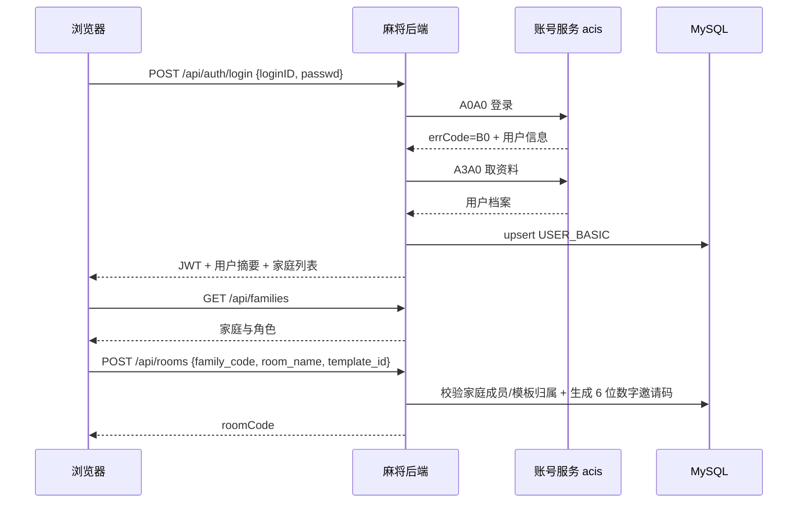
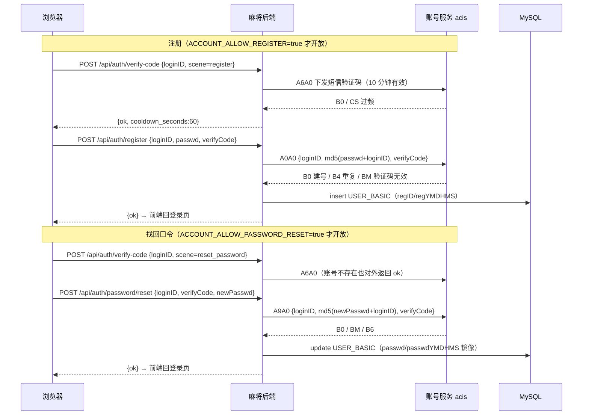
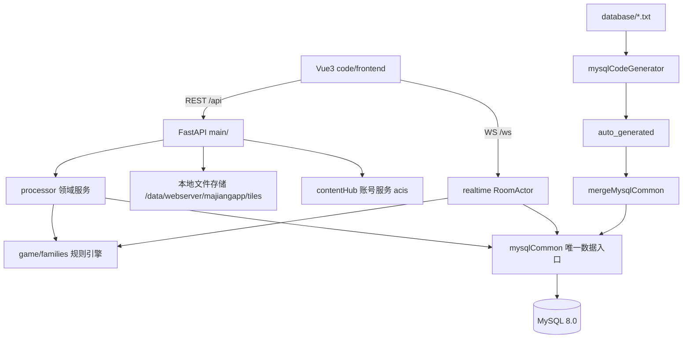

# 家庭麻将 · 总体规划文档

> 状态：v1.1.2（2026-10-31 文档定稿）；S0–S10 已实施并上线（2026-10-29），本轮追加运行反馈修复 R-1～R-4 / U-1～U-4 / B-1 与场次 F-1（默认 4 圈，开桌可选 1/2/4/8 圈）；**2026-10-31 第二轮追加 R-5 一只幺 / R-6 13不靠 取消门清独赢 / S-1 牌面人声报牌 / V-1 结算页胡张标记（已上线生产 v1.1.1）**；**2026-10-31 第三轮追加 U-5 庄徽标跟随轮转 / S-2 吃碰胡杠改叫牌人声（文档已定稿，代码待实施，实施步骤见 I13 / I14）**；**P8/P9（v1.1.0 首批）已于 2026-10-30 上线生产，发版记录见 [I7-发布记录.md](I7-发布记录.md)；P10（v1.1.1 第二轮：一只幺 / 13不靠 判番 / 牌面人声报牌 / 胡张标记）已于 2026-10-31 14:06 上线生产（未做冒烟），见 [v1.1.1-发布记录.md](v1.1.1-发布记录.md)；P11（v1.1.2 第三轮：庄徽标跟随 / 叫牌人声）已于 2026-10-31 16:28 上线生产（未做冒烟），见 [v1.1.2-发布记录.md](v1.1.2-发布记录.md)**
> 范围：规划文档；v1.1.0 的逐条问题台账与修复方案见 [改进和错误修复文档.md](改进和错误修复文档.md)，实施步骤见 [improve step-prompts.md](improve%20step-prompts.md)。
> 子文档：[架构](01-系统架构设计.md)｜[数据库](02-数据库设计.md)｜[规则族](03-规则族设计.md)｜[协议](04-协议设计.md)｜[UI](05-UI设计.md)｜[实施计划](06-实施计划.md)｜[柏氏细则](07-柏氏规则细则.md)｜[音效](08-音效设计.md)｜[改进和错误修复](改进和错误修复文档.md)｜[分步提示语](step-prompts.md)｜[v1.1.0 分步改进](improve%20step-prompts.md)

## 1. 背景

"家庭麻将 · 一桌一世界"是一套面向家庭成员、部署在自有服务器上的在线麻将 Web 应用：账号登录、邀请码开桌、四人入座、服务端权威判定吃碰杠胡、实时聊天与系统播报、规则模板自定、战绩查询。

现状（已核实的实现事实）：

| 维度 | 现状 |
| --- | --- |
| 后端 | FastAPI 0.115 + Uvicorn + SQLAlchemy 2.0（同步）+ Pydantic 2 + PyJWT；单进程内存房态 |
| 数据库 | SQLite（WAL），7 张表：`users`、`rule_templates`、`rooms`、`games`、`game_players`、`game_rounds`、`room_messages` |
| 前端 | Vue 3 + TypeScript + Vite 5 + Pinia + Tailwind CSS；5 个视图（登录/大厅/规则/牌桌/战绩） |
| 牌面 | `Tile.vue` 纯 CSS 绘制，无任何图片资源 |
| 接口 | 22 个 REST 端点（`/api/*`）+ 1 个 WebSocket（`/ws`） |
| 规则 | 单一通用 `RuleConfig`，20 个番种、四类牌型插件、三组「开关 + 从属配置」、4 套预置模板 |
| 测试 | 76 个 pytest 用例（引擎/牌型/番种/结算/WS），HTTP 端点无测试 |
| 账号 | 自建 `users` 表 + scrypt 口令 + 本地 JWT |

现状的结构性问题：

1. **账号与 contentHub 生态割裂**：家庭里已有 contentHub 账号体系（`USER_BASIC` + 账号服务 acis），麻将另建一套账号，成员要记两套密码。
2. **SQLite 不利于多人/多实例演进**，且建表靠 `Base.metadata.create_all`，没有版本化 schema 路径。
3. **规则只有一套通用实现**，无法表达四川、广东、柏氏等玩法差异；番种与开关全部塞在一个 `RuleConfig` 里。
4. **无家庭/租户概念**：一个部署只有一批成员、一批房间、一批模板，无法按家庭隔离数据。
5. **牌面无法换肤**：纯 CSS 单一风格，无法支持家庭自定义牌面。
6. **文档混杂**：`docs/` 同时承载规划与说明，规划变更没有单一来源。

## 2. 目标与非目标

### 2.1 目标

1. **账号复用**：接入 contentHub 账号服务（A0A0 登录/注册、A3A0 取资料、A6A0 短信验证码、A9A0 改密/找回口令、AIA0 存在性、A5A0 登出），本地 `USER_BASIC` 只做档案镜像，不再自建账号表与口令体系。
2. **MySQL 化**：表定义以 `code/backend/database/*.txt` 为唯一来源，经 `mysqlCodeGenerator.py` 生成数据层，业务层只经 `mysqlCommon` 访问 MySQL；移除 SQLAlchemy 与 Alembic。
3. **家庭隔离**：新增 `mj_family` / `mj_family_member`，房间、规则模板、自定义皮肤、审计日志按家庭隔离。
4. **规则族分层**：族决定引擎插件与可用开关，模板是族内参数预设；落地通用（generic）、广东（guangdong）、四川（sichuan）三族，并为柏氏（baishi）提供独立族与包牌结算（细则见 [07-柏氏规则细则.md](07-柏氏规则细则.md)）。
5. **多套牌面皮肤**：后台可上传、启停、排序、设默认；用户偏好存库；前端图片优先、CSS 回退。
6. **目录与文档重整**：`backend/`、`frontend/` 迁入 `code/`；`plan/` 放规划，`docs/` 放说明。
7. **可交付的实施路径**：文档细到文件路径、函数名、字段、错误码与验收命令，并拆成可独立开新对话执行的步骤。
8. **音效反馈**：纯前端 SFX 模块，覆盖发牌/掷骰/摸牌/出牌/吃/碰/杠/胡/荒庄/询问/轮到/超时/聊天；用户可开关与调音量；**全站不做背景音乐**。
9. **观战约束**：满座后观战者只跟随 1 名在座玩家，每名在座玩家最多被 10 名观战者跟随；观战快照只含目标手牌，观战关系只存内存、不落库。

### 2.2 非目标

- 不做多进程/多实例房态共享，不引入 Redis、消息队列。
- 不做语音、录像回放、观战列表（不展示「谁在看谁」，观战关系不落库）、排行榜、社交好友。
- 不做全牌视角/多人视角观战、不做观战者操作权与观战历史；观战者只能跟随一名玩家。
- **不做背景音乐（BGM）**、语音播报/TTS、服务端混音、家庭自定义音效包；音效首期只有固定一套 SFX。
- 不做旧 SQLite 数据迁移（账号在账号服务侧初始化，历史战绩不保留）。
- 不升级前端大版本（保持 Vue 3 / Vite 5 / Tailwind 3）。
- 不在本轮实现 100% 的广东/四川细则；柏氏细则已冻结于 07，本轮只落契约与通用引擎的等价迁移。
- 不做 i18n、PWA、SSR、亮色主题。
- 不做第三方登录、图形验证码、记住我；注册与找回只走短信验证码（与 museum/webserver 参考实现一致，不引入其未启用的能力）。

## 3. 角色与权限

| 角色 | 来源 | 权限 |
| --- | --- | --- |
| 系统管理员 | 账号服务 `roleName` 映射 | 成员管理、皮肤全局管理、任意家庭与房间的只读/管理、审计查看 |
| 家庭管理员（owner） | `mj_family.ownerLoginID` / `mj_family_member.memberRole=OWNER` | 家庭资料、成员增删、家庭默认规则族/皮肤、家庭内皮肤管理、房间管理 |
| 家庭管理员（admin） | `memberRole=ADMIN` | 同 owner，但不能移除 owner、不能解散家庭 |
| 家庭成员 | `memberRole=MEMBER` | 开桌、入座、打牌、聊天、创建家庭内规则模板、切换自己的皮肤 |
| 观战者 | 同家庭但四座已满 | 必须选择并**只跟随 1 名在座玩家**；只收该玩家视角快照（目标手牌可见、其他家仅张数）；不能准备/开局/出牌；可聊天；每名在座玩家最多被 10 名观战者跟随 |

权限判定顺序：JWT 身份 → 家庭成员关系 → 家庭内角色 → 资源归属（房间/模板/皮肤属于该家庭）。

## 4. 功能清单

### 4.1 账号与家庭

| 编号 | 功能 | 说明 |
| --- | --- | --- |
| A1 | 登录 | `loginID` + 口令 → 账号服务 A0A0 → A3A0 取资料 → 同步 `USER_BASIC` → 签本地 JWT |
| A2 | 注册 | 两步：`/api/auth/verify-code` 发短信验证码（A6A0）→ `/api/auth/register` 走账号服务 A0A0（带 `verifyCode`，`passwd=md5(pwd+loginID)`）。是否开放由 `ACCOUNT_ALLOW_REGISTER` 控制（默认关，关闭时前端隐藏入口）；成功只同步 `USER_BASIC`，需回登录页自行登录 |
| A3 | 当前用户 | `GET /api/auth/me` 返回 `USER_BASIC` 摘要 + 全局角色 + 所属家庭列表 |
| A4 | 修改口令 | 登录态改密，转发账号服务 A9A0，不在本地存明文/新口令 |
| A4a | 找回口令（忘记密码） | 未登录两步：发码（A6A0，`scene=reset_password`）→ `/api/auth/password/reset` 走 A9A0（带 `verifyCode`）。`ACCOUNT_ALLOW_PASSWORD_RESET` 控制开关；验证码 10 分钟有效、一次性、同号 60 秒冷却、5 次失败作废；账号不存在时不暴露 |
| A4b | 认证能力探测 | `GET /api/auth/options` 返回 `register_enabled` / `password_reset_enabled` / `verify_code_cooldown_seconds`，前端据此渲染入口与倒计时 |
| A5 | 我的家庭 | 列表、当前家庭（`mj_user_pref.lastFamilyID`）、切换 |
| A6 | 创建家庭 | 创建者自动成为 owner 与成员，生成 `familyCode`（小写字母数字，≤32） |
| A7 | 成员管理 | owner/admin 按 `loginID` 添加成员、改角色、停用；系统管理员可跨家庭 |
| A8 | 家庭默认值 | 默认规则族、默认皮肤，供开桌与前端初始化使用 |

### 4.2 规则

| 编号 | 功能 | 说明 |
| --- | --- | --- |
| R1 | 规则族列表 | 全局族（generic/guangdong/sichuan/baishi），带 `capabilityJson` 与状态 |
| R2 | 模板列表 | 家庭内模板 + 全局预置模板；预置只读 |
| R3 | 模板增改 | 归属某族，按族能力校验；名称/说明/config |
| R4 | 模板复制 | 预置或他人模板复制为家庭内模板 |
| R5 | 模板停用 | 软删（`activeFlag=0`），不影响历史快照 |
| R6 | 规则校验 | `POST /api/rules/validate` 返回中文错误与摘要，按族校验 |
| R7 | 开桌快照 | 开桌时把族 + 模板 + 生效配置冻结进房间；开局再冻结进场次 |

### 4.3 牌桌与对局

| 编号 | 功能 | 说明 |
| --- | --- | --- |
| G1 | 创建房间 | 6 位数字邀请码、房间名、模板；房间归属当前家庭 |
| G2 | 入房校验 | 按邀请码查房，校验家庭成员、房间状态、人数 |
| G3 | 入座/准备 | 4 座，先到先得；满座后进入观战，观战须选择一名在座玩家（见 G13） |
| G4 | 开局/下一局 | 房主操作；需 4 人且全部准备；**每场首局**先抽座定东位与庄家（换圈不重抽）；座位 3（北位）庄家下庄即本圈结束；一场默认 **4 圈**（16 个庄次），开桌可选 1/2/4/8 圈 |
| G5 | 动作 | 出牌、吃、碰、明杠/暗杠/补杠、胡、过；服务端权威判定 |
| G6 | 计时 | 出牌限时（可关）、碰杠胡询问窗口（常开）、断线座位保留 |
| G7 | 结算 | 自摸/点炮/抢杠胡/荒庄/杠分/包牌（族钩子）；逐局落库 |
| G8 | 聊天 | 文字 1–200 字，5 秒 3 条限流；系统播报落库 |
| G9 | 断线重连 | 保留座位 3 分钟；重连先 `room.welcome` 再 `state.resync` |
| G10 | 抽座与轮庄 | **整场抽座一次**（四人掷 2 骰，最大者坐东并坐庄），座位与座风整场不变；庄家按座位顺延，**庄家胡牌连庄**（庄位与局风不动） |
| G11 | 发牌 | 庄家掷 2 骰定开牌点；每轮每人 4 张、共 3 轮；庄家跳牌取第 1、第 5 张（14 张），闲家各 13 张 |
| G12 | 局风与荒庄 | 局风按本圈局序 东南西北（每圈重置）；有杠（明/暗/补）荒庄迁庄并推进轮庄，无杠重发本局不计局 |
| G14 | 一场时长 | 一场 = N 圈 × 每圈 4 个庄次；N 默认 4，开桌时可选 1/2/4/8；打满即收场（`final_hands` 与总结算照常落库）；连庄会让实际局数多于 N×4 |
| G13 | 观战跟随 | 四座满后进入观战：每个观战者**同一时刻只跟随 1 名在座玩家**，切换即把名额从旧目标转移到新目标；**每名在座玩家最多被 10 名观战者跟随**，第 11 人返回 `SPECTATE_TARGET_FULL`；4×10 满后新连接返回 `ROOM_SPECTATE_FULL`；观战快照只给目标手牌明文；目标离座即清空跟随并回到「未选择」态；观战关系只存内存（不落库、不做名单） |

### 4.4 皮肤

| 编号 | 功能 | 说明 |
| --- | --- | --- |
| S1 | 皮肤清单 | 按家庭返回可用皮肤（全局内置 + 家庭自定义），带 ETag |
| S2 | 皮肤管理 | 家庭管理员/系统管理员：新建、上传 34 张牌 + 牌背、启停、排序、设默认、删除（软删） |
| S3 | 用户偏好 | `mj_user_pref.skinCode`；优先级 用户偏好 > 家庭默认 > 全局默认 > `css-classic` |
| S4 | 回退 | 单张缺图或加载失败即回退 CSS 牌面，不阻塞牌桌 |

### 4.5 战绩与审计

| 编号 | 功能 | 说明 |
| --- | --- | --- |
| H1 | 我的场次 | 按家庭过滤，分页（`limit` + `before_id`） |
| H2 | 场次详情 | 玩家、逐局结算、规则快照摘要；参与者或管理员可见 |
| H3 | 我的统计 | 累计积分、场次、胡牌局数、最好/最差场；按家庭可选 |
| H4 | 审计 | 皮肤/模板/成员/家庭变更留痕：操作者、动作、对象、详情、时间 |

### 4.6 音效

细则见 [08-音效设计.md](08-音效设计.md)；**只有 SFX，没有 BGM**，协议零改动（全部由既有 WS 事件驱动）。

| 编号 | 功能 | 说明 |
| --- | --- | --- |
| E1 | 动作音效 | 出牌、吃、碰、明杠/暗杠/补杠、胡、荒庄、抢杠提示；按优先级混音，同键 150ms 去重 |
| E2 | 牌局音效 | 掷骰、洗牌发牌、摸牌（自己正常、他人 40% 音量）、轮到自己、超时提示 |
| E3 | 聊天提示 | 复用既有 `chatSoundFlag`；聊天面板聚焦或系统播报时不响 |
| E4 | 音效设置 | 牌桌 ScoreBoard「音效」弹层：总开关、音量 0–100、试听；写入 `mj_user_pref` |
| E5 | 静音降级 | 缺文件/解码失败/自动播放被拦/后台标签页 → 静默降级，不阻塞对局、不报错 |
| E6 | 无 BGM | 不加载任何背景音乐或音频流；无音乐开关、无播放列表 |
| E7 | 牌面报牌（v1.1.1 追加） | 出牌后叠加播放该张牌的**女声报牌音**（34 个：一万～九万、一筒～九筒、一条～九条、东南西北中发白）；**纯前端、协议零改动**（只消费既有 `event.discarded.tile`）；与落牌底噪叠加而非替换；细则见 [08-音效设计.md §2.1](08-音效设计.md) |
| E8 | 叫牌人声（v1.1.2 追加） | 吃 / 碰 / 胡 / 明杠 / 暗杠 / 补杠 六种叫牌改播**女声人声**（6 个独立枚举键 `chow_voice`/`pong_voice`/`hu_voice`/`kong_exposed_voice`/`kong_hidden_voice`/`kong_added_voice`）；旧合成音**文件保留但不再触发**；与人声**互斥不叠加**、与牌面报牌**互不干扰**；**纯前端、协议零改动**；细则见 [08-音效设计.md §2.2](08-音效设计.md) |

### 4.7 v1.1.0 运行反馈修复（第一轮 + 2026-10-31 第二轮 / 第三轮追加）

逐条现象、根因与验收见 [改进和错误修复文档.md](改进和错误修复文档.md)；本节只保留范围口径。

| 编号 | 项 | 说明 |
| --- | --- | --- |
| R-1 | 258 赢 | 最后赢张为数牌 2/5/8 计 1 番，可与其他番种叠加（07 §6.11） |
| R-2 | 十三不靠 | 宽松口径：中发白必含、东南西北可选（各 ≤1）、数牌每门 0–3 张且同门同组（147/258/369）、允许缺门、恰好一对将（可为字牌） |
| R-3 | 连六 | 同花色 123456 / 234567 / 456789，每组 1 番、可多组累加；龙占用顺子不参与 |
| R-4 | 断幺 | 整手牌（含副露）无 1/9 数牌、无任何字牌计 1 番 |
| U-1 | 胡牌优先 | 同一玩家可胡也可吃碰时，先只下发 `hu/pass`；过胡（仅当前这张牌）后才补发吃碰杠 |
| U-2 | 吃牌选两张 | 点"吃"进入选牌态，默认高亮推荐组合，可点选/取消/改选两张后确认；"取消"只退出选牌态 |
| U-3 | 结算庄家标记 | 结算面板四位牌友中，庄家卡片显示"庄"徽标 |
| U-4 | 提示字号 | 吃碰提示语整体放大 2 号（桌面 14px、手机 13px、动作条按钮 16px） |
| B-1 | 结束牌局收尾 | 结束牌局或打满一场必须落库 `roomStatus=CLOSED`、大厅立即消失、重复操作幂等、WS 断线时 REST 兜底 |
| F-1 | 一场时长 | 默认 4 圈 × 每圈 4 个庄次（=16 个庄次），开桌可选 1/2/4/8 圈；整场只抽一次座；圈序与本圈进度进快照，顶栏显示「第 x/y 圈 · 第 a/4 局」 |
| R-5 | 一只幺 | **胡牌后的 14 张牌（含副露）里只有一只幺**（数牌 1/9 与字牌）计 1 番；成立路径 = 恰有一组 123 / 789 顺子（端张为幺）；番表 34 → **35 项**（07 §6.4.9） |
| R-6 | 13不靠 不计门清/独赢 | 13不靠 仍为 10 番，仍判将牌、缺门、混一色/清一色，**删去**门清 1 番与独赢 1 番（典型手牌 14 → 12 番） |
| S-1 | 牌面人声报牌 | 出牌后叠加该张牌的女声报牌音（34 个，逐张区分）；纯前端、协议零改动；随音效总开关与音量生效（08 §2.1） |
| V-1 | 结算页胡张标记 | 结算面板与战绩回放中，**胡牌的那一张**加金色「胡」角标 + 双层描金；后端补 `final_hands[].winning_tile_index`（只增字段、无 DDL）（05 §4.5） |
| U-5 | 庄徽标跟随轮转 | 牌桌上的金色「庄」徽标必须**跟随庄家轮转**（换庄后移动到新庄家）；判定**下沉到座位组件**（`isDealer \|\| seat.is_dealer`），桌面左/右/对家/自己 + 手机四席**全部覆盖**；「庄」徽标（`dealer_seat`）与金色边框（`turn`）是**两个独立元素**（05 牌桌规格） |
| S-2 | 叫牌人声 | 吃 / 碰 / 胡 / 明杠 / 暗杠 / 补杠 改播**女声人声**（6 个独立枚举键，走 `voice/` 目录）；**旧合成音文件保留但不再触发**；与人声互斥不叠加、与牌面报牌互不干扰；协议零改动（08 §2.2） |

## 5. 核心业务流程

### 5.1 登录 → 选家庭 → 开桌



### 5.1.1 注册与找回口令



- 两条链都**不签 JWT**：注册/重置完成后由用户主动登录，避免半登录态。
- 验证码不入库、不缓存；本地只做 60 秒冷却与 5 次失败计数。
- 找回口令不校验「账号是否存在」对外差异，仅审计记录原因，避免手机号枚举。

### 5.2 一局的生命周期

`waiting`（等待入座/准备）→ `dealing`（发牌）→ `discard`（出牌）→ `claim`（询问窗口）→ … → `settled`（结算）→ 下一局或 `finished`（整场结束）。

- 房态只在内存 `RoomActor`，按座位或观战目标生成快照；牌墙永不下发。
- 每局结算立即落库（`mj_game_round` + 更新 `mj_game_player.totalScore`）。
- 进程重启：遗留 `playing` 场次标记 `aborted`，座位与当前局丢弃，历史积分不受影响。

### 5.3 座位、发牌与荒庄（摘要）

细则以 [03-规则族设计.md](03-规则族设计.md) §3.4–3.6 为准，四族一致：

| 项 | 规则 |
| --- | --- |
| 座位顺序 | 座位号 0/1/2/3 为物理座位（座位 0 称东位）；摸打与询问顺序恒为 0→1→2→3 |
| 抽座时机 | **整场开始前抽一次**，座位与座风整场不变（换圈不重抽）；**北位（座位 3）庄家打完下庄即本圈结束**，最少 4 局 |
| 定座定庄 | 四人各抽风签定方位 → 各掷 2 颗骰，点数最大者坐东位并坐庄（与东位换座）；同点先掷者优先 |
| 轮庄与门风 | 庄家按 `0→1→2→3` 顺延，**庄家胡牌连庄**（庄位与局风不动）；门风 = `(座位 - 庄家) % 4`，庄家恒东风，逐局转动 |
| 局风 | 本圈内局序 东风→南风→西风→北风，每圈重置，**与谁是庄家无关** |
| 场与圈 | 一场 = 默认 4 圈 × 每圈 4 个庄次（开桌可选 1/2/4/8 圈）；打满圈数收场 |
| 发牌 | 庄家掷 2 骰定开牌家与开牌点；每人 4 张 × 3 轮 = 12 张；庄家跳牌取第 1、第 5 张，南西北各 1 张 → 14/13/13/13 |
| 荒庄 | 牌墙取尽无胡：**有杠**（明杠/暗杠/补杠）→ 记荒庄、迁庄、推进轮庄；**无杠** → 重发本局，不推进、庄家与局风不变 |
| 风刻加番 | 柏氏：门风刻 1 + 圈风刻 1，可叠加至 +2（07 §6.9） |
| 抢杠胡 | 仅**明杠**可被抢（补杠、暗杠不可）；三家各付、不乘自摸、不触发包牌（07 §6.5.4） |

## 6. 系统架构摘要



分层要点：路由只做鉴权/校验/错误映射；`processor/` 编排业务与事务；`game/` 纯逻辑不触库；`realtime/` 持房态并按座位或观战目标出快照；`mysqlCommon` 是唯一 SQL 出口。

## 7. 技术栈

| 层 | 选型 |
| --- | --- |
| 数据库 | MySQL 8.0 / InnoDB / utf8mb4 / `utf8mb4_0900_ai_ci` |
| 连接 | pymysql + DBUtils.PooledDB；写句柄 `dbW`、读句柄 `dbR`；池大小 5–20 |
| 表定义 | `database/userBasic.txt`、`database/mj_*.txt` + `mysqlCodeGenerator.py` |
| 数据访问 | `common/mysqlCommon.py`（生成区 + 手写区） |
| 后端 | FastAPI + Uvicorn（同步路由 + 原生 WebSocket）；无 SQLAlchemy/Alembic |
| 账号 | contentHub 账号服务（HTTP CMD）+ `USER_BASIC` + 本地 JWT（HS256） |
| 前端 | Vue 3 + TS + Vite 5 + Pinia + Tailwind 3 |
| 文件 | 本地磁盘 `code/backend/data/webserver/majiangapp/tiles/{skinCode}/`（生产 `/data/webserver/majiangapp/tiles/{skinCode}/`） |
| 运行 | Python 3.11+、Node 20+、Windows 开发 / Ubuntu 22.04 生产 |

## 8. 目录规划

```
majiang/
├── README.md
├── plan/                       # 规划（本目录）
├── docs/                       # 系统说明
└── code/
    ├── backend/                # 等价 contentHub 的 code/src
    │   ├── src/                # 只放代码，运行时产物一律不落这里
    │   │   ├── database/       # userBasic.txt、mj_*.txt、mysqlCodeGenerator.py、auto_generated/
    │   │   ├── common/         # mysqlCommon、mysqlHandle、accountClient、miscCommon
    │   │   ├── config/         # localSettings、basicSettings、mysqlSettings
    │   │   ├── main/           # FastAPI 装配与路由
    │   │   ├── processor/      # 领域服务与事务
    │   │   ├── game/           # 引擎 + families/{generic,guangdong,sichuan,baishi}
    │   │   ├── realtime/       # RoomActor、快照、落库
    │   │   ├── tools/          # genTableCode.ps1、mergeMysqlCommon.py、initTables.py
    │   │   └── tests/
    │   ├── log/                # 所有日志：应用日志 + cron 脚本日志
    │   └── data/               # 所有附属数据：db/、test/、backup/
    │       └── webserver/majiangapp/tiles/   # 前端可直访图片（生产 /data/webserver/majiangapp）
    └── frontend/
```

## 9. 关键设计决策

| 编号 | 决策 | 理由 |
| --- | --- | --- |
| D1 | 表定义只用 `.txt`，禁止手写 DDL 作为权威 | 与 contentHub 一致，生成与合并可重复 |
| D2 | 移除 SQLAlchemy/Alembic，业务层只经 `mysqlCommon` | 单一数据入口，避免 ORM 与生成代码两套模型 |
| D3 | `recID INT AUTO_INCREMENT` | 家庭规模足够，索引更小；按用户要求 |
| D4 | 账号不自建 | 复用账号服务与 `USER_BASIC`，避免双份账号 |
| D5 | JWT 只放 `loginID` 与全局角色，不放家庭 | 家庭可切换，避免换家庭重签 |
| D6 | 家庭隔离落在数据模型与查询条件 | 不依赖前端过滤；跨家庭访问一律 403 |
| D7 | 规则族全局、模板按家庭 | 柏氏等玩法可被任何家庭选用；模板是家庭资产 |
| D8 | 开桌/开局双快照 | 修改模板不影响进行中与历史对局 |
| D9 | 邀请码 6 位纯数字、全局唯一 | 好念、好输入；单列 UNIQUE 规避复合唯一限制 |
| D10 | 皮肤图片优先、CSS 回退 | 零资源时表现与现状一致，可渐进启用 |
| D11 | 时间统一：DB 用 `VARCHAR(16)` 本地时间，实时倒计时用 epoch 秒 | 与 contentHub 对齐；避免时区丢失 |
| D12 | 单进程 + 连接池，不引入 Redis | 家庭规模（<20 人、<3 桌）足够 |
| D13 | **整场抽座一次**、座位与座风全场不变；庄家按座位顺延、庄家胡牌连庄；北位下庄即本圈结束 | 一圈至少 4 局、每人各坐庄一次；家人在牌桌上不来回换座，连庄保留「手气旺继续坐」的体验 |
| D14 | 荒庄二分：有杠记荒庄迁庄计局，无杠重发本局 | 杠分已即时结算不能凭空重来；无杠时重发不影响分数，避免无谓扣局 |
| D15 | 门风看庄家（庄家恒东，逐局转动）、局风看局序（第 1 局东） | 两个「风」正交，风刻番（门风刻/圈风刻）判定无歧义，且与现有 `seat_wind` 实现一致 |
| D16 | 音效纯前端、只有 SFX、**不做 BGM** | 家庭长时间开局，BGM 干扰交谈且涉版权；音效只消费既有 WS 事件，服务端零感知，缺资源时可直接静音降级 |
| D17 | 观战**一人一目标**，每名在座玩家**上限 10 人**；观战关系只存 `RoomActor` 内存、不落库 | 观战者可见信息严格等于「目标玩家已知信息 + 公共信息」，不给额外手牌优势；上限按 `loginID` 计数，多标签页不重复占位；观战与座位/准备态同属房态，进程重启即清空，天然满足「不做观战列表」 |
| D18 | 房间收尾**唯一出口 + 幂等**：任何「整场结束」（自然打满或房主提前结束）都必须落库 `roomStatus='CLOSED'`；`game.finish` 在 `playing/finished` 两态均可用且重复调用幂等；关房失败必须回 `CLOSE_FAILED` 而不是静默 | 大厅只列 `OPEN`，只要状态没落库就会出现「结束了还挂在大厅」；内存已关、库里还开会产生幽灵房。收尾做成单入口后，自然结束与提前结束不会再有两条口径 |
| D19 | 番表以 `FAN_TABLE` 为唯一来源，**加番必须同步 07 条款 + 自检用例 + pytest 断言**（32 → 34 项）；13不靠 采用宽松口径（含风、可缺门、字牌将） | 番表是元组驱动，加一行成本极低，但缺少「细则/用例/校验」三处同改的门禁就会出现实现与文档漂移；宽松口径与家庭实际打法一致 |
| D20 | 询问窗口**两段式**：有胡先只问胡，过胡（仅当前这张牌）后才补发吃碰杠；吃牌改为客户端指定两张手牌、服务端严格校验 | 一个玩家在一张牌上是「先决定胡不胡，再决定吃碰」的有序决策；服务端代选吃牌组合既算不全（被吃牌作边张时漏项）也无法表达玩家意图 |
| D21 | 一场时长**可配**：`circles_per_game ∈ {1,2,4,8}`，默认 4 圈；开桌时按桌覆盖（只写本房快照，不改模板）；每圈固定 4 个庄次 | 4 局（一圈）对家庭局太短；时长应由开局的人决定而不是模板管理员；覆盖写快照保证「开桌即冻结、事后改模板不影响本房」 |
| D22 | 牌面报牌**纯前端、协议零改动**：只消费既有 `event.discarded.tile`，34 个女声资源放独立 `public/audio/voice/` 目录、**不扩 `SoundKey` 枚举**（避免预加载一次拉 49 个文件）；按需加载 + 空闲预热控制首屏流量；与落牌底噪**叠加**而非替换 | 牌面信息是公共信息，听觉传达比视觉更快；`SoundKey` 是字面量联合类型，扩到 49 项会让预加载与 `audioState.total` 失控；叠加保留麻将现场感。**素材来自无 LICENSE 的第三方仓库（`1RGameSol/Mahjong-1`），权利归属不明，风险已由用户明确接受并登记在 08 §6.3 与 `voice/LICENSE.md`** |
| D23 | 胡张位置**由后端给出**：`final_hands_snapshot()` 增 `winning_tile_index`（排序后 `concealed` 下标，同值取最后一次出现）；前端只做渲染（金色「胡」角标 + 双层描金） | `concealed` 是扁平数组且引擎 `tiles.sort()` 会打散位置，前端无法可靠推断；由后端给下标是唯一可靠口径，且**只增字段、不改表**（JSON 列）。前后端必须共用同一口径，否则旧局战绩会指错牌 |
| D24 | 庄徽标判定**下沉到座位组件**：徽标显示条件为 `isDealer \|\| seat.is_dealer`（`isDealer` 为 prop、`seat.is_dealer` 来自快照）；后端 `snapshot.py` 已按座位下发 `is_dealer`，**不改后端、不改协议** | 「庄」徽标与金色边框是两个视觉元素、两个数据源（`dealer_seat` vs `turn`）；若把判定留在父组件，4 个渲染点（桌面左/右/对家 + 两端自己内联块）就会各自漏传，徽标被钉死在某个槽位。判定下沉到组件后，新增渲染点自动正确；组件内 `\|\|` 兜底也兼容既有 prop 调用方 |
| D25 | 叫牌人声走**独立枚举键 + `SoundSpec.dir` 字段**：`SoundKey` 新增 6 个 `*_voice` 键、`SoundSpec` 增可选 `dir?: 'sfx' \| 'voice'`、`sfxUrl()` 改拼 `audio/${dir ?? 'sfx'}/${file}`；**`SOUND_KEYS` 仍 15 项、预加载文件数不变、`audioManager.ts` 零改动**；旧 6 个合成键**移除但文件保留** | 6 个叫牌音是**静态枚举**，不是 34 个牌面那种动态键，因此走 `playSound()` 枚举通道即可，`playVoice()` 动态通道（34 基名白名单 + 250ms 全局间隔）不适用；同名文件（`hu.mp3` 等）在 `sfx/` 与 `voice/` 各一份，必须靠 `dir` 区分，否则会互相覆盖；移除旧键可保证「旧音不再触发」，而磁盘文件保留便于回滚 |

## 10. 里程碑

| 阶段 | 内容 | 交付物 |
| --- | --- | --- |
| P0 | 文档评审与冻结 | `plan/*` 全部评审通过 |
| P1 | 目录迁移与骨架 | `code/backend`、`code/frontend`、配置、静态托管路径修正 |
| P2 | 数据库落地 | `database/userBasic.txt` + 14 张 `mj_*.txt`、生成器/合并工具、`initTables.py` 跑通 |
| P3 | 账号与家庭 | 登录/注册/资料同步、JWT、家庭与成员管理、隔离校验 |
| P4 | 数据层改造 | 移除 ORM，现有 22 个端点改走 `mysqlCommon`，事务与连接池（全量端点见 04，共 44 个） |
| P4b | 观战跟随与围观上限 | 目标选择/切换、每名在座玩家 10 人上限、按目标视角出快照、牌桌观战面板 |
| P5 | 规则族 | 通用族等价迁移；广东/四川骨架；柏氏细则落地（累计求番、倍数、包牌、暂停） |
| P6 | 皮肤与音效 | 皮肤表、上传/管理接口、静态托管、前端切换与回退；音效模块与 15 个 SFX 资源 |
| P7 | 联调、测试、部署 | 全量用例、迁移演练、Nginx/systemd/MySQL 上线 |
| P8 | v1.1.0 运行反馈修复 | B-1 房间收尾幂等 + R-1～R-4 番表 34 项 + U-1 两段式询问 + U-2 吃牌选两张 + U-3/U-4 结算与字号；验收见 [改进和错误修复文档.md](改进和错误修复文档.md) §6。**2026-10-30 已上线生产，2026-10-31 完成幽灵房清理与桌面/手机冒烟（[I7-发布记录.md](I7-发布记录.md)）** |
| P9 | v1.1.0 一场时长 | 默认 4 圈 × 每圈 4 个庄次、开桌可选 1/2/4/8 圈；整场只抽一次座；圈序/本圈进度进快照与顶栏；圈数写快照不改模板。**2026-10-30 与 P8 同批上线** |
| P10 | v1.1.1 追加需求（第二轮） | 柏氏番表 34 → **35 项**（新增「一只幺」1 番）；13不靠 不再计门清与独赢；新增 **34 个牌面人声报牌音效**（纯前端、协议零改动）；结算页与战绩页**明显标记胡牌的那张牌**（后端补 `winning_tile_index`、前端金色「胡」角标）；验收见 [改进和错误修复文档.md](改进和错误修复文档.md) §2A/§3A/§3B，实施步骤见 I9–I12。**2026-10-31 14:06 已上线生产（v1.1.1，未做冒烟，见 [v1.1.1-发布记录.md](v1.1.1-发布记录.md)）** |
| P11 | v1.1.2 追加需求（第三轮） | 牌桌「庄」徽标**跟随庄家轮转**（判定下沉到座位组件，桌面 + 手机四席全修）；吃 / 碰 / 胡 / 明杠 / 暗杠 / 补杠 六种叫牌改播**女声人声**（6 个独立枚举键 + `SoundSpec.dir` 字段，旧合成音文件保留但不再触发）；**纯前端、协议零改动、无 DDL**；验收见 [改进和错误修复文档.md](改进和错误修复文档.md) §3 U-5 / §3A-2 S-2，实施步骤见 I13–I14。**2026-10-31 16:28 已上线生产（v1.1.2，未做冒烟，见 [v1.1.2-发布记录.md](v1.1.2-发布记录.md)）** |

## 11. 风险与依赖

| 风险 | 影响 | 应对 |
| --- | --- | --- |
| 账号服务不可达 | 无法登录 | 明确错误提示与超时（30s）；部署前联通性检查 |
| `USER_BASIC` 与 contentHub 结构漂移 | 同步失败 | 44 列逐列对齐，静态测试锁定列集合 |
| 生成器限制（无外键/复合唯一/JSON） | 约束缺失 | 应用层校验 + 单列唯一键；JSON 列登记与归一 |
| 移除 ORM 引入回归 | 数据错写/漏写 | 端点级测试 + 事务封装 + 逐端点验收 |
| 规则族差异被低估 | 引擎返工 | 先冻结契约与能力声明；未定细则标"待补"不臆造 |
| 目录迁移遗漏硬编码路径 | 启动即坏 | 01 文档逐项映射，P1 验收全量 grep |
| 单进程房态 | 重启丢当前局 | 每局落库；发版避开对局；预留 RoomStore 接口 |
| 发牌/抽座/荒庄改动冲击旧用例 | 旧 76 用例中涉及发牌与庄家轮转的断言失效 | 用例只改发牌与轮庄断言，番种/牌型/结算基线不动；新增发牌张数、抽座、荒庄二分用例 |

## 12. 验收总则

1. `plan/` 与 `docs/` 文档齐全，交叉引用无死链；表名/字段名/接口路径/错误码四张清单互相一致。
2. 空库执行 `initTables.py` 后，`SHOW TABLES` 含 `USER_BASIC` 与 14 张 `mj_*`，无失败项。
3. 登录 → 建家庭 → 开桌 → 四人打完一场 → 战绩可查，全链路无 SQLite 依赖。
4. 跨家庭访问房间/模板/皮肤返回 403；非成员看不到家庭数据。
5. 邀请码全部为 `^[1-9][0-9]{5}$`，重复生成可自动重试。
6. 切换皮肤后 34 张牌 + 牌背全部命中；删除资源后自动回退 CSS 且牌桌不报错。
7. 现有 76 个引擎用例平移后全绿；新增账号/家庭/皮肤/邀请码/隔离用例全绿。
8. 发牌为 14/13/13/13（4 张 × 3 轮 + 跳牌）；第 n 局庄家 = 座位 n-1、局风随局序；荒庄二分与风刻用例全绿。
9. 音效：出牌/吃/碰/杠/胡/荒庄/摸牌/发牌/骰子各自命中；关闭后全站静音；删除任一音频文件仅该音效静音且无报错；全程无 BGM 请求。
10. 观战：满座后必须选择观战对象；同一观战者切换目标后旧目标计数 -1、新目标 +1；第 11 人返回 `SPECTATE_TARGET_FULL`；4×10 满后新连接返回 `ROOM_SPECTATE_FULL`；观战快照只有目标 `hand` 有值，其余三家仅 `hand_count`；观战者任何操作返回 `NO_SEAT`；`grep` 不到观战关系落库。
11. 柏氏番表 34 项与 07 §5 逐项一致；258赢 / 断幺 / 连6 / 13不靠（宽松口径）正反例全绿；重跑 `seedPresets` 后预置模板 `fan_table` 为 34 项。
12. 询问两段式：同一座位可胡可碰时 `legal.actions` 只有 `hu/pass`；过胡后同一张牌补发吃碰杠；`234556 万 + 4 万` 三组候选均可成顺子，非法两张返回 `BAD_CHOW`。
13. 结算与视觉：结算面板庄家卡片显示「庄」（含荒庄/连庄/换庄）；吃碰提示字号桌面 14px、手机 13px，375×667 与 667×375 均不折行、不遮挡。
14. 收尾：打满一场（所选圈数）或房主结束牌局后 `mj_room.roomStatus='CLOSED'`、`/api/rooms` 不含该房、重复点击幂等、WS 断开时 REST 兜底；生产无遗留 `OPEN` 房。
15. 场次：开桌可选 1/2/4/8 圈（默认 4），圈数只写本房快照且模板不变；4 圈房打完第 4 局仍在打（换圈、局风回东风、不重抽座），打满第 16 个庄次收场；1 圈房打完 4 个庄次即收场；顶栏显示「第 x/y 圈 · 第 a/4 局」并正确标注连庄。
16. 番表：柏氏 **35 项**，07 §5 表格、`FAN_TABLE`、03 §7.1 三处逐项一致；「一只幺」按**张数**判定（胡牌后 14 张牌里恰好 1 张幺牌，**含 123 / 789 顺子的端张**），副露中的幺牌同样计入；与断幺互斥；七对 / 十三幺 / 全幺 / 全文字 / 13不靠 恒为 0。
17. 13不靠：番值 = 10 + 将牌(0/1) + 缺门(0/1) + flush，**不含门清与独赢**（典型手牌 11–12 番）；其它牌型的门清 / 独赢判定不受影响；十三幺仍 102 番。
18. 牌面报牌：出牌逐张可辨（1 万 / 2 筒 / 东风）；落牌底噪同时存在；连续出两张不同牌不叠成噪音；关掉总开关后人声与 15 个 SFX 全部静音；删除任一 mp3 仅该牌面静音且无报错；**全程无新增 WS 字段**。
19. 胡张标记：结算页与战绩回放中胡牌的那张牌带金色「胡」角标且只有一张（自摸 / 点炮 / 抢杠胡均正确）；后端 `final_hands[].winning_tile_index` 指向排序后的正确下标；旧局缺该字段时前端回退口径与后端一致。
20. 庄徽标：桌面四席（左 / 右 / 对家 / 自己）与手机四席在每一局都**只有当前庄家**显示「庄」；换庄后徽标**跟随移动**；连庄时徽标不动；荒庄时仍显示；金色边框（`turn`）与「庄」徽标互不影响。
21. 叫牌人声：吃 / 碰 / 胡 / 明杠 / 暗杠 / 补杠 六种情形各播一次**女声**；旧合成音**不再触发**（`sfx/` 文件仍在磁盘）；荒庄只播 `exhausted`、不播 `hu_voice`；一局结算只播一次 `hu_voice`；与人声互斥不叠加、与牌面报牌互不干扰。
22. 叫牌人声降级与体量：关闭总开关后 15 个 SFX 全部静音、音量滑块同样生效；删除 `voice/` 中任一叫牌 mp3 只该叫牌静音、无报错；预加载仍为 15 个 SFX 请求；`voice/` 目录 40 个 mp3、合计 ≤400 KB；**全程无新增 WS 字段**。

## 13. 文档索引

| 文档 | 职责 |
| --- | --- |
| [01-系统架构设计.md](01-系统架构设计.md) | 目录映射、分层、账号链路、家庭上下文、数据访问红线、连接池、部署 |
| [02-数据库设计.md](02-数据库设计.md) | 字段级表定义、索引、JSON 登记、生成/合并流程、种子 |
| [03-规则族设计.md](03-规则族设计.md) | 族与模板、引擎契约、能力声明、四族差异、校验、柏氏摘要 |
| [07-柏氏规则细则.md](07-柏氏规则细则.md) | 柏氏番表 **35 项**（含门风刻/圈风刻/箭刻/258赢/断幺/一只幺）、13不靠宽松口径（**不判门清与独赢**）、累计计分、庄家倍数与轮庄、包牌算法、杠分、荒庄二分、暂停、验收用例（v1.10） |
| [04-协议设计.md](04-协议设计.md) | REST/WS 契约、错误码、邀请码、兼容 |
| [05-UI设计.md](05-UI设计.md) | 设计系统、页面规格、皮肤与切图、响应式 |
| [06-实施计划.md](06-实施计划.md) | 阶段、文件清单、测试矩阵、回滚 |
| [08-音效设计.md](08-音效设计.md) | SFX 触发映射、优先级与限流、Web Audio 实现、设置持久化、资源规格、**牌面人声报牌**、静音降级与验收 |
| [改进和错误修复文档.md](改进和错误修复文档.md) | v1.1.0 问题台账：R-1～R-6（规则）、U-1～U-4（交互）、B-1（收尾）、F-1（场次）、S-1（音效）、V-1（视觉），逐条现象/证据/根因/方案/验收/风险 |
| [step-prompts.md](step-prompts.md) | v1.0.x 分步实施提示语（S0–S10） |
| [improve step-prompts.md](improve%20step-prompts.md) | v1.1.0 分步改进提示语（I0–I8） |
