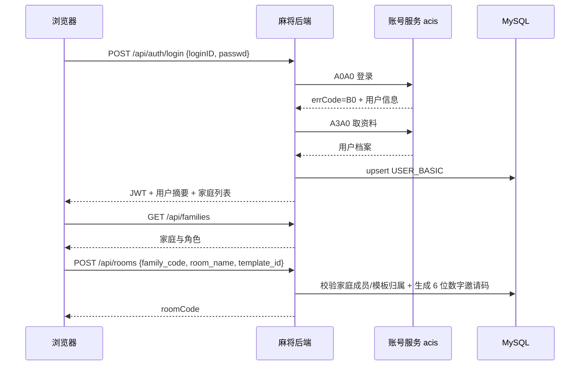
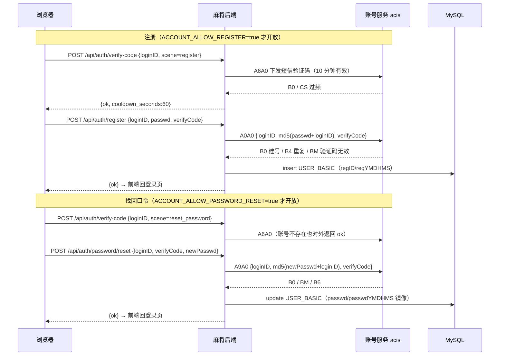
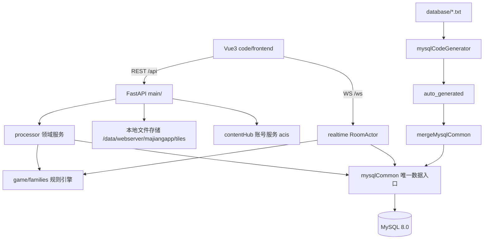

# 家庭麻将 · 总体规划文档

> 状态：已评审（2026-10-27）；同日追加观战约束（G13 / D17），S0–S2 已实施
> 范围：本轮只产出文档，不改代码、不建 `code/` 目录、不改配置。
> 子文档：[架构](01-系统架构设计.md)｜[数据库](02-数据库设计.md)｜[规则族](03-规则族设计.md)｜[协议](04-协议设计.md)｜[UI](05-UI设计.md)｜[实施计划](06-实施计划.md)｜[音效](08-音效设计.md)｜[分步提示语](step-prompts.md)

## 1. 背景

"家庭麻将 · 一桌一世界"是一套面向家庭成员、部署在自有服务器上的在线麻将 Web 应用：账号登录、邀请码开桌、四人入座、服务端权威判定吃碰杠胡、实时聊天与系统播报、规则模板自定、战绩查询。

现状（已核实的实现事实）：

| 维度 | 现状 |
| --- | --- |
| 后端 | FastAPI 0.115 + Uvicorn + SQLAlchemy 2.0（同步）+ Pydantic 2 + PyJWT；单进程内存房态 |
| 数据库 | SQLite（WAL），7 张表：`users`、`rule_templates`、`rooms`、`games`、`game_players`、`game_rounds`、`room_messages` |
| 前端 | Vue 3 + TypeScript + Vite 5 + Pinia + Tailwind CSS；5 个视图（登录/大厅/规则/牌桌/战绩） |
| 牌面 | `Tile.vue` 纯 CSS 绘制，无任何图片资源 |
| 接口 | 22 个 REST 端点（`/api/*`）+ 1 个 WebSocket（`/ws`） |
| 规则 | 单一通用 `RuleConfig`，20 个番种、四类牌型插件、三组「开关 + 从属配置」、4 套预置模板 |
| 测试 | 76 个 pytest 用例（引擎/牌型/番种/结算/WS），HTTP 端点无测试 |
| 账号 | 自建 `users` 表 + scrypt 口令 + 本地 JWT |

现状的结构性问题：

1. **账号与 contentHub 生态割裂**：家庭里已有 contentHub 账号体系（`USER_BASIC` + 账号服务 acis），麻将另建一套账号，成员要记两套密码。
2. **SQLite 不利于多人/多实例演进**，且建表靠 `Base.metadata.create_all`，没有版本化 schema 路径。
3. **规则只有一套通用实现**，无法表达四川、广东、柏氏等玩法差异；番种与开关全部塞在一个 `RuleConfig` 里。
4. **无家庭/租户概念**：一个部署只有一批成员、一批房间、一批模板，无法按家庭隔离数据。
5. **牌面无法换肤**：纯 CSS 单一风格，无法支持家庭自定义牌面。
6. **文档混杂**：`docs/` 同时承载规划与说明，规划变更没有单一来源。

## 2. 目标与非目标

### 2.1 目标

1. **账号复用**：接入 contentHub 账号服务（A0A0 登录/注册、A3A0 取资料、A6A0 短信验证码、A9A0 改密/找回口令、AIA0 存在性、A5A0 登出），本地 `USER_BASIC` 只做档案镜像，不再自建账号表与口令体系。
2. **MySQL 化**：表定义以 `code/backend/database/*.txt` 为唯一来源，经 `mysqlCodeGenerator.py` 生成数据层，业务层只经 `mysqlCommon` 访问 MySQL；移除 SQLAlchemy 与 Alembic。
3. **家庭隔离**：新增 `mj_family` / `mj_family_member`，房间、规则模板、自定义皮肤、审计日志按家庭隔离。
4. **规则族分层**：族决定引擎插件与可用开关，模板是族内参数预设；落地通用（generic）、广东（guangdong）、四川（sichuan）三族，并为柏氏（baishi）提供独立族与包牌结算（细则见 [07-柏氏规则细则.md](07-柏氏规则细则.md)）。
5. **多套牌面皮肤**：后台可上传、启停、排序、设默认；用户偏好存库；前端图片优先、CSS 回退。
6. **目录与文档重整**：`backend/`、`frontend/` 迁入 `code/`；`plan/` 放规划，`docs/` 放说明。
7. **可交付的实施路径**：文档细到文件路径、函数名、字段、错误码与验收命令，并拆成可独立开新对话执行的步骤。
8. **音效反馈**：纯前端 SFX 模块，覆盖发牌/掷骰/摸牌/出牌/吃/碰/杠/胡/荒庄/询问/轮到/超时/聊天；用户可开关与调音量；**全站不做背景音乐**。
9. **观战约束**：满座后观战者只跟随 1 名在座玩家，每名在座玩家最多被 10 名观战者跟随；观战快照只含目标手牌，观战关系只存内存、不落库。

### 2.2 非目标

- 不做多进程/多实例房态共享，不引入 Redis、消息队列。
- 不做语音、录像回放、观战列表（不展示「谁在看谁」，观战关系不落库）、排行榜、社交好友。
- 不做全牌视角/多人视角观战、不做观战者操作权与观战历史；观战者只能跟随一名玩家。
- **不做背景音乐（BGM）**、语音播报/TTS、服务端混音、家庭自定义音效包；音效首期只有固定一套 SFX。
- 不做旧 SQLite 数据迁移（账号在账号服务侧初始化，历史战绩不保留）。
- 不升级前端大版本（保持 Vue 3 / Vite 5 / Tailwind 3）。
- 不在本轮实现 100% 的广东/四川细则；柏氏细则已冻结于 07，本轮只落契约与通用引擎的等价迁移。
- 不做 i18n、PWA、SSR、亮色主题。
- 不做第三方登录、图形验证码、记住我；注册与找回只走短信验证码（与 museum/webserver 参考实现一致，不引入其未启用的能力）。

## 3. 角色与权限

| 角色 | 来源 | 权限 |
| --- | --- | --- |
| 系统管理员 | 账号服务 `roleName` 映射 | 成员管理、皮肤全局管理、任意家庭与房间的只读/管理、审计查看 |
| 家庭管理员（owner） | `mj_family.ownerLoginID` / `mj_family_member.memberRole=OWNER` | 家庭资料、成员增删、家庭默认规则族/皮肤、家庭内皮肤管理、房间管理 |
| 家庭管理员（admin） | `memberRole=ADMIN` | 同 owner，但不能移除 owner、不能解散家庭 |
| 家庭成员 | `memberRole=MEMBER` | 开桌、入座、打牌、聊天、创建家庭内规则模板、切换自己的皮肤 |
| 观战者 | 同家庭但四座已满 | 必须选择并**只跟随 1 名在座玩家**；只收该玩家视角快照（目标手牌可见、其他家仅张数）；不能准备/开局/出牌；可聊天；每名在座玩家最多被 10 名观战者跟随 |

权限判定顺序：JWT 身份 → 家庭成员关系 → 家庭内角色 → 资源归属（房间/模板/皮肤属于该家庭）。

## 4. 功能清单

### 4.1 账号与家庭

| 编号 | 功能 | 说明 |
| --- | --- | --- |
| A1 | 登录 | `loginID` + 口令 → 账号服务 A0A0 → A3A0 取资料 → 同步 `USER_BASIC` → 签本地 JWT |
| A2 | 注册 | 两步：`/api/auth/verify-code` 发短信验证码（A6A0）→ `/api/auth/register` 走账号服务 A0A0（带 `verifyCode`，`passwd=md5(pwd+loginID)`）。是否开放由 `ACCOUNT_ALLOW_REGISTER` 控制（默认关，关闭时前端隐藏入口）；成功只同步 `USER_BASIC`，需回登录页自行登录 |
| A3 | 当前用户 | `GET /api/auth/me` 返回 `USER_BASIC` 摘要 + 全局角色 + 所属家庭列表 |
| A4 | 修改口令 | 登录态改密，转发账号服务 A9A0，不在本地存明文/新口令 |
| A4a | 找回口令（忘记密码） | 未登录两步：发码（A6A0，`scene=reset_password`）→ `/api/auth/password/reset` 走 A9A0（带 `verifyCode`）。`ACCOUNT_ALLOW_PASSWORD_RESET` 控制开关；验证码 10 分钟有效、一次性、同号 60 秒冷却、5 次失败作废；账号不存在时不暴露 |
| A4b | 认证能力探测 | `GET /api/auth/options` 返回 `register_enabled` / `password_reset_enabled` / `verify_code_cooldown_seconds`，前端据此渲染入口与倒计时 |
| A5 | 我的家庭 | 列表、当前家庭（`mj_user_pref.lastFamilyID`）、切换 |
| A6 | 创建家庭 | 创建者自动成为 owner 与成员，生成 `familyCode`（小写字母数字，≤32） |
| A7 | 成员管理 | owner/admin 按 `loginID` 添加成员、改角色、停用；系统管理员可跨家庭 |
| A8 | 家庭默认值 | 默认规则族、默认皮肤，供开桌与前端初始化使用 |

### 4.2 规则

| 编号 | 功能 | 说明 |
| --- | --- | --- |
| R1 | 规则族列表 | 全局族（generic/guangdong/sichuan/baishi），带 `capabilityJson` 与状态 |
| R2 | 模板列表 | 家庭内模板 + 全局预置模板；预置只读 |
| R3 | 模板增改 | 归属某族，按族能力校验；名称/说明/config |
| R4 | 模板复制 | 预置或他人模板复制为家庭内模板 |
| R5 | 模板停用 | 软删（`activeFlag=0`），不影响历史快照 |
| R6 | 规则校验 | `POST /api/rules/validate` 返回中文错误与摘要，按族校验 |
| R7 | 开桌快照 | 开桌时把族 + 模板 + 生效配置冻结进房间；开局再冻结进场次 |

### 4.3 牌桌与对局

| 编号 | 功能 | 说明 |
| --- | --- | --- |
| G1 | 创建房间 | 6 位数字邀请码、房间名、模板；房间归属当前家庭 |
| G2 | 入房校验 | 按邀请码查房，校验家庭成员、房间状态、人数 |
| G3 | 入座/准备 | 4 座，先到先得；满座后进入观战，观战须选择一名在座玩家（见 G13） |
| G4 | 开局/下一局 | 房主操作；需 4 人且全部准备；每圈首局先抽座定东位与庄家；座位 3（北位）庄家下庄即一圈结束（最少 4 局） |
| G5 | 动作 | 出牌、吃、碰、明杠/暗杠/补杠、胡、过；服务端权威判定 |
| G6 | 计时 | 出牌限时（可关）、碰杠胡询问窗口（常开）、断线座位保留 |
| G7 | 结算 | 自摸/点炮/抢杠胡/荒庄/杠分/包牌（族钩子）；逐局落库 |
| G8 | 聊天 | 文字 1–200 字，5 秒 3 条限流；系统播报落库 |
| G9 | 断线重连 | 保留座位 3 分钟；重连先 `room.welcome` 再 `state.resync` |
| G10 | 抽座与轮庄 | 每圈抽座一次（四人掷 2 骰，最大者坐东并坐庄）；圈内座位不变，第 n 局庄家 = 座位 n-1，不连庄 |
| G11 | 发牌 | 庄家掷 2 骰定开牌点；每轮每人 4 张、共 3 轮；庄家跳牌取第 1、第 5 张（14 张），闲家各 13 张 |
| G12 | 局风与荒庄 | 局风随局序 东南西北（东风局→北风局）；有杠（明/暗/补）荒庄迁庄并推进轮庄，无杠重发本局不计局 |
| G13 | 观战跟随 | 四座满后进入观战：每个观战者**同一时刻只跟随 1 名在座玩家**，切换即把名额从旧目标转移到新目标；**每名在座玩家最多被 10 名观战者跟随**，第 11 人返回 `SPECTATE_TARGET_FULL`；4×10 满后新连接返回 `ROOM_SPECTATE_FULL`；观战快照只给目标手牌明文；目标离座即清空跟随并回到「未选择」态；观战关系只存内存（不落库、不做名单） |

### 4.4 皮肤

| 编号 | 功能 | 说明 |
| --- | --- | --- |
| S1 | 皮肤清单 | 按家庭返回可用皮肤（全局内置 + 家庭自定义），带 ETag |
| S2 | 皮肤管理 | 家庭管理员/系统管理员：新建、上传 34 张牌 + 牌背、启停、排序、设默认、删除（软删） |
| S3 | 用户偏好 | `mj_user_pref.skinCode`；优先级 用户偏好 > 家庭默认 > 全局默认 > `css-classic` |
| S4 | 回退 | 单张缺图或加载失败即回退 CSS 牌面，不阻塞牌桌 |

### 4.5 战绩与审计

| 编号 | 功能 | 说明 |
| --- | --- | --- |
| H1 | 我的场次 | 按家庭过滤，分页（`limit` + `before_id`） |
| H2 | 场次详情 | 玩家、逐局结算、规则快照摘要；参与者或管理员可见 |
| H3 | 我的统计 | 累计积分、场次、胡牌局数、最好/最差场；按家庭可选 |
| H4 | 审计 | 皮肤/模板/成员/家庭变更留痕：操作者、动作、对象、详情、时间 |

### 4.6 音效

细则见 [08-音效设计.md](08-音效设计.md)；**只有 SFX，没有 BGM**，协议零改动（全部由既有 WS 事件驱动）。

| 编号 | 功能 | 说明 |
| --- | --- | --- |
| E1 | 动作音效 | 出牌、吃、碰、明杠/暗杠/补杠、胡、荒庄、抢杠提示；按优先级混音，同键 150ms 去重 |
| E2 | 牌局音效 | 掷骰、洗牌发牌、摸牌（自己正常、他人 40% 音量）、轮到自己、超时提示 |
| E3 | 聊天提示 | 复用既有 `chatSoundFlag`；聊天面板聚焦或系统播报时不响 |
| E4 | 音效设置 | 牌桌 ScoreBoard「音效」弹层：总开关、音量 0–100、试听；写入 `mj_user_pref` |
| E5 | 静音降级 | 缺文件/解码失败/自动播放被拦/后台标签页 → 静默降级，不阻塞对局、不报错 |
| E6 | 无 BGM | 不加载任何背景音乐或音频流；无音乐开关、无播放列表 |

## 5. 核心业务流程

### 5.1 登录 → 选家庭 → 开桌



### 5.1.1 注册与找回口令



- 两条链都**不签 JWT**：注册/重置完成后由用户主动登录，避免半登录态。
- 验证码不入库、不缓存；本地只做 60 秒冷却与 5 次失败计数。
- 找回口令不校验「账号是否存在」对外差异，仅审计记录原因，避免手机号枚举。

### 5.2 一局的生命周期

`waiting`（等待入座/准备）→ `dealing`（发牌）→ `discard`（出牌）→ `claim`（询问窗口）→ … → `settled`（结算）→ 下一局或 `finished`（整场结束）。

- 房态只在内存 `RoomActor`，按座位或观战目标生成快照；牌墙永不下发。
- 每局结算立即落库（`mj_game_round` + 更新 `mj_game_player.totalScore`）。
- 进程重启：遗留 `playing` 场次标记 `aborted`，座位与当前局丢弃，历史积分不受影响。

### 5.3 座位、发牌与荒庄（摘要）

细则以 [03-规则族设计.md](03-规则族设计.md) §3.4–3.6 为准，四族一致：

| 项 | 规则 |
| --- | --- |
| 座位顺序 | 座位号 0/1/2/3 为物理座位（座位 0 称东位）；摸打与询问顺序恒为 0→1→2→3 |
| 抽座时机 | 每圈开始前抽一次，圈内座位不变；**北位（座位 3）庄家打完下庄即一圈结束**，最少 4 局 |
| 定座定庄 | 四人各抽风签定方位 → 各掷 2 颗骰，点数最大者坐东位并坐庄（与东位换座）；同点先掷者优先 |
| 轮庄与门风 | 第 n 局庄家 = 座位 n-1（不连庄）；门风 = `(座位 - 庄家) % 4`，庄家恒东风，逐局转动 |
| 局风 | 按局序 东风→南风→西风→北风，**与谁是庄家无关** |
| 发牌 | 庄家掷 2 骰定开牌家与开牌点；每人 4 张 × 3 轮 = 12 张；庄家跳牌取第 1、第 5 张，南西北各 1 张 → 14/13/13/13 |
| 荒庄 | 牌墙取尽无胡：**有杠**（明杠/暗杠/补杠）→ 记荒庄、迁庄、推进轮庄；**无杠** → 重发本局，不推进、庄家与局风不变 |
| 风刻加番 | 柏氏：门风刻 1 + 圈风刻 1，可叠加至 +2（07 §6.9） |
| 抢杠胡 | 仅**明杠**可被抢（补杠、暗杠不可）；三家各付、不乘自摸、不触发包牌（07 §6.5.4） |

## 6. 系统架构摘要



分层要点：路由只做鉴权/校验/错误映射；`processor/` 编排业务与事务；`game/` 纯逻辑不触库；`realtime/` 持房态并按座位或观战目标出快照；`mysqlCommon` 是唯一 SQL 出口。

## 7. 技术栈

| 层 | 选型 |
| --- | --- |
| 数据库 | MySQL 8.0 / InnoDB / utf8mb4 / `utf8mb4_0900_ai_ci` |
| 连接 | pymysql + DBUtils.PooledDB；写句柄 `dbW`、读句柄 `dbR`；池大小 5–20 |
| 表定义 | `database/userBasic.txt`、`database/mj_*.txt` + `mysqlCodeGenerator.py` |
| 数据访问 | `common/mysqlCommon.py`（生成区 + 手写区） |
| 后端 | FastAPI + Uvicorn（同步路由 + 原生 WebSocket）；无 SQLAlchemy/Alembic |
| 账号 | contentHub 账号服务（HTTP CMD）+ `USER_BASIC` + 本地 JWT（HS256） |
| 前端 | Vue 3 + TS + Vite 5 + Pinia + Tailwind 3 |
| 文件 | 本地磁盘 `code/backend/data/webserver/majiangapp/tiles/{skinCode}/`（生产 `/data/webserver/majiangapp/tiles/{skinCode}/`） |
| 运行 | Python 3.11+、Node 20+、Windows 开发 / Ubuntu 22.04 生产 |

## 8. 目录规划

```
majiang/
├── README.md
├── plan/                       # 规划（本目录）
├── docs/                       # 系统说明
└── code/
    ├── backend/                # 等价 contentHub 的 code/src
    │   ├── src/                # 只放代码，运行时产物一律不落这里
    │   │   ├── database/       # userBasic.txt、mj_*.txt、mysqlCodeGenerator.py、auto_generated/
    │   │   ├── common/         # mysqlCommon、mysqlHandle、accountClient、miscCommon
    │   │   ├── config/         # localSettings、basicSettings、mysqlSettings
    │   │   ├── main/           # FastAPI 装配与路由
    │   │   ├── processor/      # 领域服务与事务
    │   │   ├── game/           # 引擎 + families/{generic,guangdong,sichuan,baishi}
    │   │   ├── realtime/       # RoomActor、快照、落库
    │   │   ├── tools/          # genTableCode.ps1、mergeMysqlCommon.py、initTables.py
    │   │   └── tests/
    │   ├── log/                # 所有日志：应用日志 + cron 脚本日志
    │   └── data/               # 所有附属数据：db/、test/、backup/
    │       └── webserver/majiangapp/tiles/   # 前端可直访图片（生产 /data/webserver/majiangapp）
    └── frontend/
```

## 9. 关键设计决策

| 编号 | 决策 | 理由 |
| --- | --- | --- |
| D1 | 表定义只用 `.txt`，禁止手写 DDL 作为权威 | 与 contentHub 一致，生成与合并可重复 |
| D2 | 移除 SQLAlchemy/Alembic，业务层只经 `mysqlCommon` | 单一数据入口，避免 ORM 与生成代码两套模型 |
| D3 | `recID INT AUTO_INCREMENT` | 家庭规模足够，索引更小；按用户要求 |
| D4 | 账号不自建 | 复用账号服务与 `USER_BASIC`，避免双份账号 |
| D5 | JWT 只放 `loginID` 与全局角色，不放家庭 | 家庭可切换，避免换家庭重签 |
| D6 | 家庭隔离落在数据模型与查询条件 | 不依赖前端过滤；跨家庭访问一律 403 |
| D7 | 规则族全局、模板按家庭 | 柏氏等玩法可被任何家庭选用；模板是家庭资产 |
| D8 | 开桌/开局双快照 | 修改模板不影响进行中与历史对局 |
| D9 | 邀请码 6 位纯数字、全局唯一 | 好念、好输入；单列 UNIQUE 规避复合唯一限制 |
| D10 | 皮肤图片优先、CSS 回退 | 零资源时表现与现状一致，可渐进启用 |
| D11 | 时间统一：DB 用 `VARCHAR(16)` 本地时间，实时倒计时用 epoch 秒 | 与 contentHub 对齐；避免时区丢失 |
| D12 | 单进程 + 连接池，不引入 Redis | 家庭规模（<20 人、<3 桌）足够 |
| D13 | 每圈抽座一次、圈内座位不变；第 n 局庄家 = 座位 n-1（不连庄），北位下庄即圈结束 | 一圈至少 4 局、每人各坐庄一次，公平且免去连庄争议 |
| D14 | 荒庄二分：有杠记荒庄迁庄计局，无杠重发本局 | 杠分已即时结算不能凭空重来；无杠时重发不影响分数，避免无谓扣局 |
| D15 | 门风看庄家（庄家恒东，逐局转动）、局风看局序（第 1 局东） | 两个「风」正交，风刻番（门风刻/圈风刻）判定无歧义，且与现有 `seat_wind` 实现一致 |
| D16 | 音效纯前端、只有 SFX、**不做 BGM** | 家庭长时间开局，BGM 干扰交谈且涉版权；音效只消费既有 WS 事件，服务端零感知，缺资源时可直接静音降级 |
| D17 | 观战**一人一目标**，每名在座玩家**上限 10 人**；观战关系只存 `RoomActor` 内存、不落库 | 观战者可见信息严格等于「目标玩家已知信息 + 公共信息」，不给额外手牌优势；上限按 `loginID` 计数，多标签页不重复占位；观战与座位/准备态同属房态，进程重启即清空，天然满足「不做观战列表」 |

## 10. 里程碑

| 阶段 | 内容 | 交付物 |
| --- | --- | --- |
| P0 | 文档评审与冻结 | `plan/*` 全部评审通过 |
| P1 | 目录迁移与骨架 | `code/backend`、`code/frontend`、配置、静态托管路径修正 |
| P2 | 数据库落地 | `database/userBasic.txt` + 14 张 `mj_*.txt`、生成器/合并工具、`initTables.py` 跑通 |
| P3 | 账号与家庭 | 登录/注册/资料同步、JWT、家庭与成员管理、隔离校验 |
| P4 | 数据层改造 | 移除 ORM，现有 22 个端点改走 `mysqlCommon`，事务与连接池（全量端点见 04，共 44 个） |
| P4b | 观战跟随与围观上限 | 目标选择/切换、每名在座玩家 10 人上限、按目标视角出快照、牌桌观战面板 |
| P5 | 规则族 | 通用族等价迁移；广东/四川骨架；柏氏细则落地（累计求番、倍数、包牌、暂停） |
| P6 | 皮肤与音效 | 皮肤表、上传/管理接口、静态托管、前端切换与回退；音效模块与 15 个 SFX 资源 |
| P7 | 联调、测试、部署 | 全量用例、迁移演练、Nginx/systemd/MySQL 上线 |

## 11. 风险与依赖

| 风险 | 影响 | 应对 |
| --- | --- | --- |
| 账号服务不可达 | 无法登录 | 明确错误提示与超时（30s）；部署前联通性检查 |
| `USER_BASIC` 与 contentHub 结构漂移 | 同步失败 | 44 列逐列对齐，静态测试锁定列集合 |
| 生成器限制（无外键/复合唯一/JSON） | 约束缺失 | 应用层校验 + 单列唯一键；JSON 列登记与归一 |
| 移除 ORM 引入回归 | 数据错写/漏写 | 端点级测试 + 事务封装 + 逐端点验收 |
| 规则族差异被低估 | 引擎返工 | 先冻结契约与能力声明；未定细则标"待补"不臆造 |
| 目录迁移遗漏硬编码路径 | 启动即坏 | 01 文档逐项映射，P1 验收全量 grep |
| 单进程房态 | 重启丢当前局 | 每局落库；发版避开对局；预留 RoomStore 接口 |
| 发牌/抽座/荒庄改动冲击旧用例 | 旧 76 用例中涉及发牌与庄家轮转的断言失效 | 用例只改发牌与轮庄断言，番种/牌型/结算基线不动；新增发牌张数、抽座、荒庄二分用例 |

## 12. 验收总则

1. `plan/` 与 `docs/` 文档齐全，交叉引用无死链；表名/字段名/接口路径/错误码四张清单互相一致。
2. 空库执行 `initTables.py` 后，`SHOW TABLES` 含 `USER_BASIC` 与 14 张 `mj_*`，无失败项。
3. 登录 → 建家庭 → 开桌 → 四人打完一场 → 战绩可查，全链路无 SQLite 依赖。
4. 跨家庭访问房间/模板/皮肤返回 403；非成员看不到家庭数据。
5. 邀请码全部为 `^[1-9][0-9]{5}$`，重复生成可自动重试。
6. 切换皮肤后 34 张牌 + 牌背全部命中；删除资源后自动回退 CSS 且牌桌不报错。
7. 现有 76 个引擎用例平移后全绿；新增账号/家庭/皮肤/邀请码/隔离用例全绿。
8. 发牌为 14/13/13/13（4 张 × 3 轮 + 跳牌）；第 n 局庄家 = 座位 n-1、局风随局序；荒庄二分与风刻用例全绿。
9. 音效：出牌/吃/碰/杠/胡/荒庄/摸牌/发牌/骰子各自命中；关闭后全站静音；删除任一音频文件仅该音效静音且无报错；全程无 BGM 请求。
10. 观战：满座后必须选择观战对象；同一观战者切换目标后旧目标计数 -1、新目标 +1；第 11 人返回 `SPECTATE_TARGET_FULL`；4×10 满后新连接返回 `ROOM_SPECTATE_FULL`；观战快照只有目标 `hand` 有值，其余三家仅 `hand_count`；观战者任何操作返回 `NO_SEAT`；`grep` 不到观战关系落库。

## 13. 文档索引

| 文档 | 职责 |
| --- | --- |
| [01-系统架构设计.md](01-系统架构设计.md) | 目录映射、分层、账号链路、家庭上下文、数据访问红线、连接池、部署 |
| [02-数据库设计.md](02-数据库设计.md) | 字段级表定义、索引、JSON 登记、生成/合并流程、种子 |
| [03-规则族设计.md](03-规则族设计.md) | 族与模板、引擎契约、能力声明、四族差异、校验、柏氏摘要 |
| [07-柏氏规则细则.md](07-柏氏规则细则.md) | 柏氏番表 31 项（含门风刻/圈风刻）、累计计分、庄家倍数与轮庄、包牌算法、杠分、荒庄二分、暂停、验收用例 |
| [04-协议设计.md](04-协议设计.md) | REST/WS 契约、错误码、邀请码、兼容 |
| [05-UI设计.md](05-UI设计.md) | 设计系统、页面规格、皮肤与切图、响应式 |
| [06-实施计划.md](06-实施计划.md) | 阶段、文件清单、测试矩阵、回滚 |
| [08-音效设计.md](08-音效设计.md) | SFX 触发映射、优先级与限流、Web Audio 实现、设置持久化、资源规格、静音降级与验收 |
| [step-prompts.md](step-prompts.md) | 分步实施提示语 |
