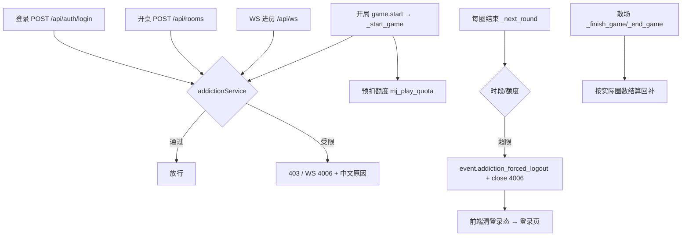

# 防沉迷机制（每日圈数上限 · 禁玩时段）

> 状态：草案（2026-11-27，待实施）
> 上游：[家庭麻将总体规划文档.md](家庭麻将总体规划文档.md)、[01-系统架构设计.md](01-系统架构设计.md)
> 权威边界：本文是**防沉迷语义的唯一权威**（规则口径、卡点时序、限制文案）。字段与接口在实施后并入 [02-数据库设计.md](02-数据库设计.md) 与 [04-协议设计.md](04-协议设计.md)；本文只给**增量提案**，不复制 02/04 的权威字段表。

## 1. 状态与范围

### 1.1 目标

家庭场景里最常见的两个诉求：**给孩子/自己定量**（每天最多 N 圈）与**给带娃的人定时段**（例如 17:00–22:00 禁止打牌）。本机制把它们做成可由家庭管理员配置的两条规则，并在 5 个卡点强制执行。

### 1.2 范围内

- 规则一：每自然日每人打牌圈数上限（预扣口径）。
- 规则二：每人禁玩时段（支持跨零点）。
- 卡点：登录、开桌、进房（含观战）、开局、每圈结束。
- 家庭管理员配置界面（PC + 手机）、受限成员的只读展示、超限文案与强制登出。

### 1.3 范围外

- 不做实名认证、不做人脸识别、不做设备指纹。
- 不改动计分、番表、规则族与既有对局数据语义。
- 不做家长远程实时监控/推送（后续可加）。
- 不限制观战以外的非牌桌功能（战绩、设置、家庭管理始终可访问）——**唯一例外**是「登录直接拒绝」模式下受限成员登录即被挡（见 §2.4）。

### 1.4 默认关闭

`mj_family_member.addictionEnabledFlag` 默认 `'0'`，上线后对存量玩家**零影响**；管理员逐个成员开启。

## 2. 规则定义

### 2.1 规则一：每日圈数上限

| 项 | 口径 |
| --- | --- |
| 统计对象 | 个人（`loginID`），按「生效家庭」分别统计 |
| 周期 | 自然日 `00:00:00`–`23:59:59`（Asia/Shanghai），记为 `quotaDate = YYYYMMDD` |
| 单位 | 圈（1 圈 = 4 个庄次，北位下庄即本圈结束，见 README 术语「圈」） |
| 上限 | `dailyCircleLimit`，`0` 表示不限；管理员可选 4/8/12/16 或自定义 |
| 记账口径 | **按开桌圈数预扣**：开局即按本场 `circles_per_game` 占用当日额度 |
| 回补 | 提前散场时按**实际完成圈数**结算，未打完的部分归还当日额度 |
| 判定式 | `used = Σ reservedCircles(当日该 loginID)`；`remaining = limit - used`；`remaining ≥ 本场圈数` 才允许开局 |

**为什么是预扣**：用户明确选择「开局即按本桌圈数占用额度」。这样不会出现"打了 3 圈才发现额度不够"的中途打断；代价是可能浪费额度，因此 §2.3 用散场结算把浪费降到最低。

### 2.2 规则二：禁玩时段

| 项 | 口径 |
| --- | --- |
| 字段 | `forbidStartHHMM` / `forbidEndHHMM`（`HHMM` 字符串，如 `1700`/`2200`） |
| 语义 | **该区间内禁止打牌**（其余时间可玩）；例：`1700`–`2200` 表示 17:00 起、22:00 止 |
| 边界 | 左闭右开：`17:00:00` 命中，`21:59:59` 命中，`22:00:00` 不命中 |
| 跨零点 | `start > end` 视为跨零点窗口，如 `2300`–`0700` |
| 未配置 | 两列任一为 `NULL`，或 `start == end`，或开关关闭 → 不限制 |
| 生效家庭 | 以**本次动作所属家庭**为准（房间的 `familyID` / 开桌时的 `current_family`） |

### 2.3 额度记账：预扣与回补

一次开局产生**一行** `mj_play_quota`（幂等键 `quotaKey`）：

| 阶段 | 触发点 | 台账变化 |
| --- | --- | --- |
| 预扣 | `_begin_game` 落库 `mj_game` 成功后 | `INSERT ... ON DUPLICATE KEY UPDATE`，`reservedCircles = 本场 circles_per_game`，`quotaStatus='RESERVED'` |
| 消耗 | 每圈结束（`_next_round` 判定跨圈） | `consumedCircles += 1`（上限为 `reservedCircles`） |
| 结算 | `_finish_game`（打满）/ `_end_game`（提前收场） | `reservedCircles = consumedCircles`，`quotaStatus='SETTLED'` |
| 崩溃兜底 | 服务重启后对 `RESERVED` 且 `mj_game.gameStatus` 已 `FINISHED/ABORTED` 的行 | 按 `consumedCircles` 结算（启动时一次性对账，见 §4.7） |

**幂等性**：`quotaKey = quotaDate_familyID_loginID_gameID` 单列内联 `UNIQUE`，重复开局/断线重连/重试都只命中同一行，`SUM(reservedCircles)` 不会重复扣。

**跨日**：一场牌跨过 0 点，额度全部归属**预扣日**，不拆分到第二天；次日新开一场按新 `quotaDate` 记账。这是预扣口径的已知取舍（§10 风险 R-2）。

### 2.4 豁免与默认值

| 情形 | 是否受限 | 说明 |
| --- | --- | --- |
| 成员未开启 `addictionEnabledFlag` | 否 | 默认 |
| `memberRole` 为 `OWNER` / `ADMIN` 且 `ADDICTION_EXEMPT_ADMIN=True`（默认） | 否 | 家庭管理员天然豁免，避免"管人的人被锁在门外" |
| `addictionExemptFlag='1'` | 否 | 管理员给普通成员的一次性/临时豁免（如生日） |
| 普通成员开启且未豁免 | 是 | 按两条规则判定 |

**登录卡点模式**（部署级开关，定义在 `config/basicSettings.py:99` 的 `BasicSettings`，`config/localSettings.py:36` 的 `Settings` 继承它，可被 `.env` 覆盖）：

| 开关 | 默认 | 含义 |
| --- | --- | --- |
| `ADDICTION_ENABLED` | `True` | 全局熔断；`False` 时所有卡点一律放行（回滚用） |
| `ADDICTION_BLOCK_LOGIN` | `True` | `True`：受限时登录直接 403；`False`：允许登录，仅下发 `play_limit` 并在开桌/进房/开局拦截 |
| `ADDICTION_EXEMPT_ADMIN` | `True` | `OWNER`/`ADMIN` 是否默认豁免 |
| `ADDICTION_ALLOW_SPECTATE` | `False` | 受限成员是否允许进房观战（默认不允许，避免"换个方式看着玩"） |
| `ADDICTION_QUOTA_TZ_OFFSET_HOURS` | `8` | 额度日切时区偏移，固定 +08:00（非法值回落 8） |

### 2.5 时间口径

- 全站统一走 `common/miscCommon.py:53` 的 `getTime()`（返回 `YYYYMMDDHHMMSS`，Asia/Shanghai），**不引入新时区库**。
- `nowHHMM = int(getTime()[8:12])`，直接与 `1700/2200` 做整数比较。
- 判定伪码：

```python
def in_forbid_window(hhmm: int, start: int, end: int) -> bool:
    if not start or not end or start == end:
        return False
    if start < end:                 # 同日窗口 1700-2200
        return start <= hhmm < end
    return hhmm >= start or hhmm < end   # 跨零点 2300-0700
```

## 3. 数据模型增量

> 本节是**增量提案**；实施时并入 `02-数据库设计.md` §3.3 与 §3.15，并由 02 保持权威。

### 3.1 `mj_family_member` 新增 5 列

落在成员关系上（而非 `mj_user_pref`）的理由：限制是「家庭管理员对成员」的关系，同一用户在不同家庭可有不同限制；`mj_user_pref` 按 `loginID` 唯一，无法表达家庭维度。

| 列 | 类型 | 默认 | 说明 |
| --- | --- | --- | --- |
| `addictionEnabledFlag` | `CHAR(1)` | `'0'` | 是否启用防沉迷 |
| `dailyCircleLimit` | `INT` | `0` | 每日圈数上限，`0` = 不限 |
| `forbidStartHHMM` | `VARCHAR(4)` | `NULL` | 禁玩开始时刻 `HHMM` |
| `forbidEndHHMM` | `VARCHAR(4)` | `NULL` | 禁玩结束时刻 `HHMM` |
| `addictionExemptFlag` | `CHAR(1)` | `'0'` | 豁免标记（普通成员临时豁免用） |

插入位置：`joinedYMDHMS` 之后、审计尾列（`label`）之前，保持 §2.1「审计尾列顺序固定」规范。源文件 `code/backend/src/database/mj_family_member.txt` 同步插在 `joinedYMDHMS` 之后。

### 3.2 新表 `mj_play_quota`

一行 = 一次开局的额度占用，源文件 `code/backend/src/database/mj_play_quota.txt`：

```text
recID INT AUTO_INCREMENT PRIMARY KEY COMMENT '记录ID'
quotaKey VARCHAR(80) NOT NULL UNIQUE COMMENT '额度幂等键 quotaDate_familyID_loginID_gameID'
familyID INT NOT NULL COMMENT '家庭ID'
loginID VARCHAR(32) NOT NULL COMMENT '成员登录号'
quotaDate VARCHAR(8) NOT NULL COMMENT '额度日期 YYYYMMDD'
roomID INT NOT NULL DEFAULT 0 COMMENT '房间ID'
gameID INT NOT NULL DEFAULT 0 COMMENT '场次ID'
reservedCircles INT NOT NULL DEFAULT 0 COMMENT '已占用圈数'
consumedCircles INT NOT NULL DEFAULT 0 COMMENT '已完成圈数'
quotaStatus VARCHAR(16) NOT NULL DEFAULT 'RESERVED' COMMENT 'RESERVED或SETTLED'
label VARCHAR(32) COMMENT 'label'
memo VARCHAR(200) COMMENT 'memo'
regID VARCHAR(32) COMMENT '注册ID'
regYMDHMS VARCHAR(16) COMMENT '注册年月日'
modifyID VARCHAR(32) COMMENT '修改用户ID'
modifyYMDHMS VARCHAR(16) COMMENT '修改年月日'
delFlag CHAR(1) NOT NULL DEFAULT '0' COMMENT '删除标记'
```

`quotaStatus` 枚举：`RESERVED`（已预扣、场次进行中）、`SETTLED`（已按实际圈数结算）。

### 3.3 索引

追加到 `code/backend/src/database/indexes.txt`（格式：`<表名> <索引名> <列1,列2,...>`，单空格分隔）：

```text
mj_play_quota idx_mjpq_login loginID,quotaDate
mj_play_quota idx_mjpq_family familyID,quotaDate
mj_family_member 已有 idx_mjm_family_login (loginID,memberStatus)，配置查询直接复用，不新增
```

### 3.4 DDL

生产/测试库执行（`COMMENT` 内不含 `%` 与 `#`，符合生成器硬约束）：

```sql
-- 1) 成员配置列（严格排在 joinedYMDHMS 之后、审计尾列之前）
ALTER TABLE mj_family_member
  ADD COLUMN addictionEnabledFlag CHAR(1) NOT NULL DEFAULT '0' COMMENT '防沉迷开关 1开 0关' AFTER joinedYMDHMS,
  ADD COLUMN dailyCircleLimit INT NOT NULL DEFAULT 0 COMMENT '每日圈数上限 0为不限' AFTER addictionEnabledFlag,
  ADD COLUMN forbidStartHHMM VARCHAR(4) NULL COMMENT '禁玩开始时刻 HHMM' AFTER dailyCircleLimit,
  ADD COLUMN forbidEndHHMM VARCHAR(4) NULL COMMENT '禁玩结束时刻 HHMM' AFTER forbidStartHHMM,
  ADD COLUMN addictionExemptFlag CHAR(1) NOT NULL DEFAULT '0' COMMENT '豁免标记 1豁免 0不豁免' AFTER forbidEndHHMM;

-- 2) 额度台账
CREATE TABLE IF NOT EXISTS mj_play_quota (
  recID INT AUTO_INCREMENT PRIMARY KEY COMMENT '记录ID',
  quotaKey VARCHAR(80) NOT NULL UNIQUE COMMENT '额度幂等键 quotaDate_familyID_loginID_gameID',
  familyID INT NOT NULL COMMENT '家庭ID',
  loginID VARCHAR(32) NOT NULL COMMENT '成员登录号',
  quotaDate VARCHAR(8) NOT NULL COMMENT '额度日期 YYYYMMDD',
  roomID INT NOT NULL DEFAULT 0 COMMENT '房间ID',
  gameID INT NOT NULL DEFAULT 0 COMMENT '场次ID',
  reservedCircles INT NOT NULL DEFAULT 0 COMMENT '已占用圈数',
  consumedCircles INT NOT NULL DEFAULT 0 COMMENT '已完成圈数',
  quotaStatus VARCHAR(16) NOT NULL DEFAULT 'RESERVED' COMMENT 'RESERVED或SETTLED',
  label VARCHAR(32) COMMENT 'label',
  memo VARCHAR(200) COMMENT 'memo',
  regID VARCHAR(32) COMMENT '注册ID',
  regYMDHMS VARCHAR(16) COMMENT '注册年月日',
  modifyID VARCHAR(32) COMMENT '修改用户ID',
  modifyYMDHMS VARCHAR(16) COMMENT '修改年月日',
  delFlag CHAR(1) NOT NULL DEFAULT '0' COMMENT '删除标记',
  KEY idx_mjpq_login (loginID, quotaDate),
  KEY idx_mjpq_family (familyID, quotaDate)
) ENGINE=InnoDB DEFAULT CHARSET=utf8mb4 COLLATE=utf8mb4_0900_ai_ci COMMENT='防沉迷每日额度台账';
```

> 实际以 `tools/initTables.py` 生成产物为准；上式为等价参考，便于 DBA 手工执行与回滚。

### 3.5 生成器流程（无 migration 红线）

`tools/initTables.py:12-15` 明确「生成器不提供 migration，只 `CREATE TABLE IF NOT EXISTS`」，因此按以下顺序：

1. 改 `code/backend/src/database/mj_family_member.txt` 与新建 `mj_play_quota.txt`；
2. 在 `code/backend/src/database/` 目录执行 `python mysqlCodeGenerator.py -i mj_play_quota.txt -t playquota`（`-t` = 去 `mj_` 前缀去下划线），再对 `mj_family_member` 重跑 `-t familymember`；
3. 在 `code/backend/src/` 执行 `python tools/mergeMysqlCommon.py` 合并到 `common/mysqlCommon.py` 手写区；
4. `tools/initTables.py:22-24` 升版本：`_VERSION="20261127"`、`SCHEMA_VERSION_CODE="20261127_01"`；
5. 生产库**只执行 §3.4 的 DDL**（`initTables.py` 不负责加列），并写入 `mj_schema_version`。

### 3.6 回滚语句

```sql
-- 回滚（先备份：mysqldump 仅这 5 列涉及的表 + 台账）
ALTER TABLE mj_family_member
  DROP COLUMN addictionExemptFlag,
  DROP COLUMN forbidEndHHMM,
  DROP COLUMN forbidStartHHMM,
  DROP COLUMN dailyCircleLimit,
  DROP COLUMN addictionEnabledFlag;
DROP TABLE IF EXISTS mj_play_quota;
```

代码回滚只需把 `ADDICTION_ENABLED` 置 `False`（所有卡点放行），无需立刻删表删列——先止血再清理。

## 4. 校验时序

### 4.1 总览



新增判定层 `code/backend/src/processor/addictionService.py`（纯逻辑 + 少量 SQL），被 5 个卡点调用；`RoomActor` 只调用它，不重复实现规则。

### 4.2 卡点 1 · 登录

位置：`code/backend/src/main/api/auth.py:37 login()`（acis 校验与 token 生成之后、返回 `LoginResponse` 之前）。

1. 取家庭上下文：`pref.lastFamilyID`（无则不限，进房时按房间家庭再判）；
2. 读该家庭的成员配置（`familyService` 已有的成员查询，扩列返回）；
3. `ADDICTION_ENABLED=False` → 直接放行；
4. 豁免判定（§2.4）→ 放行；
5. `in_forbid_window(nowHHMM, start, end)` 为真 → **403** `ADDICTION_CURFEW`，文案「现在是休息时段（17:00-22:00 禁止打牌），22:00 之后再来」；
6. `remaining <= 0` → **403** `ADDICTION_QUOTA`，文案「今天的 8 圈额度已用完，明天再来」；
7. 通过 → 正常返回，并附 `play_limit` 摘要（§5.3）；
8. `ADDICTION_BLOCK_LOGIN=False` 时第 5/6 步改为**不拒绝**，只把 `blocked=true` 与原因放进 `play_limit`，由前端在大厅提示、后端在开桌/进房/开局硬拦。

### 4.3 卡点 2 · 开桌

位置：`code/backend/src/processor/roomService.py:285 createRoom()`（写 `mj_room` 之前）。

- 使用请求的 `current_family`（`main/deps.py:191`）作为生效家庭；
- 禁玩时段命中 → 403 `ADDICTION_CURFEW`；
- `remaining < circles`（`circles` 是 `createRoom` 的入参即本桌圈数；合法值集合 `ALLOWED_CIRCLES=(1,2,4,8)` 在 `roomService.py:267`，实际由 `_applyCirclesOverride`（:270）写入快照的 `circles_per_game`，非法值抛 `RULE_CIRCLES_INVALID`）→ 403 `ADDICTION_QUOTA`，文案带剩余圈数；
- **不预扣**（开桌不等于开局），预扣只发生在开局成功后。

### 4.4 卡点 3 · 进房（含观战）

位置：`code/backend/src/main/ws.py:39 websocket_endpoint`，在 `actor.assign(...)`（`ws.py:105`）**之前**。

- 房间记录已在 `ws.py:52-62` 区间取到（含 `familyID`），以此为准；
- 受限 → `_reject(websocket, "ADDICTION_FORBIDDEN", message, _CLOSE_ADDICTION)`，新增常量 `_CLOSE_ADDICTION = 4006`（现有 4001–4005 已被占用，见 `ws.py:27-31`）；
- 观战：`ADDICTION_ALLOW_SPECTATE=False`（默认）时同样拦截；`True` 时只拦截入座，放行观战。

### 4.5 卡点 4 · 开局（批量校验 + 预扣）

位置：`code/backend/src/realtime/room.py:891 _start_game()`。

在现有校验（座位/房主/`PLAYING`/满 4 人/全员 ready/`_apply_turn_timeout`）之后、`await self._begin_game()`（`room.py:917`）之前插入：

1. 收集在座 4 人 `loginID`；
2. **一次批量查询**（`loginID IN (...)` + `quotaDate`）取各自当日 `used`，避免 N+1；
3. 逐人判定：禁玩时段命中 → 记录第一个受限者；`remaining < circles_per_game` → 记录第一个额度不足者；
4. 有受限者 → `send_error(login_id, "ADDICTION_PLAYER_LIMITED", "张三今天额度已用完，换人再来")`，**不开局**，房间保持 `waiting`；
5. 全部通过 → 继续 `_begin_game()`。

预扣时机：`_begin_game()` 内 `self.game_id` 落库成功之后（`room.py:996-1006`）调用 `addictionService.reserve(...)`。原因：`quotaKey` 需要 `gameID`。预扣失败**不阻断开局**（与现有「内存态优先」一致），只记 `logger.warning` 并在 §4.7 对账兜底——因为第 3 步已保证额度足够，失败仅影响统计精度。

### 4.6 卡点 5 · 每圈结束（强制登出）

位置：`code/backend/src/realtime/room.py:1080 _next_round()`，在 `dealerSeat, roundWind, circleNo, finished = self._next_dealer_state()`（`room.py:1098`）之后、`_finish_game()`（`room.py:1099-1105`）之前。

1. **跨圈判定**：`finished` 为真，或 `circleNo != self.circle_no`，即本圈刚打完；
   - 若 `nextRoundState`（`room.py:47-70`，返回 `(dealerSeat, roundWind, circleNo, finished)`）在 `finished` 时返回的 `circleNo` 与当前相同、无法区分，则在 `nextRoundState` 增加第 5 个返回值 `circleChanged: bool`，避免用启发式判断；
2. 对每位在座玩家：`consumeCircle()`（`consumedCircles += 1`，幂等上限 `reservedCircles`）；
3. 再对每人校验：
   - 禁玩时段命中 → 踢出（`reason=CURFEW`，`resume_at=明日/窗口结束时刻`）；
   - 当日 `remaining <= 0` 且规则一开启 → 踢出（`reason=QUOTA`）。正常路径不会命中（预扣已保证），只有「管理员中途把上限改小」才会触发；
4. 踢出动作 `RoomActor._force_logout(login_id, reason, resume_at)`：
   - 下行事件 `event.addiction_forced_logout{code, message, reason, resume_at}`（`room.py:739 send()`）；
   - 全桌系统播报「李四 已到休息时段，下桌休息」（复用 `system_chat`，`room.py:776`）；
   - 释放座位：先 `slot = self.slot_of_login(login_id)` 拿 `slot.seat`，再 `clear_seat(seat)`（`room.py:681`，**入参是座位号 `int`**，不是 `loginID`）→ `push_all()`；
   - 关闭该用户全部连接：`self.conns` 是 `dict[loginID, list[ws]]`（`room.py:163`，一个账号可有多连接），遍历 `self.conns.get(login_id, [])` 逐个 `await ws.close(code=4006)`；
   - **不扣积分**、不改战绩，`mj_game_player` 保留该玩家本场已得分；
5. 房主被踢：`self.host_login_id`（`room.py:154`）迁移到按 `seat` 顺序的下一位在座玩家，并广播**新增**事件 `event.host_changed`（当前代码无此事件，需后端新增、前端补处理）；若无人剩余 → `_end_game` 收场；
6. 若本次 `finished=True`，顺序为：先 `consumeCircle` 与踢出 → 再 `_finish_game()` 结算收场，保证台账与实际圈数一致。

### 4.7 散场结算（回补）与对账

| 路径 | 位置 | 动作 |
| --- | --- | --- |
| 打满圈数 | `room.py:1126 _finish_game()` | `settle(gameID)`：`reserved = consumed`、`quotaStatus='SETTLED'` |
| 提前收场 | `room.py:1164 _end_game()` | 同上 |
| HTTP 关房 | `processor/roomService.py:356 closeRoom` | 若该房有 `gameID` 且未结算，同样 `settle` |
| 启动对账 | `main/app.py:82 lifespan`（`FastAPI(... lifespan=lifespan)` 在 `app.py:97`） | 查 `RESERVED` 且对应 `mj_game.gameStatus IN ('FINISHED','ABORTED')` 的行 → 按 `consumedCircles` 结算；异常只记日志 |

对账只跑一次、限量（`LIMIT 500`），失败不影响启动。

### 4.8 判定伪码（服务层）

```python
# processor/addictionService.py（新增）
def evaluate(familyID, loginID, needCircles, now=None) -> LimitVerdict:
    cfg = loadConfig(familyID, loginID)          # 5 列 + memberRole
    if not cfg or not cfg.enabled or isExempt(cfg):
        return ALLOW
    hhmm = int((now or getTime())[8:12])
    if in_forbid_window(hhmm, cfg.start, cfg.end):
        return BLOCK("ADDICTION_CURFEW", resumeAt=cfg.end)
    used = usedCircles(loginID, today())          # SUM(reservedCircles)
    if cfg.dailyLimit and used + needCircles > cfg.dailyLimit:
        return BLOCK("ADDICTION_QUOTA", remaining=max(cfg.dailyLimit - used, 0))
    return ALLOW
```

`ALLOW/BLOCK` 只表达结论，文案由调用方按场景选择（登录/开桌/开局/进房的措辞不同）。

## 5. 接口约定

> 实施后并入 `04-协议设计.md` §3（家庭）、§2（认证）、§9（WS）、§10（错误码）。

### 5.1 成员接口字段扩展

`PATCH /api/families/{family_code}/members/{login_id}`（`main/api/families.py:127`，服务 `processor/familyService.py:677 updateMember`）

请求体在 `MemberUpdateRequest`（`schemas/family.py:57`）新增 5 个可选字段：

| 字段 | 类型 | 约束 |
| --- | --- | --- |
| `addiction_enabled` | `bool \| None` | 仅 `OWNER`/`ADMIN` 可写 |
| `daily_circle_limit` | `int \| None` | `0`–`64`，`0` = 不限 |
| `forbid_start_hhmm` | `str \| None` | `^([01]\d\|2[0-3])[0-5]\d$`，与 `forbid_end_hhmm` 同时为空或同时非空 |
| `forbid_end_hhmm` | `str \| None` | 同上；`start == end` 视为未配置 |
| `addiction_exempt_flag` | `bool \| None` | 仅 `OWNER`/`ADMIN` 可写 |

`GET /api/families/{family_code}/members`（`families.py:97`）返回项 `MemberOut`（`schemas/family.py:22`）新增同样 5 字段 + 以下**只读**派生字段：

| 字段 | 含义 |
| --- | --- |
| `today_used_circles` | 今日已占用圈数（批量 `SUM`，一次查询） |
| `today_remaining_circles` | 今日剩余（`dailyLimit=0` 时为 `null`） |
| `curfew_active` | 当前是否处于该成员的禁玩时段 |

### 5.2 新增额度查询端点

```text
GET /api/families/{family_code}/members/{login_id}/quota?date=YYYYMMDD
权限：本人或该家庭 OWNER/ADMIN
200 {
  "quota_date": "20261127",
  "enabled": true,
  "daily_circle_limit": 8,
  "used_circles": 4,
  "remaining_circles": 4,
  "forbid_start_hhmm": "1700",
  "forbid_end_hhmm": "2200",
  "curfew_active": false,
  "resume_at": "2200"
}
```

用途：牌桌/大厅展示自己的剩余圈数与禁玩时段；管理员查看成员当日用量。`date` 缺省为今天，只允许今天与最近 7 天。

### 5.3 登录响应扩展

`POST /api/auth/login`（`auth.py:37`）与 `GET /api/auth/me`（`auth.py:59`）的响应新增可选对象：

```json
"play_limit": {
  "enabled": true,
  "family_code": "lianjia",
  "daily_circle_limit": 8,
  "used_circles": 4,
  "remaining_circles": 4,
  "forbid_start_hhmm": "1700",
  "forbid_end_hhmm": "2200",
  "curfew_active": true,
  "resume_at": "2200",
  "blocked": true,
  "block_code": "ADDICTION_CURFEW"
}
```

不可限（未开启/已豁免/无家庭）时该字段为 `null`，前端按老逻辑运行，保持向后兼容。

### 5.4 WS 事件与关闭码

| 类型 | 名称 | 载荷 |
| --- | --- | --- |
| 下行事件 | `event.addiction_forced_logout` | `{code, message, reason: "CURFEW"\|"QUOTA", resume_at, seat}` |
| 关闭码 | `4006`（`_CLOSE_ADDICTION`） | 现有五个常量 `4001`–`4005`（`ws.py:27-31`），在其后追加；`api/ws.ts:77-91` 的 `onclose` 目前只判 `4001`/`4003`，需新增 `4006` 分支 |

`reason=CURFEW` 时 `resume_at` 为该窗口结束时刻（`HHMM`）；跨零点窗口给出次日日期（`YYYYMMDDHHMM`）。`reason=QUOTA` 时 `resume_at` 为次日 `0000`。

### 5.5 错误码

| 场景 | HTTP / WS | code | 中文文案 |
| --- | --- | --- | --- |
| 登录命中禁玩时段 | 403 | `ADDICTION_CURFEW` | 现在是休息时段（17:00-22:00 禁止打牌），22:00 之后再来 |
| 登录额度用尽 | 403 | `ADDICTION_QUOTA` | 今天的 8 圈额度已用完，明天再来 |
| 开桌被拒 | 403 | 同上两个 | 同上（开桌场景把「登录」换成「开桌」） |
| 进房被拒 | WS `close 4006` | `ADDICTION_FORBIDDEN` | 你今天不能打牌：额度已用完 / 现在处于休息时段 |
| 开局被拒 | error 帧 | `ADDICTION_PLAYER_LIMITED` | 张三今天额度已用完，换人再来 |
| 圈结束踢出 | event + `close 4006` | `ADDICTION_FORCED_LOGOUT` | 已到休息时段，本圈打完后已下桌 |
| 配置非法 | 400 | `ADDICTION_CONFIG_INVALID` | 每日圈数需在 0-64 之间 / 禁玩时段格式应为 HHMM |

### 5.6 兼容性

- 所有新增字段均为**可选**：老前端不读即忽略；老后端返回缺字段时新前端回落「不限制」。
- WS 新事件只发给受限者本人，其余三人只看到已有 `system_chat` 与 `state.snapshot`，无需协议版本升级（信封 `v:2` 不变）。

## 6. 前端交互

### 6.1 登录页（PC + 手机）

- 登录 403 时读响应体 `{code, message}`，`ADDICTION_*` 直接展示为**常驻提示块**（不是短暂 toast），显示原因与「可玩时间 / 剩余圈数」；
- 从牌桌被踢回登录页时 URL 带 `?reason=addiction&resume_at=2200`，登录页顶部展示「已到休息时段，22:00 之后可以继续打牌」；
- 涉及文件：`views/LoginView.vue`、`mobile/views/MobileLoginView.vue`、`stores/auth.ts`。

### 6.2 大厅

- `play_limit.curfew_active` 为真或 `remaining_circles<=0` 时：开桌按钮置灰并在按钮下方给出原因；点邀请码入房仍允许发起，由服务端拒绝后以模态提示原因；
- 顶部展示「今日剩余 N 圈 · 17:00-22:00 休息」标签（`remaining_circles=null` 时不显示圈数部分）。

### 6.3 家庭管理（PC）

文件：`views/FamilyMembersView.vue`（已存在）。

| 元素 | 说明 |
| --- | --- |
| 成员行徽标 | `不限` / `每天 8 圈` / `17:00-22:00 休息` / `已豁免`，沿用现有深色牌桌主题 + 金色强调 |
| 入口 | 行内「防沉迷」按钮，仅 `OWNER`/`ADMIN` 可见（与现有 `canManage` 同源） |
| 弹窗 | 新增 `components/AddictionSettingsDialog.vue`：开关、圈数选择（不限/4/8/12/16/自定义）、时段起止（`<input type="time">`）、豁免开关、**实时预览文案**（「每天最多 8 圈，17:00-22:00 不可打牌」） |
| 校验 | 起止必须同时填写；`start==end` 提示「起止不能相同」；保存走 §5.1 的 `PATCH` |
| 保存后 | 徽标即时刷新，失败展示后端 `ADDICTION_CONFIG_INVALID` 的具体原因 |

### 6.4 家庭管理（手机）

文件：`mobile/views/MobileFamiliesView.vue` + 新增 `mobile/components/MobileAddictionSheet.vue`（底部抽屉，沿用 `MobileSheet.vue` 手势与遮罩）。字段与校验同日 PC 版，交互压缩为「开关 → 圈数 → 时段 → 保存」。

### 6.5 牌桌内强制登出

文件：`stores/game.ts` 的 `handleEvent`（`game.ts:226`）。

1. 收到 `event.addiction_forced_logout`：先弹模态说明（含 `resume_at`），用户点「知道了」后 `auth.clear()` → `router.replace('/login?reason=addiction&resume_at=...')`；
2. 同时 `api/ws.ts` 的 `onclose`（现有 `ws.ts:77-91`，只处理 `4001` 与 `4003`）**新增** `code===4006` 分支做兜底：无论事件是否到达，都清登录态并跳登录页，避免「只提示不退」；
3. 其余三人：座位变空、系统播报已收到，牌桌继续；若房主被踢，由新增事件 `event.host_changed`（当前代码无，需实施）更新房主标识；
4. `error` 帧中 `ADDICTION_*` 一律走**模态**提示（不是 toast），因为需要用户明确知道「今天不能打了」。

### 6.6 类型与状态

- `types.ts`（`code/frontend/src/types.ts`，`FamilyMember` 在 :32、`AuthSession` 在 :50）的 `FamilyMember` 增 5 个配置字段 + 3 个派生字段；新增 `PlayLimit`、`AddictionVerdict` 类型；
- `stores/auth.ts` 的 `applySession`（`auth.ts:55`）保存 `play_limit`，`clear`（`auth.ts:153`）一并清除；
- 复用 `composables/useToast.ts`（`useToast.ts:27`）只用于轻提示，禁止用于超限原因。

## 7. 边界与例外

| 情形 | 处理 |
| --- | --- |
| 中途离桌（本场未结束） | 不影响额度：额度按场次预扣，散场时按实际圈数结算；离桌者的 `mj_game_player` 保留 |
| 打满前散场（只打 2/4 圈） | `reserved` 收敛为 `consumed=2`，回补 2 圈，当日仍可再开 |
| 一场跨 0 点 | 额度全部记在预扣日；禁玩时段按**当前时刻**判，跨零点窗口照常生效 |
| 管理员中途改小上限 | 可能导致 `remaining<0`；随后圈结束检查会踢出，文案按「额度已用完」处理 |
| 房主被强制登出 | 房主顺延给下一位在座玩家并广播；无人在座则收场（`_end_game`） |
| 观战者受限 | 默认不允许进房观战（`ADDICTION_ALLOW_SPECTATE=False`） |
| 断线重连 | 重连仍走 WS 握手卡点；若此时已超限，重连被拒（4006），前端跳登录页 |
| 多家庭并存 | 以「本次动作所属家庭」判定；不同家庭额度独立，不跨家庭累计 |
| 同一账号多人用 | 无法识别，按账号计（已知局限，§10 R-4） |
| 未登录/无家庭 | `play_limit=null`，不限制 |
| 服务重启时场次仍在进行 | 台账 `RESERVED` 行保留；§4.7 启动对账只处理已 `FINISHED/ABORTED` 的场次，进行中的不动 |
| 额度日切（23:59 开局） | `quotaDate` 取预扣瞬间日期；跨日后不重复扣，也不回补到新一天 |

## 8. 测试矩阵

### 8.1 后端单测（`tests/`，新增 `test_addiction.py`）

| # | 用例 | 期望 |
| --- | --- | --- |
| A1 | `in_forbid_window(1700,1700,2200)` / `(2159,…)` / `(2200,…)` / `(1659,…)` | True / True / False / False |
| A2 | 跨零点 `(2300,0700)`：`2300`/`0000`/`0659`/`0700` | True / True / True / False |
| A3 | `start==end`、任一端为 `NULL` | 一律 False |
| A4 | 额度 `limit=8`，已用 4，`need=4` | 允许；`need=5` 拒绝 `ADDICTION_QUOTA` |
| A5 | `limit=0`（不限） | 永远允许 |
| A6 | 管理员 + `ADDICTION_EXEMPT_ADMIN=True` | 豁免 |
| A7 | 幂等：同一 `gameID` 连续 `reserve` 3 次 | 台账 1 行，`SUM(reserved)` 不变 |
| A8 | 结算：`reserved=8, consumed=2` → `settle` | `reserved=2`、`status=SETTLED`，剩余额度回补 6 |
| A9 | 结算重复调用（打满 + 关房两次） | 幂等，不重复回补 |
| A10 | 批量查询 4 人 → SQL 次数 | 1 次（用 `pytest` mock 计数） |

### 8.2 接口与 WS 集成测（沿用 `test_ws_flow` 风格）

| # | 场景 | 期望 |
| --- | --- | --- |
| B1 | 受限成员登录（时段命中） | 403 `ADDICTION_CURFEW`，文案含 `22:00` |
| B2 | 受限成员登录（额度 0） | 403 `ADDICTION_QUOTA` |
| B3 | `ADDICTION_BLOCK_LOGIN=False` + 时段命中 | 200，`play_limit.blocked=true` |
| B4 | 受限成员开桌 | 403；放开配置后 200 |
| B5 | 受限成员带邀请码入房 | WS close 4006，座位不出现该玩家 |
| B6 | 四人中 1 人额度不足，房主开局 | error `ADDICTION_PLAYER_LIMITED`，文案含该玩家昵称；牌局未开始 |
| B7 | 全员通过开局 | `mj_play_quota` 4 行 `RESERVED`，`reservedCircles = circles_per_game` |
| B8 | 打满 1 圈后到 22:00（时间注入） | 座位清空 + `event.addiction_forced_logout` + close 4006，其余 3 人继续 |
| B9 | 房主被踢 | 房主迁移，`event.host_changed` |
| B10 | 提前收场（2/4 圈） | 台账 `reserved=2`，`SETTLED` |
| B11 | 老前端（忽略 `play_limit`） | 全流程不报错 |

### 8.3 边界时刻（必测）

`16:59:59` 允许 → `17:00:00` 拒绝 → `21:59:59` 拒绝 → `22:00:00` 允许；跨零点 `22:59:59` 允许 → `23:00:00` 拒绝 → 次日 `06:59:59` 拒绝 → `07:00:00` 允许。

### 8.4 手工验收（双端）

1. 管理员在 PC 给成员设「每天 4 圈 + 17:00-22:00」，手机端同步可见；
2. 该成员在 17:05 登录 → 登录页展示原因，22:00 后重试成功；
3. 开局打 4 圈后收场 → 台账 `SETTLED`、剩余 0，再开桌被拒；
4. 打 2 圈散场 → 剩余回补 2 圈，可再开一桌；
5. 牌桌进行中被踢 → 该端跳登录页，其余三人牌桌正常、聊天里有播报。

## 9. 上线与回滚

### 9.1 版本

`1.2.1` → **`1.3.0`**（新增表 + 协议新增可选字段，按语义化版本进位）；四处同步：

| 位置 | 文件 |
| --- | --- |
| 后端 | `code/backend/src/config/basicSettings.py:21 VERSION` |
| 前端 | `code/frontend/package.json:4` |
| 桌面登录页 | `views/LoginView.vue` 的 `ref()` |
| 手机登录页 | `mobile/views/MobileLoginView.vue` 的 `ref()` |

### 9.2 顺序（生产 `www.iottest.online`）

1. `sudo bash ~/mj_deploy2/check_state.sh` 确认无 `gameStatus=PLAYING`；
2. 备份：`mysqldump` 仅 `mj_family_member` 结构与 `mj_play_quota`（本表新建），并留后端/前端 tgz（脚本自带）；
3. 测试库 `mahjong_test` 先跑 §3.4 DDL + 冒烟（§8.2 的 B6/B8）；
4. 生产执行 §3.4 DDL，写入 `mj_schema_version`；
5. 本地 `npm run build` / `npm run build:mobile`，打包三件套；
6. `sudo bash ~/mj_deploy2/12_redeploy.sh`（后端 + 桌面）→ `sudo bash ~/mj_deploy2/deploy_mobile_only.sh`（手机）；
7. 验收：`/api/health` 回显 `1.3.0`；家庭管理页能存能读；受限成员登录被拒；牌局跑 1 圈正常记台账。

### 9.3 回滚

| 层级 | 动作 |
| --- | --- |
| 止血（首选） | `.env` 设 `ADDICTION_ENABLED=False` → `systemctl restart mahjong`（10 秒内所有卡点放行） |
| 代码 | 用 `12_redeploy.sh` 回滚上一版后端 tgz + 前端 tgz（`/data/backup`） |
| 数据 | 列可保留（默认 `'0'` 不影响老代码）；必要时执行 §3.6 DDL 回滚 |

> 上线后 24h 观察项：`grep ADDICTION` 后端日志、`mj_play_quota` 行数与 `RESERVED` 残留数（应随散场归零）。

## 10. 风险与后续

| # | 风险 | 影响 | 缓解 |
| --- | --- | --- | --- |
| R-1 | 预扣导致额度浪费（开 8 圈只打 1 圈就走） | 当天少打 | 已用散场结算回补；§7 明确 |
| R-2 | 跨日场次额度归属不拆分 | 深夜连打跨日时第二天额度不受影响 | 预扣口径的刻意取舍；如需严格，后续按局拆分 |
| R-3 | 管理员中途改配置 | `remaining<0` | 圈结束检查兜底踢出 + 文案说明 |
| R-4 | 同一账号多人使用 | 限制失效 | 已知局限，后续可加设备维度 |
| R-5 | 误封（合法玩家被拦） | 体验 | 登录页给出精确原因与恢复时刻；管理员可一键豁免（`addictionExemptFlag`） |
| R-6 | 时区/时钟漂移 | 窗口判定偏差 | 统一 `getTime()`；`ADDICTION_QUOTA_TZ_OFFSET_HOURS` 可调 |
| R-7 | 台账写失败 | 统计偏差（不影响打牌） | 内存态优先 + 启动对账 |

**后续可加**：周末/节假日例外、每日总时长（分钟）限制、家长端实时查看与远程强制下桌、`recidive` 式「多次触发后自动延长」。

## 11. 实施清单（文件级）

| 层 | 文件 | 动作 |
| --- | --- | --- |
| DB | `src/database/mj_family_member.txt` | 加 5 列（`joinedYMDHMS` 之后） |
| DB | `src/database/mj_play_quota.txt` | 新建 |
| DB | `src/database/indexes.txt` | 加 2 条索引 |
| DB | `src/database/auto_generated/auto_gen_code_mj_*.py` | 重新生成（禁手改） |
| DB | `src/common/mysqlCommon.py` | 合并 + 手写 `query_mj_play_quota_*` / `update_mj_play_quota_*` |
| DB | `src/tools/initTables.py:22-24` | 升 `_VERSION`/`SCHEMA_VERSION_CODE` |
| 服务 | `src/processor/addictionService.py` | **新建**：`evaluate` / `reserve` / `consumeCircle` / `settle` / `summary` / `nowHHMM` |
| 服务 | `src/processor/familyService.py:123/572/677` | `memberOut` 扩列、`listMembers` 批量带用量、`updateMember` 校验与落库 |
| 服务 | `src/schemas/family.py:22/57` | `MemberOut` / `MemberUpdateRequest` 扩字段 |
| 服务 | `src/main/api/families.py:97/127` | 列表带用量、新增 `GET .../quota` |
| 服务 | `src/main/api/auth.py:37/59` | 登录/`me` 附 `play_limit` + 403 拦截 |
| 服务 | `src/main/deps.py` | 复用 `current_family`（:191）与 `require_family_admin`（:222），不新增依赖 |
| 服务 | `src/processor/roomService.py:285/356` | `createRoom` 前置校验；`closeRoom` 结算台账 |
| 服务 | `src/main/ws.py:27-31/39/105` | 新增 `_CLOSE_ADDICTION=4006`；`assign` 前 `_reject` |
| 服务 | `src/realtime/room.py:891/962/1050/1080/1126/1164` | 开局批量校验与预扣、跨圈消耗与踢出、散场结算；新增 `_force_logout` |
| 服务 | `src/config/basicSettings.py:21/99` | 5 个 `ADDICTION_*` 开关（类 `BasicSettings`，`config/localSettings.py:36 Settings` 继承）+ 版本号 |
| 前端 | `views/FamilyMembersView.vue` | 徽标 + 入口 + 保存 |
| 前端 | `components/AddictionSettingsDialog.vue` | 新建（PC 弹窗） |
| 前端 | `mobile/views/MobileFamiliesView.vue`、`mobile/components/MobileAddictionSheet.vue` | 手机抽屉 |
| 前端 | `views/LoginView.vue`、`mobile/views/MobileLoginView.vue` | 403 常驻原因 + `reason=addiction` |
| 前端 | `views/LobbyView.vue`、`mobile/views/MobileLobbyView.vue` | 置灰与「今日剩余/休息时段」标签 |
| 前端 | `stores/game.ts:226`、`api/ws.ts:77-91`、`stores/auth.ts:55/153`、`types.ts:32/50` | 事件、4006 兜底、会话与类型 |
| 测试 | `tests/test_addiction.py` + 现有 WS 用例扩展 | §8 |
| 文档 | `plan/02-数据库设计.md`、`plan/04-协议设计.md`、`plan/README.md` | 实施后并入增量与索引登记 |

## 12. 变更记录

| 日期 | 变更 |
| --- | --- |
| 2026-11-27 | 首版草案：确认口径（禁玩时段=禁打时段、圈数=开桌预扣、配置=家庭管理员、超限=拒绝登录/进房 + 圈结束踢出）；给出 `mj_family_member` 5 列 + `mj_play_quota` 台账、5 个卡点时序、REST/WS 接口与错误码、双端交互、边界、测试矩阵与上线回滚 |
